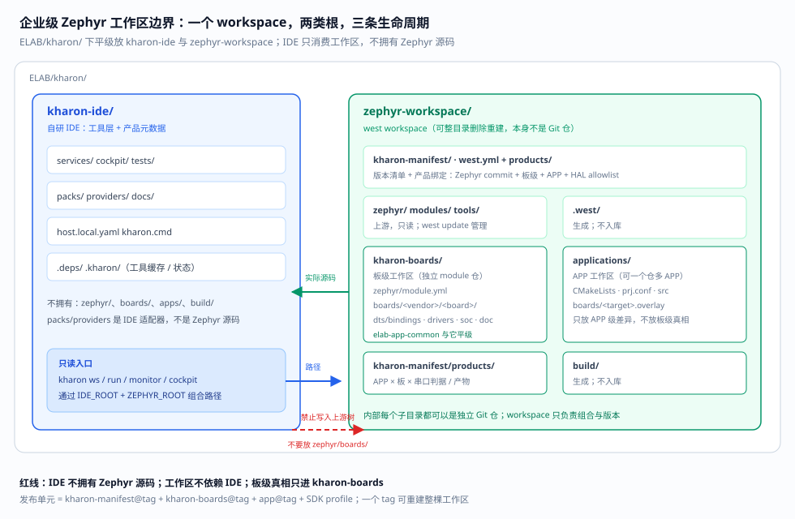

# 企业级 Zephyr 工作区边界（2026-11-19）

> 状态：**方案稿 · 顶层边界已拍板，迁移细节待评审**。
> 本文件只定义“谁住在哪、谁拥有什么、怎么迁”，**不改变当前工作区布局**；
> 实施按 §10 的分期执行，每一期单独验收。
>
> 关联文档：[ADR-001 事实源与边界](../current/ADR-001-事实源与边界.md)、
> [仓库结构地图与官方对照](仓库结构地图与官方对照_2026-11-18.md)、
> [12 · Zephyr 工作区三形态](../tutorials/12-Zephyr工作区三形态.md)。

---

## 0. 决策摘要

| # | 决策 | 理由 |
|---|---|---|
| D1 | 顶层采用 `ELAB/kharon/`，下面平级放 `kharon-ide/` 与 `zephyr-workspace/` | IDE 与 Zephyr 源码生命周期不同，不能共用一个根 |
| D2 | `zephyr-workspace/` 是 **west workspace**，本身不是 Git 仓 | 可整目录删除、由 manifest 重建；内部各子目录才是独立仓 |
| D3 | IDE 只消费工作区，**不拥有** Zephyr 源码 | IDE 升级/重装不影响板级、APP 和构建 |
| D4 | 板级真相只进 `kharon-boards/`；APP 只保留 APP 级差异 | 对应 Zephyr 的 board / application 分层，避免 `applications/common` 藏硬件事实 |
| D5 | 发布单元是 `kharon-manifest@tag` + `kharon-boards@tag` + APP tag + SDK profile | 换机器能重建同一棵工作区，而不是“本机刚好能编” |
| D6 | `packs/`、`providers/` 留在 IDE | 它们是 IDE 的适配器，不是 Zephyr 源码 |

一句话：

> **一个 Zephyr 文件夹装全部 Zephyr 相关内容；一个 workspace 组合多个仓；IDE 只从外面看它。**



---

## 1. 目标与非目标

### 1.1 目标

1. 把 `ELAB_ROOT` 这个“一个根代表一切”的假设拆成 `IDE_ROOT` + `ZEPHYR_ROOT`。
2. 让 `zephyr-workspace/` 成为所有 Zephyr 构建输入的唯一入口：
   `zephyr`、`modules`、`kharon-boards`、`applications`、`manifest`、`build`。
3. 让 `kharon-ide/` 只保留工具层：`services`、`cockpit`、`packs`、`providers`、`docs`、`tests`。
4. 给后续迁移提供文件级映射、路径改造点、回归清单和回滚方案。
5. 把“板级工作区”和“APP 工作区”的边界写成硬规则，后续新增板/APP 不再靠口头约定。

### 1.2 非目标

- 本轮**不**改业务代码、构建命令、串口/调试协议。
- 本轮**不**拆成“每块板一个仓、每个 APP 一个仓”；先做物理边界，仓拆分按需后置。
- 本轮**不**照抄教程的 `boards/arm` + `board.yaml` 旧样板；继续用 Zephyr 4.x 的
  `boards/<vendor>/<board>/` + `board.yml`。
- 本轮**不**把 `packs/`、`providers/` 搬进 Zephyr 工作区。
- 本轮**不**动旧仓 `dsh-elab-flow` 的发布线。

---

## 2. 三个根，三条生命周期

| 根 / 层 | 路径 | 生命周期 | 谁可以写 |
|---|---|---|---|
| **IDE 根** | `ELAB/kharon/kharon-ide/` | 独立升级、独立发布 | IDE 维护者 |
| **Zephyr 工作区根** | `ELAB/kharon/zephyr-workspace/` | 可删除、可由 manifest 重建 | `west update` / 迁移脚本 |
| **上游 Zephyr** | `zephyr-workspace/zephyr/`、`modules/`、`tools/` | 跟随 commit/tag，只读 | 上游 / `west update` |
| **板级工作区** | `zephyr-workspace/kharon-boards/` | 独立版本、跨产品复用 | 板级维护者 |
| **APP 工作区** | `zephyr-workspace/applications/` | 独立版本、按产品功能演进 | 应用维护者 |
| **产品清单** | `zephyr-workspace/kharon-manifest/` | 发布单元，锁组合 | 产品/发布 |
| **IDE 适配层** | `kharon-ide/packs/`、`providers/` | 跟随 IDE 版本 | IDE 维护者 |

关键区分：

- `zephyr-workspace/` 是**工作区**，不是仓库。把它整个删掉，执行 `west init -m ...` +
  `west update` 就能重建；它不应该有需要人手工编辑的“唯一副本”。
- `kharon-boards/`、`applications/`、`kharon-manifest/` 是**源码/发布仓**，各自有 Git 历史。
- `packs/`、`providers/` 是 IDE 的**适配器**，不是 Zephyr 源码；它们可以引用工作区，但不被工作区依赖。

> **可删除的前提**：`kharon-boards/`、`applications/`、`kharon-manifest/` 已经推到远程、
> 并由 manifest 锁定。P2/P3 阶段如果它们还是本地唯一副本，**不能直接删整个 workspace**；
> 先备份/建仓，再谈“可重建”。

---

## 3. 目标目录形态

### 3.1 顶层

```text
ELAB/
├── dsh-elab-flow/                 # 旧仓，冻结，不在本次迁移范围
└── kharon/
    ├── kharon-ide/                # 自研 IDE
    └── zephyr-workspace/          # 所有 Zephyr 相关内容
```

> 当前 `kharon-ide` 在 `ELAB/kharon-ide`；迁移后移到 `ELAB/kharon/kharon-ide`。
> 移动会改变 `.deps`、`west` junction 与 `host.local.yaml` 的绝对路径，见 §9。

### 3.2 `kharon-ide/`

```text
kharon-ide/
├── services/                      # 内核：编排 / 构建 / 烧录 / 串口 / 调试
├── cockpit/                       # 独立驾驶舱 HTTP 面 + Web 壳
├── packs/                         # IDE 的板 target / 调试参数适配
├── providers/                     # 工具链命令模板（west 等）
├── docs/                          # IDE 操作教程、设计文档
├── tests/                         # IDE / 内核测试
├── scripts/                       # IDE 侧脚本
├── config/
│   ├── host.kharon.profile.yaml   # 入库：键名 + 相对路径
│   └── host.local.yaml.example    # 入库：本机路径模板
├── host.local.yaml                # gitignored：IDE_ROOT / ZEPHYR_ROOT / 工具路径
├── kharon.cmd
└── kharon
```

硬规则：

- 不出现 `west/`、`zephyr_modules/`、`applications/`、`manifests/`、`build/`。
- 不出现任何 Zephyr 的 `boards/` 或 `dts/` 源文件。
- `packs/`、`providers/` 可以写“怎么调工具”，不能写“板子是什么”。

### 3.3 `zephyr-workspace/`

```text
zephyr-workspace/
├── .west/                         # 生成，不入库
├── kharon-manifest/
│   ├── west.yml                   # 产品清单（唯一版本事实）
│   └── products/                  # 产品绑定：APP × 板 × 串口判据
├── zephyr/                        # 上游 Zephyr，只读
├── modules/                       # HAL / 依赖，只读
├── tools/                         # 上游工具
├── kharon-boards/                 # 板级工作区（独立 Zephyr module 仓）
│   ├── zephyr/module.yml          # board_root: . ; dts_root: dts
│   ├── boards/
│   │   ├── espressif/
│   │   │   ├── esp32s31_function_coreboard/
│   │   │   └── korvo1/
│   │   └── st/
│   │       └── <f401_custom>/
│   ├── dts/bindings/
│   ├── drivers/
│   ├── soc/
│   ├── doc/
│   └── support/
├── elab-app-common/               # APP 公共 C 代码，Zephyr module
├── applications/
│   ├── stm32f4/
│   │   ├── f411_breath/
│   │   ├── f411_hwpwm/
│   │   └── f411_modbus/
│   ├── stm32f1/
│   ├── esp32s3/
│   └── esp32s31/
├── build/                         # 生成，不入库
└── .kharon/                       # 通道状态 / 生成快照，不入库
```

> `kharon-manifest/products/` 也可以被 IDE 显示成一个逻辑 `products/` 目录；
> 物理上它跟 manifest 一起走，保证“产品定义 + 版本清单”是同一个发布单元。

### 3.4 `kharon-boards/` 的板级结构

```text
kharon-boards/
├── zephyr/module.yml
├── boards/
│   └── <vendor>/
│       └── <board>/
│           ├── board.yml                 # 板身份：name / vendor / socs / variants
│           ├── board.cmake               # runner / openocd 参数
│           ├── Kconfig.<board>           # 默认配置
│           ├── <board>_defconfig         # 默认 defconfig
│           ├── <board>.dts               # 整板设备树
│           ├── <board>-pinctrl.dtsi      # 引脚复用
│           ├── <board>_common.dtsi       # 板级公共差异（可选）
│           ├── support/openocd.cfg       # 调试器配置
│           └── doc/                      # 板图 / 说明
├── dts/bindings/                         # 自研外设 binding
├── drivers/                              # 板级/SoC 驱动（按需）
├── soc/                                  # 自研 SoC 支持（按需）
└── doc/
```

规则：

1. **一块物理 PCB = 一个 board 目录**；同一 MCU 不同外设，建两个 board，不靠一个 board
   加一堆 APP overlay。
2. 共享的 SoC/板级接线放 `*_common.dtsi`，由板级 `.dts` 引用；APP 不再引 `../../common`。
3. 只有“同一块板的不同 revision / core”才用 `board.yml` 的 `variants`；
   不同 PCB 不进同一个 board。
4. 所有 APP 都成立的接线 = 板级；只有一个 APP 用到的外设 = 该 APP 的
   `boards/<target>.overlay`。
5. 板级 module 一个就够，按 vendor 分层；不要每块板建一个 module，除非团队/生命周期确实不同。

### 3.5 `applications/` 的 APP 结构

```text
applications/<family>/<app>/
├── CMakeLists.txt
├── prj.conf
├── src/
├── boards/<target>.overlay         # 只放本 APP 额外要的外设
├── sysbuild.conf                   # 可选：MCUboot 双镜像
└── dts/bindings/                   # 可选：本 APP 私有 binding
```

规则：

- APP 目录不出现 `../../common` 这种跨应用相对路径；公共 C 代码走 `elab-app-common` module。
- APP 不拥有板级身份：`board.yml`、板级主 DTS、板级 `support/openocd.cfg` 都不在 APP 里。
- `CMakeLists.txt` 保持 `find_package(Zephyr)` + `target_sources(app ...)`，不写死 `BOARD_ROOT`。
- 一个 APP 可以配多个 board target；由 `products/` 描述组合，不复制多份 APP。

> APP 层残留板级真相的逐文件审计、`app.yaml` 能力契约与 `targets[]` 分期方案，
> 见 [应用层多板解耦与企业级改造计划](应用层多板解耦与企业级改造计划_2026-11-20.md)。

---

## 4. 事实源矩阵

| 事实 | 唯一宿主 | 禁止写入 |
|---|---|---|
| Zephyr / HAL 版本 | `kharon-manifest/west.yml` | IDE 配置、APP 源码 |
| 板级身份 / 引脚 / 外设 | `kharon-boards/boards/<vendor>/<board>/` | `applications/common`、`packs/` |
| 板级调试/烧录参数 | `kharon-boards/**/support/` + IDE `packs` 的 runner 映射 | APP 源码 |
| APP 功能 / APP 级设备树 | `applications/<family>/<app>/` | 板级 module |
| 产品组合（APP × 板 × 串口判据） | `kharon-manifest/products/` | 内核代码、APP 源码 |
| 工具链命令模板 | `kharon-ide/providers/` | 板级 module、APP |
| 本机绝对路径 | `kharon-ide/host.local.yaml` | profile、产品清单 |
| 构建产物 | `zephyr-workspace/build/` | 源码目录 |

同一事实只能有一个可编辑宿主；其他位置只能是生成物、只读引用或校验结果。

---

## 5. 运行时数据流

```text
kharon.cmd
  ├─ IDE_ROOT    = <kharon-ide>
  ├─ ZEPHYR_ROOT = <zephyr-workspace>     # host.local.yaml / ELAB_ZEPHYR_ROOT
  ├─ 读 host.kharon.profile.yaml + host.local.yaml
  │
  ├─ bootstrap
  │    ├─ venv / 工具缓存 → IDE_ROOT/.deps
  │    ├─ west workspace  → ZEPHYR_ROOT
  │    ├─ manifest       → ZEPHYR_ROOT/kharon-manifest/west.yml
  │    └─ 通道状态       → ZEPHYR_ROOT/.kharon/bootstrap.json
  │
  ├─ provider（zephyr/west）
  │    ├─ cwd            = ZEPHYR_ROOT
  │    ├─ ZEPHYR_BASE    = ZEPHYR_ROOT/zephyr
  │    ├─ EXTRA_ZEPHYR_MODULES =
  │    │     ZEPHYR_ROOT/kharon-boards;ZEPHYR_ROOT/elab-app-common
  │    └─ app_arg       = ZEPHYR_ROOT/applications/<app>
  │
  ├─ products/<product>.yaml
  │    ├─ app           = ZEPHYR_ROOT/applications/<family>/<app>
  │    ├─ board target  = kharon-boards 里的 board.yml
  │    └─ pack/provider = kharon-ide/packs、providers
  │
  └─ build              = ZEPHYR_ROOT/build/<family>/<app>/<variant>
```

**IDE 与工作区之间只通过路径与 HTTP/CLI 交互**，不 import 源码，不共享可变文件。

---

## 6. Manifest 与工作区语义

### 6.1 两种工作区模式

| 模式 | 初始化 | 模块范围 | 用途 |
|---|---|---|---|
| `learning` | `west init -m https://github.com/zephyrproject-rtos/zephyr zephyr-workspace` | 全量 `west update` | 学 Zephyr、看完整 boards/samples/drivers |
| `product` / `pinned` | `west init -m <kharon-manifest> zephyr-workspace` | manifest allowlist + 锁定 revision/tag | CI、回归、产品发布 |

两种模式共用同一个 `zephyr-workspace/` 根；切换模式只改变“装什么、锁什么”，不改变目录边界。

### 6.2 产品 manifest 的职责

`kharon-manifest/west.yml` 是**发布事实**，只回答三件事：

1. Zephyr 用哪个 commit/tag；
2. 板级 module、APP 仓、HAL 用哪些 revision；
3. 哪些项目属于本产品（`group-filter` / allowlist）。

概念形态（最终以 `west manifest --check` 为准）：

```yaml
manifest:
  self:
    path: kharon-manifest
  remotes:
    - name: zephyr
      url-base: https://github.com/zephyrproject-rtos
    - name: kharon
      url-base: https://github.com/xkk6663
  projects:
    - name: zephyr
      remote: zephyr
      revision: <commit>
      import:
        name-allowlist:
          - hal_stm32
          - hal_espressif
          - cmsis_6
          - mbedtls
          - tf-psa-crypto
          - mcuboot
    - name: kharon-boards
      remote: kharon
      repo-path: kharon-boards
      path: kharon-boards
      revision: <tag>
    - name: kharon-apps
      remote: kharon
      repo-path: kharon-apps
      path: applications
      revision: <tag>
```

约束：

- `manifest` 仓库本身只放 `west.yml` 和 `products/`，不放源码。
- 当前 `manifests/zephyr.west.yml` 是**生成快照/allowlist**，迁移后降级为
  `zephyr-workspace/.kharon/zephyr.lock.yml`（gitignored）或由 manifest 生成，
  **不再当唯一事实源**。
- `learning` 模式仍然可以使用原生 Zephyr 清单；它不要求 `kharon-manifest` 存在。
- `product` 模式才要求 `kharon-manifest`；两种模式不能在同一目录混跑而不切换状态。

---

## 7. 板级 / APP 的证据规则

这条规则直接对应视频 9/10 的“板与 APP 隔离”，但比教程更严格：

| 场景 | 归属 | 例子 |
|---|---|---|
| 所有 APP 都成立的 PCB 接线 | `kharon-boards` | PA_CTRL=GPIO7、WS2812=GPIO37、I2C0、ADC 电阻梯 |
| 只有某 APP 额外接的外设 | `applications/<app>/boards/<target>.overlay` | 某实验台额外点的 PWM LED |
| 同一 MCU、不同 PCB | 两个 board 目录 | `esp32s31_function_coreboard` 与 `korvo1` |
| 同一 PCB、不同核心/revision | 一个 board + `variants` | `.../hpcore`、`.../lpcore` |
| 自研外设 binding | `kharon-boards/dts/bindings/` | 自定义 sensor/GPIO 节点 |
| 板级调试配置 | `kharon-boards/**/support/` | `openocd.cfg` |

当前需要归位的具体文件：

- `applications/common/korvo_board.dtsi` → `kharon-boards/boards/espressif/korvo1/`
- `applications/common/korvo_i2c.dtsi` → 同上（或合并进板级 `*_common.dtsi`）
- `applications/stm32f4/common/dap_link_openocd.cfg` → 对应板级 `support/`
- `applications/stm32f1/common/dap_link_openocd.cfg` → 同上
- 5 个 S31 APP 的 `boards/*.overlay` 中 `#include "../../../common/..."` → 删除，
  改由板级 DTS 自带公共节点

> 这一步做完，APP 目录才能真正单独拉走；否则“应用层工作区分离”只是目录分离，构建仍然断。

---

## 8. 当前 → 目标 映射

| 当前 | 目标 | 处理 |
|---|---|---|
| `ELAB/kharon-ide/` | `ELAB/kharon/kharon-ide/` | 整体移动；更新绝对路径 |
| `west/`（junction 到旧仓） | `ELAB/kharon/zephyr-workspace/` | **不要移动 junction**；移除后由 bootstrap 重建 |
| `zephyr_modules/elab-boards/` | `zephyr-workspace/kharon-boards/` | 改名 + 加 `dts_root` / `support` |
| `zephyr_modules/elab-app-common/` | `zephyr-workspace/elab-app-common/` | 作为 Zephyr module 保留 |
| `applications/` | `zephyr-workspace/applications/` | 移动；APP overlay 去 `../../common` |
| `manifests/zephyr.west.yml` | `zephyr-workspace/kharon-manifest/west.yml` | 重写为真 west manifest；旧文件降级为生成快照 |
| `projects/kharon/` | `zephyr-workspace/kharon-manifest/products/` | 产品定义随 manifest；运行时 JSON 不随仓库，见 §9.3 |
| `projects/**/*.debug.json` / `.frames.json` / `.widgets.json` | `kharon-ide/.work/projects/` | 运行时状态，不入 manifest |
| `build/` | `zephyr-workspace/build/` | 可删除重建；不迁移旧产物 |
| `.deps/` | `kharon-ide/.deps/` | 工具缓存留 IDE；不要搬 junction |
| `packs/`、`providers/` | `kharon-ide/` | 原地保留，不搬进工作区 |
| `docs/zephyr-learn/` | 暂留 `kharon-ide/docs/` | 资料，不参与构建；后续可独立成文档仓 |
| `docs/tutorials/10–14` | `kharon-ide/docs/` | IDE 操作教程，必须留 IDE |

> `components/` 若仍被 APP 的 CMake 引用，应随 Zephyr 源码迁移或收进 `elab-app-common`；
> 若已退役，则留 IDE 归档。迁移前先做一次 `rg "components" applications` 盘点，不靠猜。

---

## 9. 根变量与代码改造点

### 9.1 新变量

| 变量 | 含义 | 默认 |
|---|---|---|
| `IDE_ROOT` | `kharon-ide/` | `kharon.cmd` 所在目录 |
| `ZEPHYR_ROOT` | `zephyr-workspace/` | `host.local.yaml:zephyr_root`，否则 `../zephyr-workspace` |
| `ELAB_ZEPHYR_ROOT` | 环境变量覆盖 | 可选 |
| `ELAB_ROOT` | **兼容别名 = `IDE_ROOT`** | 过渡期保留，逐步弃用 |
| `ZEPHYR_BASE` | `${ZEPHYR_ROOT}/zephyr` | 由 profile/provider 展开 |

### 9.2 配置示例

```yaml
# kharon-ide/config/host.kharon.profile.yaml（示意）
tools:
  west_python: { path: ${IDE_ROOT}/.deps/venv/Scripts/python.exe }
  zephyr:
    workspace: ${ZEPHYR_ROOT}
    base: ${ZEPHYR_ROOT}/zephyr
    boards_local: ${ZEPHYR_ROOT}/kharon-boards/boards
    ccache_dir: ${IDE_ROOT}/.deps/ccache
```

```yaml
# kharon-ide/providers/official/zephyr/west/provider.yaml（示意）
env:
  ZEPHYR_BASE: "${host:tools.zephyr.base}"
  EXTRA_ZEPHYR_MODULES: "${ZEPHYR_ROOT}/kharon-boards;${ZEPHYR_ROOT}/elab-app-common"
```

```yaml
# zephyr-workspace/kharon-manifest/products/f411_breath.yaml（示意）
name: f411_breath
app: applications/stm32f4/f411_breath
targets:
  - board: blackpill_f411ce
    pack: zephyr/framework
    provider: zephyr/west@>=1 <2
```

### 9.3 必须一起改的代码/配置

1. `services/kharon/__main__.py`：`_root()` 从单一 `ELAB_ROOT` 改为 `IDE_ROOT` + `ZEPHYR_ROOT`；
   `MODULE_REL` / `MODULE_NAME` / `APP_MODULE_REL` 改为 `kharon-boards` / `kharon_boards` / `elab-app-common`。
2. `services/kharon/bootstrap.py`：`WEST`、`MANIFEST`、`BOARDS_MODULE`、`STATE` 指向
   `ZEPHYR_ROOT`；`VENV` 指向 `IDE_ROOT`。
3. `config/host.kharon.profile.yaml`：拆 `IDE_ROOT` / `ZEPHYR_ROOT`。
4. `providers/official/zephyr/west/provider.yaml`：`EXTRA_ZEPHYR_MODULES`、`cwd` 改根。
5. `services/elab/core/config.py`：`projects` 的发现根从 `IDE_ROOT/projects` 改为
   `PRODUCTS_DIR`（`kharon-manifest/products`）；新增 `RUNTIME_DIR`（IDE `.work/projects`）。
   `project_admin.py` / `adapt.py` / `serialframes.py` / `modbusmaster.py` /
   `debugstore.py` / `serialwidgets.py` / `workflow/doctor.py` 中所有 `cfg.root/projects`
   都要按“产品定义 / 运行时状态”分流，不能一刀切搬走。
6. `projects/kharon/*.yaml` → `kharon-manifest/products/*.yaml`：`root`、`work_dir` 改根；
   `chip` 改为可多 target 的 `targets`。`.modbus.json` 等产品定义随 products；
   `.debug.json` / `.frames.json` / `.widgets.json` 等运行时状态留 IDE `.work/projects`。
7. `cockpit/server.py`：`--root` 语义保留为 IDE 根；新增工作区根参数/配置读取。
8. 所有测试：路径 fixture 从单根改为双根；`bootstrap` 状态、`ws` 探测、`env` 生成各加一组。
9. 所有文档：`${ELAB_ROOT}` 出现处按“IDE 资产 / Zephyr 资产”分类替换；
   历史设计文档只加“历史口径”提示，不做全量回改。

> 仓库内 `${ELAB_ROOT}` 约 169 处（含文档与旧设计稿），不能靠手工替换；
> 必须先用 `rg` 分类，再按“IDE 资产 / Zephyr 资产 / 历史文档”三列迁移。

---

## 10. 迁移分期

### P0：冻结与清单（本阶段）

- 写本文件；冻结 `kharon-ide` 当前布局为迁移基线。
- 盘点 `ELAB_ROOT`、`zephyr_modules`、`applications/common`、`west` junction 的实际引用。
- 不动源码、不移动目录。
- 验收：本文件 + 迁移清单评审通过。

### P1：双根脚手架（不搬文件）

- 增加 `IDE_ROOT` / `ZEPHYR_ROOT` 解析；保留 `ELAB_ROOT` 兼容别名。
- `bootstrap` 支持 `--zephyr-root`；状态文件迁到 `ZEPHYR_ROOT/.kharon`。
- `host.profile` / provider 模板支持两个根，但当前路径仍指向旧位置。
- 新增双根单测；确保旧布局仍能跑。
- 验收：`kharon bootstrap --check`、`kharon where`、`pytest tests -q` 全绿，行为零变化。

### P2：物理拆分

1. 建 `ELAB/kharon/`；移动 `kharon-ide` 到 `ELAB/kharon/kharon-ide`。
2. 建**空的** `ELAB/kharon/zephyr-workspace`，先 `west init`（learning 用 Zephyr 原生清单，
   product 用 `kharon-manifest`），**再**把本地板/APP 搬进去；不要让已存在的源码挡在
   `west init` 前面。
3. `west` 是 junction，必须移除后用 bootstrap 重建；`.deps` 若是 junction，可保留只读、
   复制或重建 venv，**不要用 `Move-Item` 搬链接**。
4. 用 `bootstrap --pinned` 先重建 6 模块闭包；需要学习全量时再 `--learning`。
5. 移动 `zephyr_modules/elab-boards` → `kharon-boards`；
   `zephyr_modules/elab-app-common` → `elab-app-common`；
   `applications`、`manifests`、`build` → workspace。
6. 更新 `host.local.yaml`、provider、products、测试路径。
- 验收：F411 + S31 各一个工程 `doctor/build` 通过；`kharon ws` 报 `workspace` / `t2`（或明确 `t1` 的 learning 模式）；IDE 根 `git status` 不再出现 Zephyr 源文件。

### P3：板级事实归位

- 新建 `korvo1` board；把 `korvo_board.dtsi` / `korvo_i2c.dtsi` / DAP cfg 搬进板级。
- 删除 APP 的 `../../../common` include；APP overlay 只留 APP 级差异。
- `kharon-boards` 的 `module.yml` 增加 `dts_root: dts`（有自研 binding 时）。
- 验收：5 个 S31 APP 全部 build + monitor；`west boards` 能看到 `korvo1`；`applications` 内不再有板级 DTSI。

### P4：产品 manifest 与多板矩阵

- 把 `manifests/zephyr.west.yml` 重写为 `kharon-manifest/west.yml`；
- 在**临时干净目录**先验证 `west init -m kharon-manifest` + `west update`；
  不直接覆盖 P2 已跑通的工作区。
- `products` 支持 `targets` 多板；CI 加 `west manifest --check` + `twister --board-root`。
- 验收：干净目录 `west init -m kharon-manifest` + `west update` + `kharon bootstrap --check` 通过；
  `f411_breath` 可在至少两块板上构建；manifest 漂移检查进 CI。

> P2 的 `west` 重建可能触发 1.1G 全量下载；建议先用 `--pinned` 完成迁移验证，
> 再单独安排一次 `--learning` 全量实测。

---

## 11. 风险与回滚

| 风险 | 影响 | 处理 |
|---|---|---|
| `west` / `.deps` 是 junction | 直接移动会改到旧仓 | `west` 必须移除后重建；`.deps` 可保留/复制/重建，均不 `Move-Item` |
| `ELAB_ROOT` 引用多 | 漏改导致路径指向旧根 | 先分类清单；P1 保留兼容别名；P2 后全量 `rg` 校验 |
| 1.1G west 全量下载 | 迁移时间长、网络失败 | P2 用 `--pinned` 6 模块；learning 全量单独验收 |
| 旧 `build` 混用 | CMake cache 指向旧板/旧路径 | 旧 `build` 不迁移；迁移后首次 `pristine` 构建 |
| APP overlay 仍引 `applications/common` | APP 无法独立 | P3 强制归位；CI 加 `rg "../../common"` 检查 |
| manifest 仓 URL 未就绪 | 无法 `west init -m` | P2 先本地目录；P4 等远程仓/tag 就绪再切 t2 |
| 旧仓发布线被误改 | 发布风险 | 旧仓冻结；迁移只在 `ELAB/kharon` 下操作 |

回滚策略：

- P1 之前保留当前 `kharon-ide` 原路径与 `ELAB_ROOT` 别名，随时可回退。
- P2 用独立 Git 分支/工作树；旧目录不删除，确认新布局通过验收后再切。
- `west` 重建失败时保留原 junction 只读，不删除旧仓工作区。

---

## 12. 验收清单（迁移完成时）

- [ ] `ELAB/kharon/kharon-ide` 内没有 `west/`、`zephyr_modules/`、`applications/`、`manifests/`、`build/`。
- [ ] `ELAB/kharon/zephyr-workspace` 可以整目录删除，再由 manifest 重建。
- [ ] `kharon where` 同时打印 `IDE_ROOT`、`ZEPHYR_ROOT`、`ZEPHYR_BASE`。
- [ ] `kharon ws` 能识别 `t2` 产品工作区与 `standalone/workspace/repo` 三种应用形态。
- [ ] `kharon bootstrap --check` / `--pinned` / `--learning` 的路径都落在 `ZEPHYR_ROOT`。
- [ ] `kharon-boards` 至少包含 `esp32s31_function_coreboard` + `korvo1` 两块板。
- [ ] `applications` 内没有任何 `../../common` 板级 DTSI 引用。
- [ ] 一个 APP 可通过 `products/*.yaml` 的 `targets` 配多块板，不需要复制工程 YAML。
- [ ] F411 与 S31 各一个工程 `doctor/build` 通过；S31 至少一个 `monitor` 闭环。
- [ ] `pytest tests -q` 通过；`west manifest --check` 通过。
- [ ] IDE 的 `git status` 不出现 Zephyr 源码；工作区 `.west/`、`build/`、`.kharon/` 均被忽略。

---

## 13. 待定项

1. **`docs/zephyr-learn` 的归属**：本轮暂留 `kharon-ide/docs`；是否独立成
   `zephyr-learn` 文档仓，等迁移完成后再定。
2. **`kharon-boards` / `applications` 何时拆成独立 Git 仓**：建议 P2 先做成
   “可整体拆走的目录”，P4 再按团队/发布节奏拆仓；不在 P2 强行建远程仓。
3. **`products` schema 的多板字段**：本方案建议 `targets:` 列表；具体字段名与
   `kharon run --board` 的优先级，在 P4 前单独评审。
4. **`ELAB_ROOT` 兼容期**：建议保留一个发布周期；之后只保留
   `IDE_ROOT` / `ZEPHYR_ROOT`，避免“两个根又退回一个根”。

---

## 14. 一句话总结

**`ELAB/kharon/zephyr-workspace` 是唯一的 Zephyr 入口，`kharon-ide` 是唯一的 IDE 入口；
工作区由 manifest 重建，板级真相只在 `kharon-boards`，APP 只在 `applications`，
产品组合只在 `kharon-manifest/products`。**
