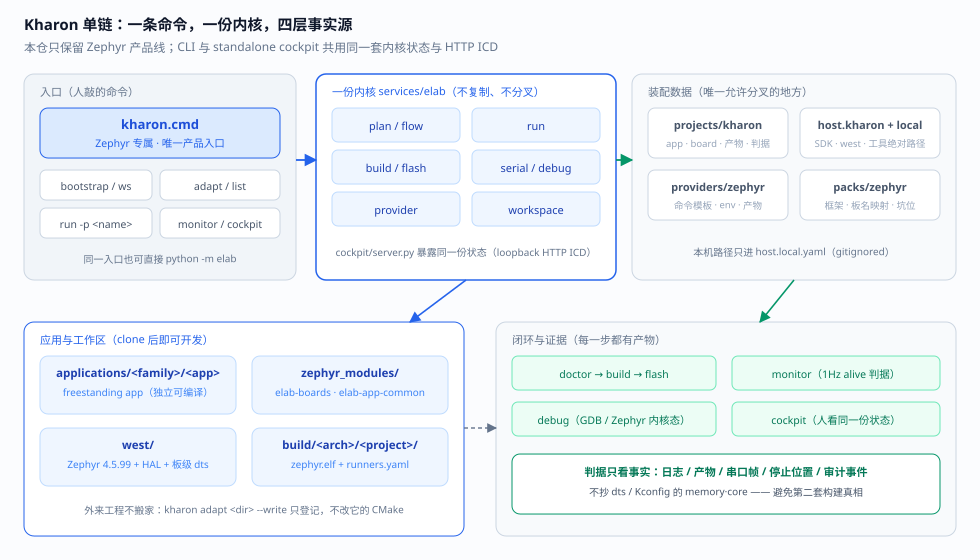

# 00 · Kharon 项目全览与快速开始

> 目标读者：第一次打开 `kharon-ide` 的人；也适合已经会跑 `west build`、但说不清这套 IDE 为什么这么分层的人。
> 读完你能：① 一句话说清 Kharon 管什么；② 从 clone 到编译/烧录跑通一块 F411；③ 知道应用、工程、工作区、provider 各住哪；④ 判断一个外来 Zephyr 工程该怎么接进来。

---

## 0. 一句话版本

**Kharon 把 Zephyr 工作区里“编译—烧录—串口—调试—报告”这条链收成一套可复现的 IDE 闭环：CLI 与 Web 驾驶舱共用同一个内核，芯片/板级事实只写数据包，工具链命令只写 provider。**

| 是 | 不是 |
|---|---|
| Zephyr 专属 IDE / 开发闭环 | 多芯片 classic 构建器（那在旧仓 `dsh-elab-flow`） |
| 一套 loopback HTTP ICD，CLI 与驾驶舱同源 | DSH 插件仓库；本仓不含 `packages/dsh-elab-cockpit` |
| 应用可独立、工程可登记、工作区可识别 | 把所有人的工程硬塞进一个 `applications/` 大目录 |

---

## 1. 五分钟跑通（F411 基线）

前置：Windows + PowerShell 7、Python 3.10+、Git、Zephyr SDK、DAP-Link 驱动。

```powershell
git clone <本仓地址> kharon-ide
cd kharon-ide

Copy-Item config\host.local.yaml.example host.local.yaml
notepad host.local.yaml          # 填 SDK / gdb / openocd 的本机绝对路径

.\kharon.cmd bootstrap --check   # 只读体检：缺什么，下一步跑什么
.\kharon.cmd bootstrap           # 幂等补 venv + west 工作区（--offline 只查本机）

.\kharon.cmd ws --app applications\stm32f4\f411_breath
.\kharon.cmd run -p f411_breath --steps doctor,build
```

烧录与串口：

```powershell
.\kharon.cmd run -p f411_breath --steps flash
.\kharon.cmd monitor -p f411_breath
```

驾驶舱：

```powershell
.\kharon.cmd cockpit
```

> `host.local.yaml` 已 gitignore；只写本机绝对路径。仓库内 profile 用 `${ELAB_ROOT}/...` 相对路径，换机器不用改。

---

## 2. 四层事实源

| 层 | 位置 | 只回答一个问题 |
|---|---|---|
| 应用 | `applications/<family>/<app>/` | 这个工程编译什么（`CMakeLists.txt` + `prj.conf` + `src/` + `boards/`） |
| 工程登记 | `projects/kharon/<name>.yaml` | 这个 app 配哪块板、产物在哪、串口怎么判 |
| 工作区 | `west/`（不入库）+ `manifests/zephyr.west.yml` | Zephyr 与 module 的版本事实 |
| 工具链 | `providers/official/zephyr/**` + `config/host.kharon.profile.yaml` | 命令模板 / 主机路径 |

应用不保存“板子怎么烧”，工程不保存“Zephyr 是哪版”，provider 不保存“芯片是什么”。任何一层换掉，其余层不改。



---

## 3. 应用、工程、工作区三件事

### 3.1 应用是 freestanding 的

```
applications/stm32f4/f411_breath/
├── CMakeLists.txt
├── prj.conf
├── src/main.c
└── boards/blackpill_f411ce.overlay
```

不依赖仓库根部的任何相对路径；公共代码通过 Zephyr module 接入：

- `zephyr_modules/elab-boards`：自研板定义（`west boards` 可见）
- `zephyr_modules/elab-app-common`：`breath_sync` / `ota_engine` / `store`

应用 CMake 只写自己的源文件；公共源由 module 的 `zephyr_library` 提供。

### 3.2 工程登记是“app + board”

```yaml
name: f411_breath
root: ${ELAB_ROOT}/applications/stm32f4/f411_breath
pack: zephyr/framework
chip: blackpill_f411ce
archetype: zephyr
provider: zephyr/west@>=1 <2
```

`name` 必须与目录名逐字相同；新增应用必须同时登记工程，否则 `kharon list` 看不到它。

### 3.3 工作区有三种形态，识别是自动的

| 形态 | 例子 | `kharon ws` |
|---|---|---|
| 仓库应用 | `applications\stm32f4\f411_breath` | `standalone` / `t1` / `source=host` |
| west 树内官方样例 | `west\zephyr\samples\hello_world` | `repo` / `t1` / `source=detect` |
| 外来工程 | 任意含 `find_package(Zephyr)` 的目录 | `kharon adapt <dir>` 识别并生成登记 YAML |

---

## 4. 把别人的工程接进来

```powershell
.\kharon.cmd adapt D:\work\my_zephyr_app
```

识别依据：`CMakeLists.txt` 里的 `find_package(Zephyr)`、`prj.conf`、`boards/*.overlay`。
默认只打印 YAML；确认无误后加 `--write`：

```powershell
.\kharon.cmd adapt D:\work\my_zephyr_app --write
```

它会在 `projects/kharon/` 下落一份 `<name>.yaml`，之后就能 `kharon run -p <name>`。
外来工程不需要搬进 `applications/`，也不需要改它的 CMake。

---

## 5. 目录地图

| 路径 | 作用 |
|---|---|
| `services/elab/**` | 内核：闭环、构建、烧录、串口、调试、项目/工作区解析 |
| `cockpit/server.py` | standalone cockpit 的 HTTP 面 + 串口自描述 |
| `packages/cockpit-ui-core/**` | 驾驶舱前端共用组件 |
| `providers/official/zephyr/**` | Zephyr 工具链 provider（声明式数据） |
| `packs/official/zephyr/**` | Zephyr 框架包 / 板级事实 |
| `zephyr_modules/**` | 板级 module + 应用公共层 module |
| `manifests/zephyr.west.yml` | west 允许清单（commit + revision） |
| `docs/tutorials/**` | 操作教程 |
| `docs/zephyr-learn/**` | S3/S31 学习线索引 |

---

## 6. 文档路线

| 你现在的状态 | 下一篇 |
|---|---|
| 第一次跑 F411 | 本篇 + [10 Zephyr 模式上手](10-Zephyr模式上手.md) |
| 要理解工作区识别 | [12 Zephyr 工作区三形态](12-Zephyr工作区三形态.md) |
| 要接串口/Modbus | [07 串口面板](07-串口面板使用.md) / [11 Zephyr Modbus 从站](11-Zephyr_Modbus从站.md) |
| 要调试 | [14 Zephyr 调试区操作](14-Zephyr调试区操作.md) |
| 要做 OTA | [13 Zephyr OTA 局域网升级](13-Zephyr_OTA局域网升级.md) |
| 学 S3/S31 框架层 | [`docs/zephyr-learn/README.md`](../zephyr-learn/README.md) |

---

## 7. 与旧仓的关系

- `dsh-elab-flow`：classic 多芯片 + DSH 插件发布线，已冻结；`v4.0.0` 及已有 tag/release 不动。
- `kharon-ide`：Zephyr 专属产品线，后续功能只进这里；DSH 若要接，只作为 HTTP ICD 的外部消费者。
- 迁移细节见 [`docs/current/迁移说明_从dsh-elab-flow拆分.md`](../current/迁移说明_从dsh-elab-flow拆分.md)。
