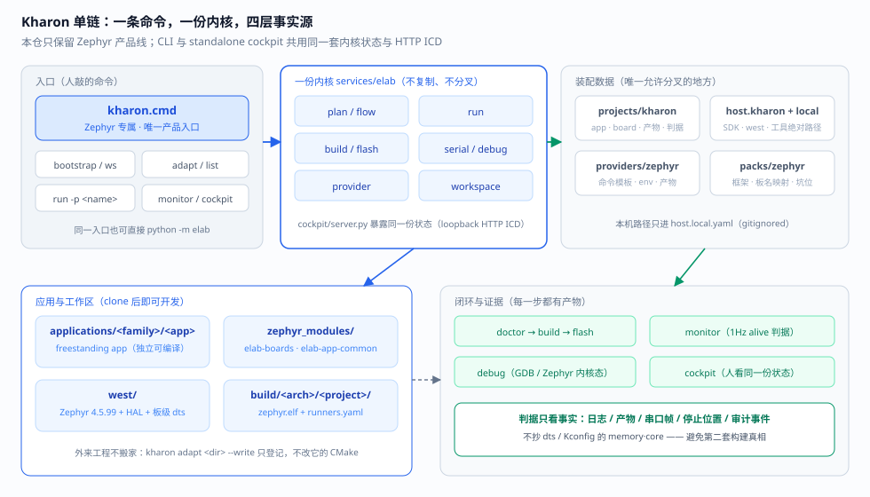
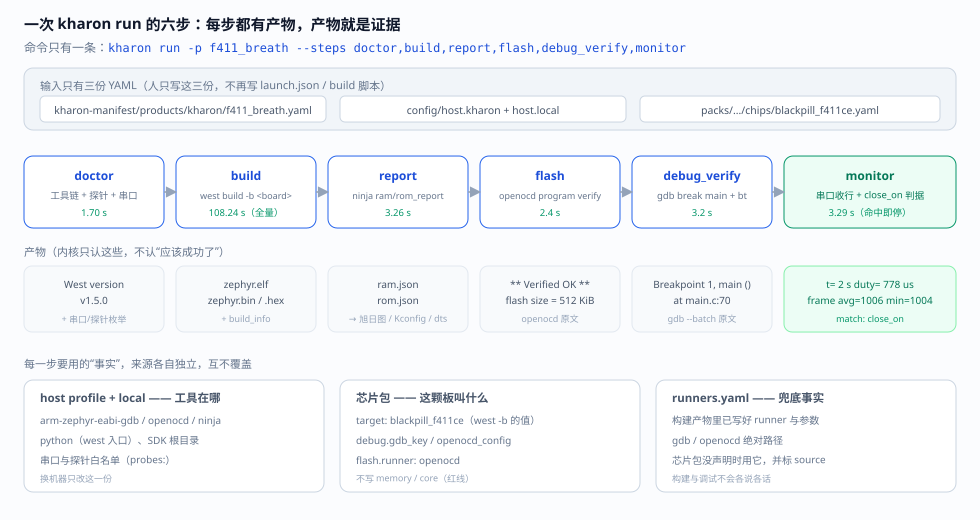
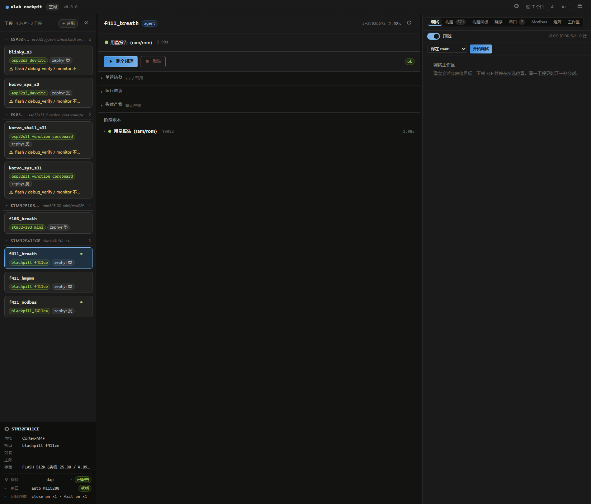
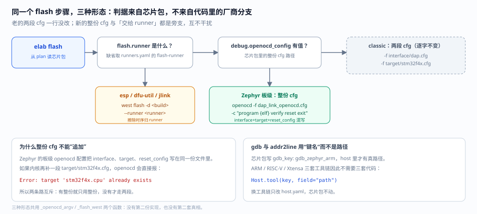
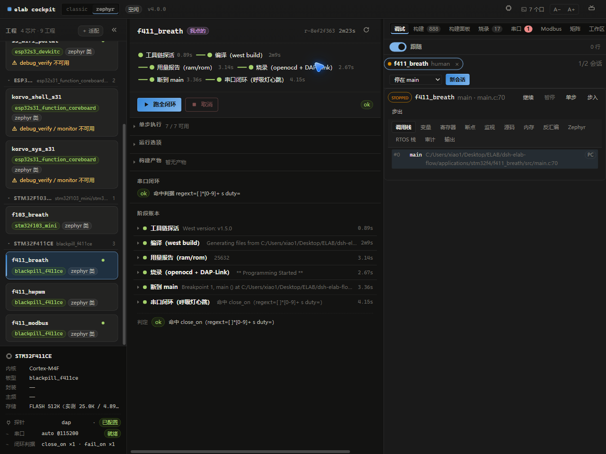
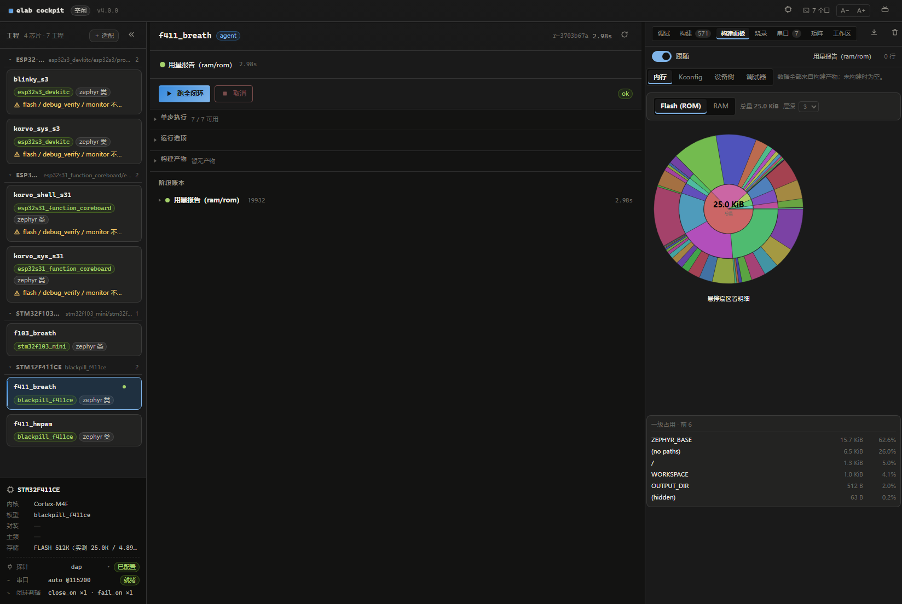
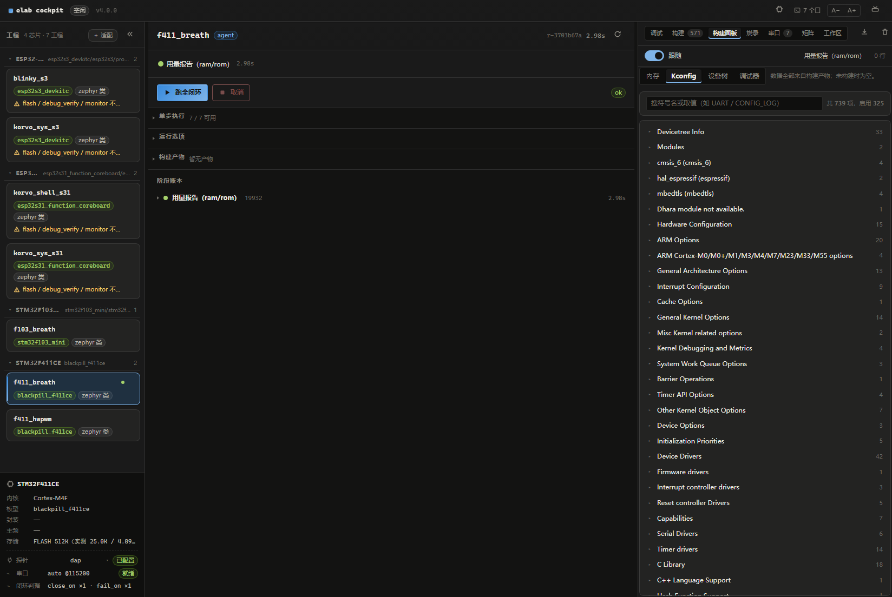
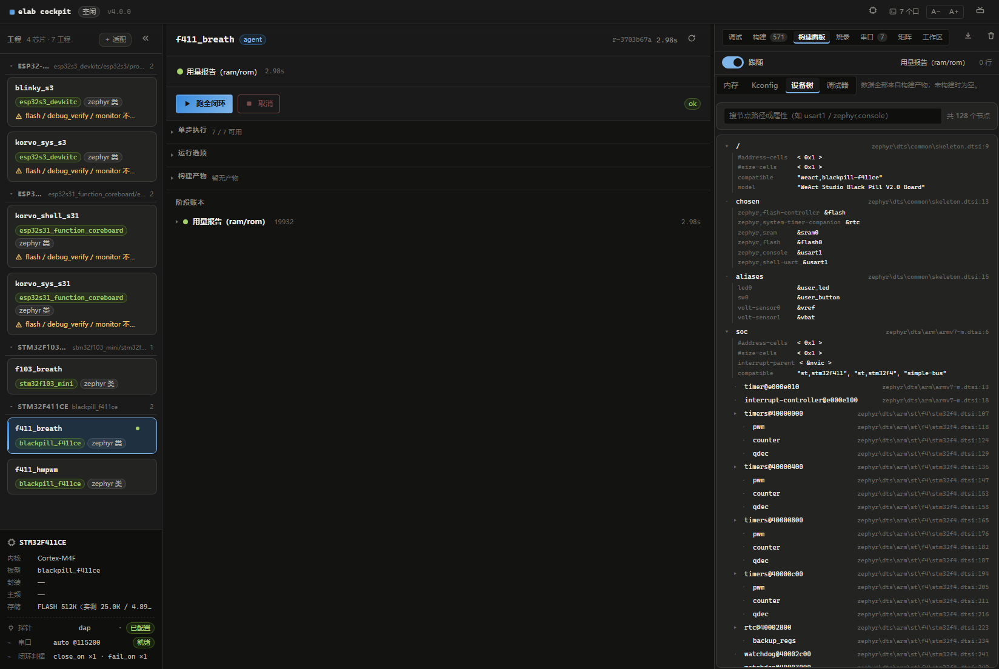

# Zephyr 模式上手 10：从一块 F411 到六步闭环（STM32F411 实机）

> **本仓口径（2026-11-19）**：`kharon-ide` 只保留 Kharon 单线；文中出现的 classic、
> `elab.cmd`、`cockpit.cmd`、双模式切换来自旧仓 `dsh-elab-flow`，仅作设计对照，
> 不是本仓现行操作。本仓入口只有 `.\kharon.cmd`。
>
> 板子：WeAct Black Pill V2.0（STM32F411CEU6），经 DAP-Link 接 `COM10`，115200 8N1
> 内核：Zephyr **4.5.99** / west **v1.5.0** / Zephyr SDK **1.0.1**
> 入口：`kharon`（Zephyr 模式）——本仓不再提供 classic 的 `elab` 入口
> **host 口径（2026-11-19）**：Kharon 默认 `config/host.kharon.profile.yaml`，
> 本机路径/探针差异写 `host.local.yaml`；`ELAB_HOST=kharon` 等价选 profile。
> 本文所有数字都是**这一轮实机跑出来**的，不是估算；截图都是真机 + 真内核 + 真面板
> 工作区布局进阶（三形态 / 双拓扑 / 无工作区降级 / 板子来源）→ [12 · 三种 Zephyr 应用形态怎么接](./12-Zephyr工作区三形态.md)
> 双根拆分与 Board / APP / Product 分层 → [15 · 双根与板级 APP 产品](./15-Zephyr工作区双根与板级APP产品.md)
>
> **安装通道**：`kharon bootstrap` 全新 clone 默认 `learning`（跟随上游 + 全量），对齐
> Zephyr 官方教程；本文所有数字来自 `pinned` 通道（manifest 钉 commit + 6 模块闭包），
> 需要复现时加 `--pinned`。

---

## 0. 你将得到什么

| 编号 | 问题 | 对应章节 |
|---|---|---|
| A | **Kharon 为什么是单链**：一条命令背后是哪四层事实 | §1 |
| B | **怎么从零跑通一块板**：六步各自产出什么、哪一步会卡住 | §2–§6 |
| C | **面板上的数怎么读**：内存旭日图、Kconfig、设备树、调试器 | §7 |
| D | **工作区三形态**：仓库应用 / west 工作区 / 外来工程怎么接 | [12-Zephyr工作区三形态](12-Zephyr工作区三形态.md) |

顺序是**先会用，再看数，最后踩坑**。只想把灯点亮的读 §1–§6；想改 provider、改调试链的读 §4、§7。

---

## 1. 为什么是 Kharon 单链

Zephyr 把「构建怎么跑」这件事写进了产物：板级 dts、Kconfig、`runners.yaml`、ELF 符号都在
`build/` 里，工具只要会读，不需要每个工程再维护一套 `launch.json` / build 脚本。Kharon 就是
把这套读法固定下来：**一条命令、一份内核、四层事实源**。



- **入口**只有 `.\kharon.cmd`；CLI 与 standalone cockpit 共用同一套内核状态与 HTTP ICD。
- **内核**是 `services/elab/**`，`plan / run / build / flash / serial / debug / provider / workspace`
  都在这里；`cockpit/server.py` 只是它的 HTTP 面。
- **装配数据**四份：`zephyr-workspace/kharon-manifest/products/kharon/*.yaml`（产品是什么）、
  `config/host.kharon.profile.yaml` + `host.local.yaml`（工具在哪）、
  `providers/official/zephyr/**`（命令怎么拼）、`packs/official/zephyr/**`（芯片是什么）。
- **应用与工作区**：`zephyr-workspace/applications/<family>/<app>/**` 是可独立编译的
  workspace app；板级真相在 `zephyr-workspace/kharon-boards/`，公共层在
  `zephyr-workspace/elab-app-common/`，`zephyr-workspace/` 是 west topdir。

本仓没有第二个产品入口，也没有 classic / DSH 分支；旧仓 `dsh-elab-flow` 的
`elab.cmd`、`cockpit.cmd`、双模式切换只作为历史对照，不是这里的操作步骤。

### 1.1 你只需要写三份 YAML

```text
zephyr-workspace/kharon-manifest/products/kharon/f411_breath.yaml  # 这个产品是什么（app 在哪、用哪颗芯片、串口参数）
config/host.kharon.profile.yaml + host.local.yaml   # 工具在哪（profile 默认 + 本机路径覆盖：gdb / openocd / ninja / python / 探针）
packs/official/zephyr/framework/chips/blackpill_f411ce.yaml   # 这颗芯片叫什么（west -b 的值）
```

第三份一般不用你写——内置包里已经有 4 颗板。**不再需要** `launch.json`、不再需要 build 脚本、
不再需要在面板里手填探针。

### 1.2 一次 run 的六步，每步都有产物



最下面那三块（host / 芯片包 / runners.yaml）是这个设计的核心：**每一步要用的「事实」来源互相独立**。
host 只管路径，芯片包只管名字映射，`runners.yaml` 是构建产物里的兜底。三者不重叠，所以不会出现
「构建说一套、调试说另一套」。

### 1.3 单 profile：没有模式开关，也没有 classic 分支

驾驶舱只读 `config/host.kharon.profile.yaml`，再把 `host.local.yaml` 叠上去；顶栏没有
`classic ⇄ zephyr` 开关，因为本仓只有一套清单。宿主选择仍是三档（后端逻辑，不是界面开关）：

| 顺序 | `ELAB_HOST` | 解析到 |
|---|---|---|
| 1 | `kharon`（profile 名） | `config/host.kharon.profile.yaml` |
| 2 | 一个路径 | 该文件（历史用法，保持兼容） |
| 3 | 未设置 | 仓库根 `elab.host.yaml`；没有才落回 `kharon` profile |

`kharon where` / `doctor` 的第一行会打印实际用的 host 路径，这就是「工具链真的换了」的硬证据：

```text
[kharon] 主机事实源：.../config/host.kharon.profile.yaml
```

三条使用约束：

- **有活就拒**：闭环在跑、调试会话开着、串口监视开着时，不要改 `host.local.yaml` 或换 profile；
  会话握着按旧 host 解析出来的 openocd/gdb/串口句柄。
- **改完重拉**：改 profile/local 后重开 cockpit 或重新 `doctor`，让 `capabilities` / `projects`
  按新路径重新解析。
- **单仓单入口**：`elab.cmd` / `cockpit.cmd` 不在本仓；旧仓的双模式文档只作对照。

> 再开一条产品线（例如 RT-Thread）不是在这里复制 profile 加按钮，而是另起一个仓定义入口与
> provider；本仓不预留第二模式。

---

## 2. 左栏是「芯片 → 工程」，不是工程列表



旧仓 classic 的左栏是一列工程，工程多了就分不清谁跟谁同一块板。Kharon 改成两级：

| 层级 | 显示什么 | 为什么这么分层 |
|---|---|---|
| 芯片组 | `STM32F411CE` · `blackpill_f411ce` · 组内工程数 | 同一块板上跑多个 app 是常态（`f411_breath` 软件 PWM、`f411_hwpwm` 硬件 PWM、`f411_modbus` 协议从站） |
| 工程卡 | 工程名 + 芯片 id + `zephyr 类` | 选中即切换工作区上下文 |
| 底部芯片卡 | 内核 / 型号 / 主频 / 存储 / 探针 / 串口 / 闭环判据 | **这块板现在能不能烧、能不能看串口**，一眼确认 |

> `kharon-manifest/products/kharon` 现登记 13 个产品（F1 / F4 / ESP32-S3 / ESP32-S31 四组）。
> 截图是补登记之前的 8 个，布局与交互不变。

底部那张卡值得单独说：`探针 dap（已配置）`、`串口 auto 115200（就绪）`、`闭环判据 close_on ×1`、
`flash_on ×1`。这三行就是「声明与执行同源」——面板能点「烧录」的前提，是 host 里真有这个探针，
不是猜的。

> 截图里 ESP32 那两组还挂着橙色提示「flash / debug_verify / monitor 不可用」。那不是 bug：
> 板子此刻没插，ESP32 的烧录还依赖 esp 系 runner（见 §4），面板如实显示「现在不行」。
> **宁可显示不可用，也不要点了才发现不行。**

「主频 / 存储」这两栏在工程**构建过**之后才从 ELF 里读实测值，没构建时显示 `—`。这是刻意的：
不想让面板上出现「板子标称 100 MHz」这种二手数字。

---

## 3. 第一次跑通：doctor → build → report

```bash
kharon run -p f411_breath --steps doctor,build,report
```

```text
project=f411_breath
  [✓] doctor          1.70s  West version: v1.5.0
  [✓] build         108.24s  [1/131] Generating misc/generated/syscalls.json …
  [✓] report          3.26s  25632
✓ 全部通过
```

三件事值得记下来：

- **build 全量 108 s，增量约 27 s**。耗时几乎全在第一次 configure + 编译 131 个目标。
- **report 不是重新编译**，它在已构建目录上跑 `ninja ram_report rom_report`，3 秒出两份 JSON。
  旭日图、Kconfig、设备树都吃这两份产物，所以面板打开很快。
- doctor 只做只读探活（`python -m west --version`），1.7 秒。

### 3.1 产物有多大（ELF 实测）

| 段 | 字节 | 归属 |
|---|---|---|
| `text` | 21,564 | FLASH |
| `rodata` | 2,764 | FLASH |
| `datas` | 84 | FLASH → RAM 运行期拷贝 |
| `bss` | 847 | RAM |
| `tbss` | 4 | RAM |

- **FLASH 合计 24,412 B ≈ 23.8 KiB**（21,564 + 2,764 + 84），占 512 KiB 的 4.7%
- `ram_report` 的 total 是 **5,571 B**（含线程栈等不落在 `.bss` 里的部分）

> 对比一下：这个工程没开 `CONFIG_DEBUG` 时 FLASH 是 19,940 B。开了以后多 4.4 KiB——
> 那是调试冻结位与内核调试钩子的代价，见 §5.1。**用 4.4 KiB 换一个能按「继续」的调试器，值。**

---

## 4. 烧录：三种形态，一个出口

`flash` 这一步最容易被「按厂商分叉」写烂。这里没有分叉——判据全来自芯片包：



本轮实跑的是中间那条（Zephyr 板级整份 cfg）。真机输出：

```text
xPack Open On-Chip Debugger 0.12.0+dev-02228-ge5888bda3-dirty
[stm32f4x.cpu] halted due to debug-request, current mode: Thread
xPSR: 0x01000000 pc: 0x08001258 msp: 0x20001580
** Programming Started **
Info : device id = 0x10006431
Info : flash size = 512 kbytes
** Programming Finished **
** Verify Started **
** Verified OK **
** Resetting Target **
shutdown command invoked
```

`device id = 0x10006431` 是 STM32F411CE 的 DEV_ID，`flash size = 512 kbytes` 与板载一致——
这两个数字是「贴的是真芯片、擦的是真容量」的物理证据，比一句「烧录成功」有价值。

为什么整份 cfg 不能追加两段 cfg？因为 Zephyr 的板级 openocd 配置已经把 interface、target、
`reset_config` 写进同一个文件；再补一段 `target/stm32f4x.cfg`，openocd 直接报
`Error: target 'stm32f4x.cpu' already exists`。所以两条路**互斥**，代码里是「有整份就只用整份，
没有才走两段」，后者是 Zephyr 以外工程的兜底路径，逐字未改。

---

## 5. 调试：断到 main，再按继续



会话建立后停在 `main`，右栏出现 `[stopped]`、调用栈（`#0 main … /applications/stm32f4/f411_breath/src/main.c:70`），
以及 12 个页签：调用栈 / 变量 / 寄存器 / 断点 / 监视 / 源码 / 内存 / 反汇编 / Zephyr / RTOS 栈 / 审计 / 输出。
点帧能跳源码，选中行能下断点；Zephyr 页签只在 west 构建的 Zephyr ELF 上出现。
每个页签读什么、四个 Kconfig 开关怎么影响视图、串口监视为什么会顶掉会话 →
[14 · Zephyr 调试区操作](./14-Zephyr调试区操作.md)。

`debug_verify` 这一步做的事更简单，它就是一次**无人值守的调试**：

```text
Breakpoint 1, main () at /…/applications/stm32f4/f411_breath/src/main.c:70
```

能停在 `main` 说明三件事同时成立：ELF 的调试信息可用、openocd 的 gdb server 通、芯片没被读保护。
这比「探针能连上」强得多——很多人卡在「能连不能停」。

### 5.1 ★ 真坑：不开 `CONFIG_DEBUG` 时，按「继续」看起来像固件崩了

这是本轮最费人的一个现象，值得单独写：

```text
Error: [stm32f4x.cpu] Polling failed, trying to reexamine
Error: Failed to read memory at 0xe000ed04
Error: [stm32f4x.cpu] Examination failed
```

同时 gdb 侧报 `signal-received`、`pc = 0x0`、栈全是 `??`。**看起来就是固件崩了**。
但同一时刻串口心跳照旧、`monitor` 步全绿——固件根本没崩。

根因：`main` 里的主循环一直在 WFI/STOP 低功耗态，内核时钟被门控，AHB-AP 读不到内核寄存器
（`0xe000ed04` 是 SCB 的 ICSR）。DP 层还有回应（`SWD DPIDR 0x2ba01477`），所以不是接线问题；
把 SWD 降到 500 kHz 也照样复现，排除速率。

修法只有一行：

```conf
# prj.conf
CONFIG_DEBUG=y
```

STM32 的 SoC 初始化随之置 `DBGMCU_CR` 的 `DBG_SLEEP | DBG_STOP | DBG_STANDBY` 三个冻结位，
低功耗态下调试口仍然可访问。加完再按继续，直接命中
`breakpoint-hit 0x80006e2 @ main.c:97`。

> 这条不是 F411 的特性，是所有 Cortex-M + WFI 的共性，只是「固件看起来崩了」这个假象特别费人。
> 所以它被写进适配包的坑位（`packs/official/zephyr/framework/pack.yaml#pitfalls`），
> 下一个撞上的人（或 agent）能直接搜到。

---

## 6. 串口闭环：写清楚「什么算成功」

`monitor` 不是「打开串口看一眼」，它有判据。工程 yaml 里写：

```yaml
monitor:
  close_on:                      # 命中即成功并断开
    - { kind: regex, pattern: "t=[ ]*[0-9]+ s duty=" }
  fail_on:                       # 命中即失败
    - { kind: regex, pattern: "FATAL ERROR|ASSERTION FAIL|Unhandled kernel exception" }
  idle_timeout_s: 30
```

真机一次复位的完整输出（这就是判据命中的那个窗口）：

```text
*** Booting Zephyr OS build 34e025569cbb ***

=== f411_breath ===
board   : blackpill_f411ce/stm32f411xe
kernel  : 4.5.99
led0    : gpio@40020800 pin 13
sw0     : gpio@40020000 pin 0
pwm     : software, 1000 us frame, duty step 1 us
self-test: k_busy_wait(1000 us) = 96246 cycles = 1002 us (core 96 MHz)
self-test: LED blink 3x done
breathing ON (press KEY/PA0 to toggle)
t=   2 s duty= 778 us frame avg=1006 min=1004 max=1024 us late=0 frames=1974
```

这段日志本身就是一个自检：`led0 = gpio@40020800 pin 13`（PC13）、`sw0 = gpio@40020000 pin 0`（PA0）
是 dts 解析出来的，不是源码里写死的；`k_busy_wait(1000 us) = 1002 us` 说明时钟树配对了（96 MHz 内核，
1000 µs 只差 0.2%）；`late=0` 说明 1 kHz 帧没有丢拍。

没有 `close_on` 的工程，面板会把 `monitor` 标成不可用——**没有判据就没有结论**，这个设计是有意的。
本轮就顺手给 `f103_breath` / `f411_hwpwm` 补上了同一行判据，三个 STM32 工程的六步可用性从
「部分红」变成全绿。

---

## 7. 构建面板：把「构建产物」变成能看的四张图

面板顶部的四个页签（内存 / Kconfig / 设备树 / 调试器）全部来自构建产物，**不重新编译、不联网**。

### 7.1 内存旭日图



- 中心 25.0 KiB 是 ROM 总量，外圈按「源文件 → 目录 → 路径前缀」逐层归因，点一下下钻
- 第一层贡献：`ZEPHYR_BASE` 15.7 KB（62.6%）、`(no paths)` 6.5 KB（26.0%）、`/` 1.3 KB、`WORKSPACE` 1.0 KB
- `(no paths)` 是工具链/库的归因缺口，**不是错误**——谁也没法把 `libgcc.a` 归到某个源文件。
  所以它被单独画成一瓣，而不是平均摊到别人头上

### 7.2 Kconfig：739 项里，到底启用了多少



顶部一行是全局面包屑：`739 项 / 启用 323 / 65 组`。分组是 Kconfig **源文件级**的
（`Device Drivers 42`、`Serial Drivers 7`、`Timer drivers 6`…），所以即使某个模块没被这颗板用到，
它的分组也会出现在列表里——看到 `hal_espressif` 不必惊讶，那只是 `west` 工作区里有这个模块的定义。

搜索框支持 `CONFIG_` 前缀直接粘：`CONFIG_LOG` 能定位到 `LOG` 及其子项。

### 7.3 设备树：128 个节点，每个节点都带源文件行号



这一屏回答的是「`led0` 到底是谁」：

| 节点 | 值 | 来源 |
|---|---|---|
| `chosen/zephyr,console` | `usart1` | 板级 dts |
| `chosen/zephyr,flash` | `flash0` | SoC dtsi |
| `aliases/led0` | `blue-led` → `gpioc 13` | 板级 dts |
| `aliases/sw0` | `user-button` → `gpioa 0` | 板级 dts |

右列的行号是关键：出问题时能直接翻到那一行，而不是在 20 个 `.dtsi` 里猜自己这份 overlay 有没有生效。

---

## 8. 常见故障（都是真机踩到的）

| 现象 | 根因 | 处理 |
|---|---|---|
| 调试会话「20 秒内没监听端口」 | 中文 Windows 的 openocd 输出 GBK 字节（`0xb3`），读取线程直接死 | 内核已给子进程加 `errors="replace"`；自建脚本同理 |
| 按「继续」后 openocd 刷 `Polling failed` / gdb `pc=0` | WFI 期间内核时钟门控，AHB-AP 读不到寄存器 | `prj.conf` 加 `CONFIG_DEBUG=y`（见 §5.1） |
| CLI 能烧，面板「烧录」是灰的 | 工程没声明 `debug.probe`，或 host 的 `probes:` 里没有这个探针 | 两处都要有：工程 `debug.probe: dap` + host `probes.list` 里有 `dap` |
| 面板 `monitor` 恒不可用 | 工程没写 `monitor.close_on` | 补一条正则判据（§6） |
| `west` 命令零输出、立刻退出 | `west.exe` 的 shebang 写死了旧路径 | 一律用 `python -m west`，别直接调 `west.exe` |
| `POST /api/west` 的 `status` 报 west 不可用（127 / 无版本） | 解释器链里没有能 `-m west` 的 python | 在 `config/host.kharon.profile.yaml` 配 `tools.west_python.path`，或跑 `kharon.cmd bootstrap` 重建 `.deps/venv` |
| 内存旭日图有一瓣叫 `(no paths)` | 工具链/库无法归因到源文件 | 正常现象，不是漏统计 |
| `monitor` 报 `ERROR_ACCESS_DENIED`（打开 COMx 被拒） | 驾驶舱面板仍开着这个串口会话——串口是**独占**的 | 面板点「关闭会话」，或先关驾驶舱再跑 CLI |

---

## 9. 上手任务：把心跳从 2 s 改成 5 s，并证明它真的变了

改写一行：

```c
// applications/stm32f4/f411_breath/src/main.c
-#define REPORT_PERIOD_S 2
+#define REPORT_PERIOD_S 5
```

验收三步，缺一不算过：

1. **构建**：`kharon run -p f411_breath --steps build,report`
   —— `report` 的 ROM 总量应与改动前只差几十字节（常量改值不改结构）
2. **烧录 + 观察**：`kharon run -p f411_breath --steps flash,monitor`
   —— 判据仍是 `t= N s duty=`，但相邻两行时间戳间隔从 2 s 变成 5 s
3. **面板**：左栏选中 `f411_breath` → 构建面板 → 内存，确认 ROM 数字与第 1 步一致

做完你会对「一条命令 → 一个数字 → 一个截图」这个闭环有手感：**每次改动都有可核对的产物**，
而不是「应该好了」。

---

## 附录：命令速查

```bash
kharon where                              # 第一诊断命令：当前主机事实源 + 四个路径
kharon deps --check                       # 归档板是否与 west 树一致（换机器必跑）
kharon run -p f411_breath                 # 默认只跑 doctor,build（快速确认能编译）
kharon run -p f411_breath --steps doctor,build,report,flash,debug_verify,monitor   # 六步全闭环
kharon run -p f411_breath --steps build,report          # 只构建 + 出报告
kharon run -p f411_breath --steps flash,monitor         # 只烧录 + 串口闭环
kharon run -p f411_breath --steps debug_verify -v       # 调试校验，透传 gdb/openocd 原文
kharon cockpit --port 8334                # 起 standalone 驾驶舱
kharon list                               # 列出所有工程
kharon ws -p f411_breath --json           # 工作区事实（agent 同源：GET /api/workspace）
```

> `kharon` 是薄壳：`ELAB_HOST` 默认 `config/host.kharon.profile.yaml`，外加 `bootstrap` / `deps` / `where` / `cockpit` 几个自有子命令，
> 其余**逐字转发**给 `python -m elab`。所以 `kharon doctor --deep`、`kharon pkg index --check`
> 这些内核子命令照样能用，只是换了一套主机事实源。

---

下一篇：[11-Zephyr_Modbus从站](11-Zephyr_Modbus从站.md) —— 同一块板、同一条串口、同一个面板，
换一份 Zephyr 固件跑 Modbus RTU 从站。
