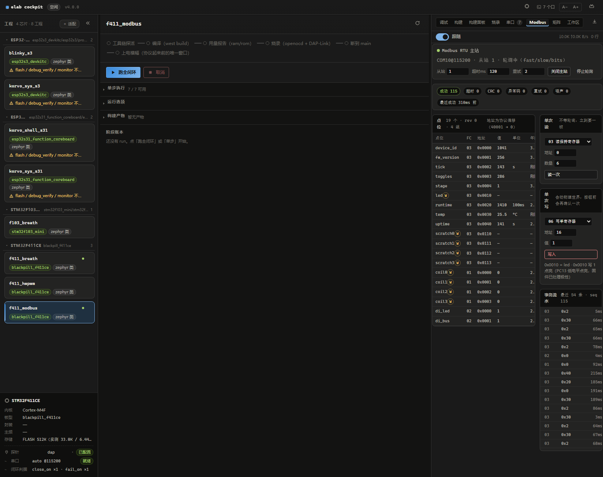
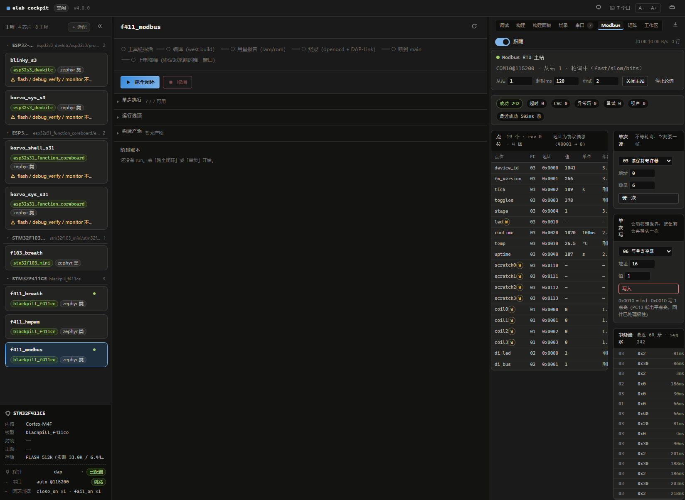

# Zephyr 协议上手 11：Modbus RTU 从站（同一块板、同一条串口、同一个面板）

> 从站固件：`applications/stm32f4/f411_modbus`（Zephyr 4.5.99 / STM32F411CEU6 / 115200 8N1 / unit 1）
> 对照固件：旧仓 `dsh-elab-flow` 的 `examples/STM32F411_modbus`（classic：手写 CRC + 循环 DMA + 软件乒乓发送）；本仓不带 classic 工程
> 主站与面板：**完全没换**——`services/elab/modbus.py` 编解码 + `modbusmaster.py` 事务 + 驾驶舱 Modbus 工作区
> 本文的帧、计数、截图都来自本轮真机
>
> **现状校准（2026-11-20）**：`zephyr-workspace/applications/stm32f4/f411_modbus` 与
> `f411_breath` 同属当前 F411 主线；产品登记在
> `zephyr-workspace/kharon-manifest/products/kharon/f411_modbus.yaml`，点表与产品 yaml 同目录。
> classic 对照篇在旧仓 `docs/tutorials/09`；双根与分层见 [15](./15-Zephyr工作区双根与板级APP产品.md)。

---

## 0. 这篇要解决三件事

| 编号 | 问题 | 章节 |
|---|---|---|
| A | 换了引擎，**对外契约有没有变**（寄存器/异常码/点表） | §1、§4 |
| B | Zephyr 怎么把 USART1 变成 Modbus 物理层，**改哪两处** | §2、§3 |
| C | 哪些东西**搬不过来**（不是遗漏，是新引擎里不存在） | §5、§6 |

如果你只想让一块板会说 Modbus，读 §2–§4；想搞清楚「迁移的边界在哪」，读 §5、§6。

---

## 1. 先看结果：同一个面板，换了一块固件



这张图里每一块都能和 classic 教程 09 对上，因为它们用的是**同一个面板**：

| 面板区域 | 本轮实机值 |
|---|---|
| 连接条 | `COM10 / 115200 · 从站 1 · 轮询中（fast / slow / bits）` |
| 统计条 | 成功 **115**、超时 **0**、CRC **0**、异常码 **0**、重试 **0**、噪声 **0** |
| 点表 | 19 个点 / rev 0 / 4 组 |
| 事务流水 | 每行一条 TX/RX 十六进制 + 耗时（`elapsed_ms` 在 4–200 ms 之间） |

点表里三个数一起看在讲故事：

```text
tick      0x0002  143  s
toggles   0x0003  286        ← 严格 2 倍：tick 每秒 +1，toggles 每秒 +2
di_led    0x0000    1
di_bus    0x0001    1        ← 最近 2 s 总线上确实有事务
```

`toggles == tick * 2` 不是巧合：心跳线程 500 ms 翻一次灯，寄存器口径保持 classic 的「每秒 +2」，
所以拿旧点表读新固件，语义完全对得上。

再跑一会儿，成功数从 115 涨到 242，超时仍然是 0：



---

## 2. 两套引擎：换掉的是中间四层


左边是 classic 的四层手写实现，右边是 Zephyr 的四层现成实现。**最后一层（寄存器表）两边必须一致**，
那是业务契约；上面四层是协议栈，换了就该扔掉，而不是搬过去再改一遍。

代码量的对比不是「谁更高级」，而是**维护成本归谁**：

| 层 | classic | Zephyr |
|---|---|---|
| 收字节 | `uart_dma.c` 380 行（CIRC DMA + HT/TC + IDLE） | `subsys/modbus/modbus_serial.c`（上游） |
| 帧边界 | 20 ms 静默定界（自己测、自己调） | 子系统内建（按 RTU 规范 + 波特率算） |
| CRC / 功能码 / 异常码 | `modbus_slave.c` 514 行 | `modbus_server.c`（上游） |
| 寄存器表 | `holding[] / coils[] / scratch[]` | 六个回调 + 一个 switch |

所以这一版 `main.c` 只有 **310 行**，其中一半是注释与启动打印；**协议代码一行都没有**。
剩下能算业务逻辑的，就是 §4 那张 19 行对照表。

---

## 3. dts 决定物理层，Kconfig 决定角色

### 3.1 overlay：两行把 USART1 变成 Modbus

```dts
/* applications/stm32f4/f411_modbus/boards/blackpill_f411ce.overlay */
&usart1 {
	status = "okay";

	modbus0: modbus0 {
		compatible = "zephyr,modbus-serial";
		status = "okay";
	};
};
```

三个细节都有原因：

- **必须挂在 `&usart1` 底下**，不能写 `chosen`。Zephyr 的 Modbus 串口实例是 uart 节点的**子节点**，
  驱动用 `DT_INST_PARENT(inst)` 反查 uart 设备；写成 chosen 会找不到设备。
- **不写 `de-gpios` / `re-gpios`**。那两只是 RS485 收发器的方向脚；DAP-Link 的 CDC 串口是 TTL 直连，
  写了等于去操作一个不存在的引脚。
- **不写引脚号**。PA9/PA10 由板级 dts 的 `usart1` pinctrl 决定，这份 overlay 只管「这个 uart 上挂了个
  Modbus 实例」。

### 3.2 prj.conf：三个「必须」和一个「必须关」

```conf
CONFIG_SERIAL=y
CONFIG_UART_INTERRUPT_DRIVEN=y     # RTU 的静默定界靠 IRQ + 超时，不走轮询
CONFIG_MODBUS=y
CONFIG_MODBUS_ROLE_SERVER=y        # 角色：从站
CONFIG_LOG=n                       # ★ 必须关：异步日志会和 Modbus 帧抢同一个 UART
CONFIG_DEBUG=y                     # 调试会话必需（教程 10 §5.1 的坑）
```

`CONFIG_LOG=n` 是这一版最容易踩的地方：Zephyr 的 log 子系统在中断里也能输出，
一旦它往 USART1 写一个字符，主站收到的那一帧就废了。**协议口上只能有协议字节。**

---

## 4. 寄存器表：19 个点逐条对齐

classic 的点表有 31 个点，Zephyr 版有 19 个。少的 12 个不是漏了，见 §6。

| 地址 | 名称 | 类型 | Zephyr 实现 | 与 classic 的差别 |
|---|---|---|---|---|
| `0x0000` | device_id | u16 | 常量 `0x0411` | 无（对外契约不变） |
| `0x0001` | fw_version | u16 | 常量 `0x0100` | 无 |
| `0x0002` | tick | u16 | `k_uptime_get()/1000` | 无（每秒 +1） |
| `0x0003` | toggles | u16 | `tick * 2` | 无（每秒 +2） |
| `0x0004` | stage | u16 | `modbus_init_server` 成功后恒 1 | 无 |
| `0x0010` | led | u16 可写 | 写回调里 `gpio_pin_set_dt` + 置 `led_manual` | 无（写 1 亮） |
| `0x0020/21` | runtime | u32 高字在前 | `uptime_s * 10` | 无（单位仍是 100 ms） |
| `0x0030/31` | temp | f32 高字在前 | 8 档常量循环 | 无 |
| `0x0040/41` | uptime | u32 高字在前 | `uptime_s` | 无 |
| `0x0110..117` | scratch0..7 | u16 可写 | 数组 `scratch[8]` | 无（FC06/FC16 都验过） |
| `FC01 0..3` | coil0..3 | bit 可写 | `coil_bits` 位图 | 无（coil0 仍与 LED 联动） |
| `FC02 0` | di_led | bit | 读**引脚电平**（不是命令） | 无 |
| `FC02 1` | di_bus | bit | 任意回调被调用即刷新时间戳 | 无（最近 2 s 有事务） |
| `0x0100..0109` | dma_* | — | **恒 0** | ❗ 见 §6 |
| `0x0005` | frames | — | **恒 0** | ❗ 见 §6 |
| `0x0011` | burst | u16 可写 | 接受写入、不产生连发 | ❗ 见 §6 |

写点的白名单是**显式列表**，不是按地址段猜——这条规矩两边一致：

```c
/* 读错可以重读，写错会动硬件 —— 显式列表永远优于按地址段猜 */
if (addr == REG_LED)        { ... return 0; }
if (addr == REG_BURST)      { ... return 0; }
if (addr >= REG_SCRATCH0 && addr < REG_SCRATCH0 + SCRATCH_N) { ... return 0; }
return -ENOTSUP;        /* 其余 → 服务端回 02 非法地址 */
```

---

## 5. 单口方案的代价：启动静默期

只有一条串口（DAP-Link CDC），又要跑协议，又要让人看见「固件起来了」。所以：

```text
*** Booting Zephyr OS build 34e025569cbb ***

[boot] f411_modbus unit=1 115200 8N1 (Zephyr 4.5.99)     ← init 之前
[boot] board=blackpill_f411ce/stm32f411xe
                              ← 等 700 ms
[boot] regs 0x0000 id | 0x0002 tick | 0x0010 led | 0x0110..117 scratch
                              ← 等 700 ms
[boot] coils 0..3 (coil0=led) | di0=led di1=bus-active
                              ← 等 150 ms 排空 FIFO，然后 modbus_init_server()
```

为什么要**分三段、中间等 1.4 秒**——第一版是一次打完四行，结果 `monitor` 步永远抓不到：

```text
[?] monitor  15.19s  整个观察窗口内一个字节都没收到
```

不是固件没打印，而是**烧录结束到串口可用需要 0.6–1.2 s**（实测），横幅在 10 ms 内就打完了。
把四行摊开到 1.4 s，`monitor` 立刻从「inconclusive」变成「2.28 s 命中」：

```text
[✓] monitor  2.28s  命中 close_on（regex:^\[boot\] within_s=15）
```

代价是从站上线晚 1.4 s。这在现场可以接受（主站上电后一般也要秒级才轮询），嫌慢就改两个 `k_msleep`。
**这条经验比代码重要：不是所有「没有输出」都是坏了，有可能是窗口太窄。**

> 注意 `monitor` 在这个工程里只证明「固件起来了 + USART1 通」，**不证明协议在应答**。
> 协议是否真的工作，看 §7 那三条因果链，或者直接看面板的成功/超时计数。

---

## 6. 哪些搬不过来（不是遗漏，是新引擎里不存在）

| classic 的概念 | 为什么 Zephyr 没有 | 处理 |
|---|---|---|
| `0x0100..0109` DMA 仪表盘（HT/TC/IDLE/TX 乒乓等 10 个寄存器） | Zephyr 的 Modbus 用子系统自己的收发路径，没有「你的环形缓冲」这回事 | 这段恒返回 0，点表里删掉这 10 个点 |
| `0x0005` frames（合法帧计数） | 子系统不向应用暴露帧计数 | 恒 0；判活看 `tick` 或 `di_bus` |
| `0x0011` burst（连发 N 帧看 TX 乒乓） | 应用侧没有两块发送缓冲可切，发送归子系统 | 接受写入但不产生连发 |

**这三条不是「以后补上」，而是「在新引擎里没有对应物」。** 硬要模拟（比如自己维护一个假计数）
只会让人以为它在测量什么——那比没有更糟。

反过来，这也是迁移的收益清单：classic 教程 09 里 §7–§9 整整三章在讲「为什么是循环 DMA + HT/TC」、
「为什么发送只能软件乒乓」——**这三章在新架构里直接消失了**，因为它们不再是你的问题。

---

## 7. 真机验收：三条因果链

### 7.1 读身份：值必须对得上

```text
TX  01 03 00 00 00 06 C5 C8
RX  01 03 0C 04 11 01 00 00 09 00 12 00 01 00 00 13 85
    → [1041, 256, 9, 18, 1, 0]
       device_id=0x0411  fw=0x0100  tick=9  toggles=18  stage=1  frames=0
```

`0x0411`（STM32F411）、`0x0100`（v1.0）、`toggles = 2 × tick` —— 三项一次对齐，
说明「寄存器语义」这一层搬得没问题。

### 7.2 批量写 + 回读：FC16 是写路径里最容易错的

```text
写  TX  01 10 01 10 00 04 08 00 01 00 02 00 03 00 04 ED C7
    RX  01 10 01 10 00 04 C1 F3                       ← 回显「起始地址 + 数量」
读  TX  01 03 01 10 00 04 44 30
    RX  01 03 08 00 01 00 02 00 03 00 04 0D 14
    → [1, 2, 3, 4]
```

注意写应答是 **8 字节**（不是 7 字节）：FC16 的应答只回显地址与数量，不回数据。这一点 classic 与
Zephyr 完全一致——因为校验逻辑在服务端，两边都按规范实现。

### 7.3 写硬件 + 读回引脚：这条链最硬

```text
写  TX  01 06 00 10 00 00 88 0F      ← 0x0010 = 0（灭灯）
    RX  01 06 00 10 00 00 88 0F      ← 回显
读  TX  01 02 00 00 00 02 F9 CB
    RX  01 02 01 02 20 49            ← di_led=0, di_bus=1
```

**关键在 `di_led` 从 1 变成 0**：`di_led` 读的是**引脚电平**，不是「上次写了什么」。
所以这一对帧不仅证明寄存器被写了，还证明**GPIO 真的动了**。

如果 `di_led` 永远等于你刚写的值，那这个点就是个骗子——很多实现的「状态回读」就是这个坑。
本工程里 `di_led` 走 `gpio_pin_get_dt()`，写路径只负责 `gpio_pin_set_dt()`，两条路在硬件上才汇合。

### 7.4 异常码：拒绝也要拒绝得对

| 请求 | 应答 | 含义 |
|---|---|---|
| FC03 读 `0x0500`（不存在） | `01 83 02` | 02 非法地址 |
| FC06 写 `0x0002`（只读） | `01 86 02` | 02 非法地址（写白名单外） |
| FC04 读输入寄存器（本片无） | `01 84 02` | 02 非法地址 |

三个都是 `02` 而不是 `01`（非法功能码）：因为功能码本身是**支持**的（FC03/06/04 服务端都实现），
只是地址不在表里。**功能码不支持回 01、地址不对回 02** —— 这个区分在排障时能省很多时间。

---

## 8. 常见故障

| 现象 | 根因 | 处理 |
|---|---|---|
| `[boot] modbus0 not found (-1)` | overlay 没生效，或 `modbus0` 节点不在 `&usart1` 下 | 看构建产物 `zephyr.dts` 里有没有 `modbus0` |
| 主站一直超时，但线是通的 | init 之后还有 printk / LOG 输出，帧被撞碎 | `CONFIG_LOG=n`，协议起来后不再打印 |
| 点表读出来是空的（0 个点） | 点表放错目录 | 必须与工程 yaml **同目录同名**：`kharon-manifest/products/kharon/f411_modbus.modbus.json` |
| 只有自己的请求有回应，别的从站地址没反应 | `unit_id` 不一致 | 固件 `UNIT_ID`、点表 `unit_id`、面板「从站」三个数要一样 |
| `monitor` 报「一个字节都没收到」 | 单口方案 + 启动窗口太窄 | 见 §5：把横幅分开打印，留出 1 s 量级的窗口 |
| `monitor` 报 `ERROR_ACCESS_DENIED` | **驾驶舱面板还开着这个串口会话**（独占设计） | 面板点「关闭会话」，或先关驾驶舱再跑 CLI |
| 写完 LED 寄存器，面板上 `di_led` 没变 | 读的是寄存器镜像而不是引脚 | 本工程 `di_led` 走 `gpio_pin_get_dt()`，可作对照 |

---

## 9. 上手任务：给从站加一个「温度阈值告警」

目标：让 `di_bus` 旁边多一个离散输入 `di_temp_alarm`（FC02 地址 2），温度超过 26.0 °C 时置 1。

三处改动：

```c
/* 1) 离散输入回调里加一个地址（阈值 26.0 °C） */
case 2u:
	*state = temp_celsius() > 26.0f;
	return 0;

/* 2) 把温度抽成函数：原来只在 holding_reg_rd 里算 f32 位模式，
 *    现在还要拿它做数值比较，所以单独抽出来，避免把位模式和浮点值混用 */
static float temp_celsius(void) { return temp_tab[uptime_s() % 8u]; }

/* 3) 点表加一个点（kharon-manifest/products/kharon/f411_modbus.modbus.json），并放进 bits 组 */
{ "name": "di_temp_alarm", "fc": 2, "address": 2, "type": "bit", "plot": true }
```

验收：

1. `kharon run -p f411_modbus --steps build,flash`
2. 面板 → Modbus → 打开主站 → 开始轮询
3. `temp` 在 25.0 / 25.5 / 26.0 / 26.5 / 27.0 之间循环，`di_temp_alarm` 应随之翻转
4. 把阈值改成 25.2 再烧一次，观察翻转的时刻提前——**阈值改对了，时序就会变**，这是能自证的

---

## 附录：本轮用到的命令

```bash
# 建与烧
kharon run -p f411_modbus --steps doctor,build,report           # 编译 + 出报告
kharon run -p f411_modbus --steps flash,monitor                 # 烧录 + 抓启动横幅
kharon run -p f411_modbus --steps debug_verify                  # 断到 main（协议栈初始化前）

# 手工验协议（不占面板）
.deps/venv/Scripts/python.exe .work/modbus_probe.py             # 11 条请求的 TX/RX 原文

# 面板侧（HTTP，面板上点按钮等价）
POST /api/modbus/open    {"project":"f411_modbus"}              # 复用串口会话 + 探测首帧
POST /api/modbus/start   {}                                     # 按 groups 开始轮询
GET  /api/modbus/state?project=f411_modbus&after=0              # 引擎快照 + 增量事务
POST /api/modbus/read    {"fc":3,"address":272,"count":4}       # 单次读
POST /api/modbus/write   {"fc":16,"address":272,"values":[1,2,3,4],"confirm":true}
```

---

上一篇：[10-Zephyr模式上手](10-Zephyr模式上手.md) —— 六步闭环、构建面板、调试与 `CONFIG_DEBUG` 坑。
