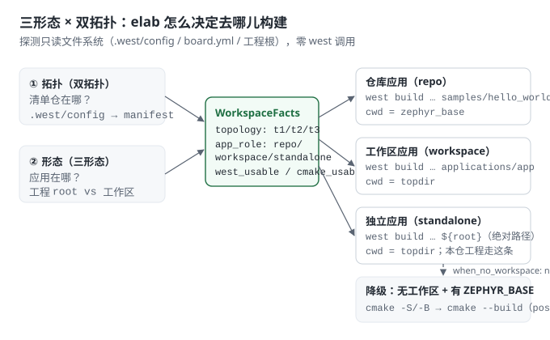

# 12 · 三种 Zephyr 应用形态怎么接

> **现状校准（2026-11-20）**：应用落点 `zephyr-workspace/applications/<family>/<app>`，
> 产品登记 `zephyr-workspace/kharon-manifest/products/kharon/<app>.yaml`，
> west 工作区在 `zephyr-workspace/`（`ZEPHYR_BASE=zephyr-workspace/zephyr`）。
> 板级真相在 `zephyr-workspace/kharon-boards/`，`kharon deps --check` 是只读校验。
> host 事实源：`config/host.kharon.profile.yaml` + 本机覆盖 `host.local.yaml`。
> 双根与分层细节见 [15 · 双根与 Board / APP / Product](./15-Zephyr工作区双根与板级APP产品.md)。

> 读完你能回答：手里的 Zephyr 工程属于哪种形态、Kharon 会去哪儿构建它、
> 没有 west 工作区时为什么还能编、以及"这块板从哪来"。
> 前置：读完 [10 · Zephyr 模式上手](./10-Zephyr模式上手.md)（知道六步闭环与 host / provider / `runners.yaml` 三块事实源）。

**本篇是 2026-11-18「三形态 + 双拓扑」架构升级的使用面**；设计与实现落点见
旧仓 `dsh-elab-flow` 的 `docs/archive/design/执行计划_Zephyr工作区三形态适配_2026-11-18.md`。

---

## 1. 一张图看懂

Kharon 探测 Zephyr 工程只问两个问题：**清单仓在哪**（双拓扑）、**应用在哪**（三形态）。
两个答案合成一份 `WorkspaceFacts`，构建命令的 argv 与 cwd 全部由它推导：



关键点三个：

1. **探测零 west 调用**。`.west/config` 是 INI 文本、`board.yml` 是 yaml，读文件就够了。
   所以"什么都不装"也能回答"这是什么布局"——`kharon.cmd ws` 永远可用。
2. **三形态的唯一差异是 `${ws:app_arg}` 与 cwd**。provider.yaml 里 build 是**一条**命令模板，
   三种形态共用；argv 里没有厂商分支。
3. **降级不是特殊路径**。声明了 `when_no_workspace: native-cmake` 的步骤，
   在"无工作区 + 有 ZEPHYR_BASE"时自动改走 cmake 直编（配置 + 构建两条命令）。

## 2. `kharon.cmd ws`：一条命令看懂现状

在 Kharon 模式下（`ELAB_HOST=kharon`，解析到 `config/host.kharon.profile.yaml`）：

```text
$ .\kharon.cmd ws -p f411_breath
[kharon] 工作区事实 @ C:\...\kharon-ide
  工作区      C:/.../zephyr-workspace        来源=从 app 向上找 .west
  拓扑        t1（清单在内核仓）   清单仓=zephyr
  清单        C:/.../zephyr-workspace/zephyr/west.yml
  内核        C:/.../zephyr-workspace/zephyr  4.5.99
  工程        C:/.../zephyr-workspace/applications/stm32f4/f411_breath
  应用形态    workspace —— 工作区应用 workspace application
  构建位置参  applications/stm32f4/f411_breath
  构建 cwd    C:/.../zephyr-workspace
  默认 build  C:/.../zephyr-workspace/build
  可用链      west build（三形态任一）
```

`拓扑 t1` 是双拓扑的第一种：**清单仓（`west.yml`）在内核仓里**
（`zephyr-workspace/zephyr/west.yml`）。如果哪天把清单仓独立出去（官方推荐的 workspace
布局），同一命令会变成 `拓扑 t2`——工程代码与 agent **零改动**，因为 provider 的 argv
只写 `${ws:app_arg}`，事实从探测来。

agent 读的是同一份事实，两个入口任选：

| 入口 | 用法 | 说明 |
|---|---|---|
| HTTP | `GET /api/workspace?app=<工程>` | 语义视图（形态 / 拓扑 / 去哪儿构建）；`?modules=1` 附带模块清单 |
| CLI | `.\kharon.cmd ws --app <目录> --json` | 机器可读；人读去掉 `--json` 即可 |

要 west 本身的自检、模块缺口、`west update` / `init`，或读构建元数据
（runners / kconfig / devicetree / footprint），用 `POST /api/west`（按钮走同一条 HTTP）：
`status` / `list` / `boards` / `meta` 只读，`update` / `init` 是**写**——必须显式确认，
内核侧会校验，standalone 面板没有 agent 写权限旁路。

## 3. 三形态各自的"接法"

| 形态 | 工程放哪 | `kharon.cmd ws` 显示 | 构建 argv（自动展开） | 你要写的配置 |
|---|---|---|---|---|
| 仓库应用 | Zephyr 树内（`samples/`…） | `app_role=repo` | `west build -b <板> samples/hello_world` | 产品 yaml 的 `root` 指向树内目录 |
| 工作区应用 | topdir 旁边（`applications/`…） | `app_role=workspace` | `west build -b <板> applications/app` | 同上；**本仓所有工程走这条** |
| 独立应用 | IDE 仓外任意目录 | `app_role=standalone` | `west build -b <板> <root 的绝对路径>` | 同上，`root` 指向工作区外目录 |

对本仓工程（`f411_breath` 等），工程 yaml 只写 `root` 与 `build.work_dir`，
形态是探测出来的。接第三方的 Zephyr 应用时也一样：把 `root` 指过去，
`kharon.cmd ws` 会告诉它判成了什么、argv 会是什么
（`kharon.cmd run -p <工程> --steps build --dry-run` 看展开结果）。

## 4. 没有 west 工作区也能编：降级链

只有 `ZEPHYR_BASE`（clone 了 Zephyr 但没 `west init -l`）时，`requires.host` 的
`any_of` 组仍然放行（工作区 **或** 内核二选一），build 自动改走 cmake 直编：

```text
$ .\kharon.cmd run -p f411_breath --steps build --dry-run   （无工作区 host）
── build
   $ cmake -S <app> -B <work_dir> -G Ninja -DCMAKE_MAKE_PROGRAM=...ninja.exe ...
   $ cmake --build <work_dir>
   · provider zephyr/west@1.0.0 → steps.build（build（cmake 直编 · 无 west 工作区））
```

两个注意点：

- 降级**复用内核 plan 命令**（`configure_cmd` + `build_cmd`），不是第二套 cmake 调用；
  第二条 `cmake --build` 由 provider 的 `post_cmd` 机制承载（同一 cwd/env/超时预算，配置失败就不构建）。
- 连 ZEPHYR_BASE 都没有时不降级——`any_of` 会把缺什么报出来，比 cmake 找不到 Zephyr 好懂。

## 5. 这块板从哪来：board 三源

`kharon.cmd doctor --workspace` 会把板子按来源分组（pack / west / 本仓 module），
并检查 SoC family 需要的模块在不在：

```text
$ .\kharon.cmd doctor --workspace -p f411_breath
[OK  ] ws.topology      拓扑=t1（清单仓=zephyr）
[OK  ] ws.zephyr        ZEPHYR_BASE=.../zephyr-workspace/zephyr  4.5.99
[info] ws.modules       7 / 70 已拉取（west list 全量声明，present 才是本机有的）
```

> `7 / 70` 是 **pinned 通道**的本机实测：manifest 声明 70 项，盘上只落 6 个模块 + manifest。
> `learning` 通道首次 `kharon bootstrap` 会全量 `west update`，这里应接近满额；两条通道都只影响
> “拉多少”，不影响工作区识别。

本仓自研板（`korvo1` / `esp32s3_korvo` / `esp32s31_function_coreboard`）的**真相在
`zephyr-workspace/kharon-boards/`**：它是标准 Zephyr module（`zephyr/module.yml`），
通过 `EXTRA_ZEPHYR_MODULES` 进 `west boards`——所以它跟着工作区走，`west update` 冲不掉。

`kharon deps` 现在是**只读校验**（不再复制文件）：板目录在 module 内，天然与工作区一致；
它检查的是 west 树状态与模块缺口，缺模块给出 `python -m west update <name>`。

> 换板/加板时的完整顺序（Board → APP → Product）见
> [15 · 双根与 Board / APP / Product](./15-Zephyr工作区双根与板级APP产品.md)。

## 6. 故障速查

| 现象 | 根因 | 处理 |
|---|---|---|
| `kharon.cmd ws` 显示 `拓扑=none`、`可用链=空` | 无工作区也无 ZEPHYR_BASE | `.\kharon.cmd deps --check`，或核对 config/host.kharon.profile.yaml 的 `tools.zephyr.*` |
| build 报 `tools.zephyr.jobs 未定义` | host 里写的是数字但旧内核只认字符串 | 已修复（数字标量自动转 str），升级到本版 |
| 降级没生效，仍走 `west build` | host 缺 `tools.ninja.path`（降级的 cmake 也要 ninja） | 在 host 里补 `tools.ninja.path` |
| 板在 `west boards` 里找不到 | module 未进 `EXTRA_ZEPHYR_MODULES` | 跑 `.\kharon.cmd deps --check`；核对 `zephyr-workspace/kharon-boards/zephyr/module.yml` |
| doctor 说缺 `hal_espressif` / `hal_stm32` | SoC family 需要的模块没拉 | 按 doctor 给的命令 `python -m west update <模块名>` |
| `POST /api/west` 的 status 报 west 不可用（127 / 无版本） | 解释器链里没有能 `-m west` 的 python | 配 `tools.west_python.path`，或按 `kharon bootstrap` 重建 `.deps/venv` |

---

**下一步**：[11 · Zephyr_Modbus 从站](./11-Zephyr_Modbus从站.md) 看协议面板怎么复用；
三形态的设计细节与实现落点见执行计划全文。
