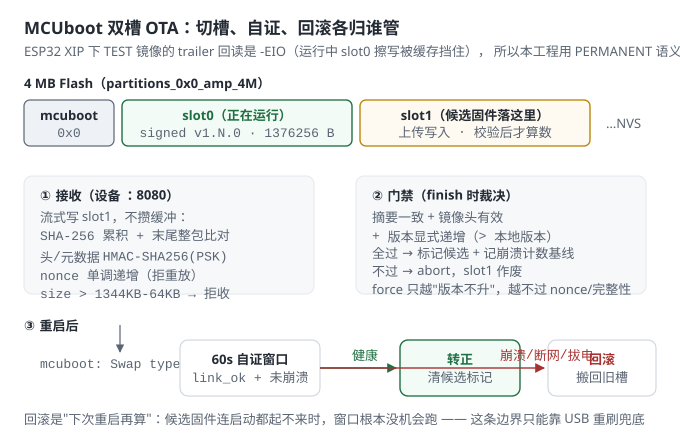
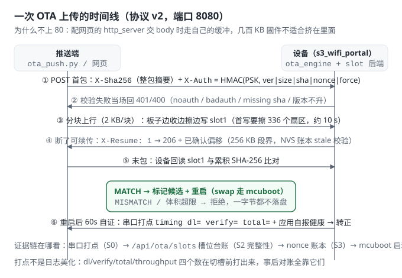
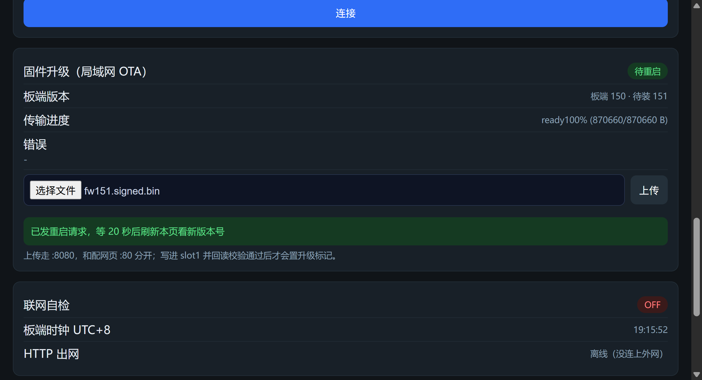
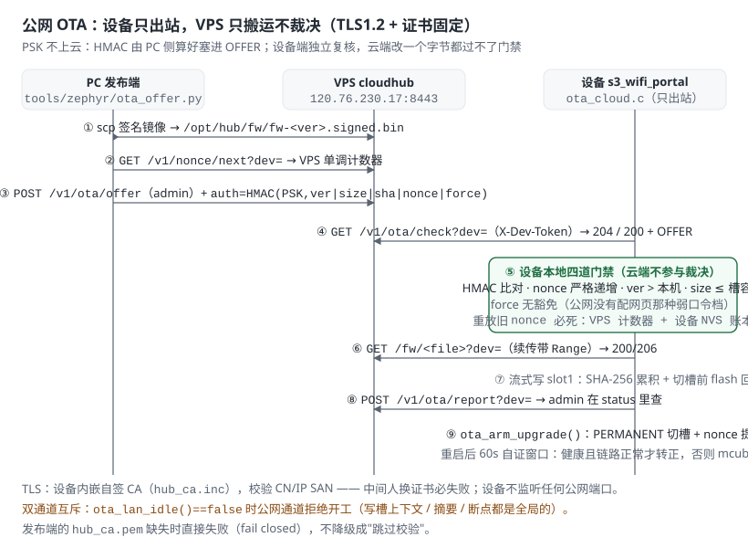

# 13 · Zephyr OTA 升级（局域网 + 公网）—— 用 s3_wifi_portal 走一遍真机闭环

> **现状校准（2026-11-19）**：Zephyr 4.5.99 / west v1.5.0 / SDK 1.0.1；应用落点
> `applications/esp32s3/s3_wifi_portal`，工程 `projects/kharon/s3_wifi_portal.yaml`。
> OTA 的构建、签名、投放仍按本文；入口命令用 `kharon run/build`。

> 目标板：ESP32-S3 DevKitC（`esp32s3_devkitc/esp32s3/procpu`）· Kharon（Zephyr）模式
> 载体工程：`applications/esp32s3/s3_wifi_portal`（Wi-Fi 配网门户 + MCUboot 双镜像）
> 本篇回答一个问题：**一块已经卖出去的板子，怎么在不插 USB 的情况下换固件 —— 并且换坏了能自己回来。**
> 两条通道：§1–§7 是**局域网推送**（PC 直连板子 :8080），§8 是**公网拉取**（板子在 NAT 后面，
> 只出站 8443 去云端取），两条通道共用同一套门禁、写槽与自证逻辑。

## 1. 这条链路长什么样

OTA 的接收端在 `src/l0/ota.c`，设计遵循 embedded-ota-pipeline 的分层，每一层都有一条
"出了事归谁管"的答案：

| 层 | 问题 | 本工程的实现 |
|---|---|---|
| S0 打点 | 事后怎么对账 | `timing dl= verify= total= throughput= size=`，切槽前输出 |
| S1 传输 | 几百 KB 固件走哪 | 独立 TCP 端口 **8080** + 手写 HTTP 解析，绕开配网页 http_server 的 body 缓冲 |
| S2 完整性 | 下载的字节真的是发的字节吗 | 流式 SHA-256 累积 + 切槽前 flash 回读比对，不符不落盘 |
| S3 鉴权 | 谁能推固件 | HMAC-SHA256(PSK, ver\|size\|sha256\|nonce\|force)；网页走弱一档的 `X-Key` 口令 |
| S4 门禁 | 什么固件允许进来 | **显式递增版本号**；force 只让发起端放行，设备端独立裁决 |
| S5 回滚 | 换坏了怎么办 | 应用侧 60s 自证窗口 + 显式回退（原因见 §2） |
| S6 体积 | 装不下怎么办 | 超过 `1344 KB − 64 KB` 直接拒，不写一个字节 |

**协议版本 v2**（`OTA_PROTO_VER 2`）：字段或规范化串变更时 +1，旧发起端拿到明确拒绝码。





## 2. 为什么自证不用 mcuboot 的 TEST 模式

Zephyr MCUboot 的标准回滚是 **TEST + 自证**：切到新槽试跑，应用调用
`boot_write_img_confirmed()` 把 trailer 里的状态转正。但 ESP32 是 **XIP**（就地执行）：
正在运行的 slot0 的 trailer 被 flash 缓存挡住，运行中回读恒 `-EIO` —— TEST 镜像永远转不了正。

所以本工程改用 **PERMANENT 语义 + 应用侧自证窗口**：

- 切槽前在 NVS 记下候选版本（`s3ota/hv`）和当时的崩溃计数基线（`s3ota/hc`）；
- 应用活着且跑满 60s（`OTA_SELFTEST_MS`）、链路正常、崩溃计数没涨 → 调 mcuboot 转**正**；
- 崩过 / 窗口走完链路还不通 / 直接被拔电 → 下次重启 mcuboot 搬回旧槽。

**边界要认清**：候选固件连启动都起不来时，自证窗口根本没有机会跑——这种情况只能 USB 重刷兜底。

## 3. 准备：Kharon 模式下的构建

s3_wifi_portal 是 sysbuild（MCUboot 双镜像）工程，声明方式是**文件系统事实**：
工程根放一个 `sysbuild.conf`，内核探测到它就自动给 `west build` 追加 `--sysbuild`。
yaml 里不写工具链、不写内存、不写构建旗标（zephyr 包红线）：

```powershell
# 全量（首次，mcuboot + app 双域一起编）
kharon run -p s3_wifi_portal --steps build

# 产物在 app 域（sysbuild 的超级构建目录里）：
#   build\esp32s3\s3_wifi_portal\default\s3_wifi_portal\zephyr\zephyr.elf
#   build\esp32s3\s3_wifi_portal\default\s3_wifi_portal\zephyr\zephyr.signed.bin
```

**版本门禁的单一事实来源**是 `src/l0/ota.h` 的 `OTA_LOCAL_VERSION`（本篇实测时从 148 → 149 → 150）。
每次要"允许被覆盖"的固件必须把这个数字调大 —— 它不是 git describe 派生，
同一个主版本下两次构建只有它才能分出先后。

镜像头版本**不在构建里注入**（改 prj.conf 会触发 819 文件全量重编），而是构建后用 imgtool
重签，参数照抄 Zephyr 自己那条 sign 命令（header 0x20 / slot 1376256 / align 4）：

```powershell
.deps\venv\Scripts\python.exe west\bootloader\mcuboot\scripts\imgtool.py sign `
    --version "1.149.0+0" --header-size 0x20 --slot-size 1376256 --align 4 `
    --key west\bootloader\mcuboot\root-rsa-2048.pem `
    build\esp32s3\s3_wifi_portal\default\s3_wifi_portal\zephyr\zephyr.bin fw149.signed.bin

# 签完必须自校验：不是 1.149.0 就别推板子
python tools\zephyr\img_hdr.py fw149.signed.bin
```

## 4. 第一次上板（USB）

```powershell
kharon run -p s3_wifi_portal --steps flash     # west flash --runner esp32（探针无关）
```

S3 的原生 USB-Serial-JTAG 直接出串口（COM11，VID 303A/PID 1001），烧录走 esptool，
实测 mcuboot 52.9 KB @0x0 + 应用 870.7 KB @0x20000，约 28 s：

```
[kharon] ✓ 烧录完成（west flash --runner esp32）
       Flashing esp32s3 chip on COM11 (921600bps)
       Wrote 52864 bytes at 0x00000000 in 0.8 seconds (553.5 kbit/s).
       Flashing esp32s3 chip on COM11 (921600bps)
       Wrote 870660 bytes at 0x00020000 in 7.7 seconds (900.8 kbit/s).
```

串口监视面板（`monitor`）应命中 `close_on` 判据：

```
[monitor] ✓ 串口闭环：OK
  +17.24s  <inf> portal: s3_wifi_portal booting ...
```

## 5. 真机 OTA（脚本推送，HMAC 强鉴权）

设备连上路由器后拿到局域网 IP（本篇实机 `<hub-ip>`）。槽位台账随时可查：

```powershell
curl "http://<hub-ip>/api/ota/slots?k=<REDACTED-PSK>"
{"slot0":{"ver":"0.0.0",...},"slot1":{"ver":"1.147.0",...},
 "confirmed":true,"local_ver":148,"swap":1}
```

推送（`tools/zephyr/ota_push.py`）：**必须推 `zephyr.signed.bin`**——裸 `zephyr.bin`
没有 MCUboot 头和尾部 TLV，会被判无效镜像：

```powershell
python tools\zephyr\ota_push.py <hub-ip> fw149.signed.bin --version 149
```

实机输出（2026-11-18）：

```
image   : fw149.signed.bin
size    : 870660 B (850.3 KB)
sha256  : 061636ff...3c0beb09
version : 149   nonce: 1794999895   force: False
auth    : HMAC-SHA256(psk=22B)
target  : <hub-ip>:8080
  sent 100%  --- response --- {"ok":true,"reboot":false}
--- client side: 20.33 s, 42 KB/s ---
device accepted: image written + sha256 verified + upgrade flag set
```

重启切槽（`tools/zephyr/ota_reboot.py`），mcuboot 搬运镜像（约 8.7 MB/4 ms 级别的 IO，
串口安静十几秒属正常），再连串口监视：

```
I (boot): Loading image 0 - slot 0 from flash, area id: 2
<inf> portal: s3_wifi_portal booting ...
```

60s 自证窗口走完后，台账宣布换装成功：

```powershell
curl "http://<hub-ip>/api/ota/slots?k=<REDACTED-PSK>"
{"slot0":{"ver":"1.149.0",...},"slot1":{"ver":"0.0.0",...},
 "confirmed":true,"local_ver":149,"swap":1}
```

注意两个细节：

- **slot1 现在是旧的 0.0.0** —— swap 是双向的，旧镜像退到 slot1 当回滚保险；
- `confirmed:true` 与 `pending:false`（`/api/status` 的 `ota` 节）就是自证转正的落账。

## 6. 网页推送（弱一档：X-Key 口令）

配网页内嵌了 OTA 上传表单（`X-Key` 明文口令，不是 HMAC），适合坐在同一网络里的现场调试。
实机截图（板端 150 → 待装 151，传输进度 100% 已过回读校验）：



网页路径的限制写在这里别忘：Chrome 的 Private Network Access 会把"http 页面 → 私网地址"的
POST 预检掐掉，板子 ：8080 已回 `Access-Control-Allow-*`，但本机 Chrome 仍需关闭
`LocalNetworkAccessChecks` 系列特性才能走通（`tools/zephyr/page_ota_cdp.py` 就是这么做的）。

## 7. 验收清单（三条因果链）

1. **完整性**：改一个字节再推 → 设备端 SHA-256 不匹配 → 拒绝，`/api/ota/slots` 槽位无变化；
2. **门禁**：同版本重推（不 force）→ 版本不升被拒；nonce 重放 → `badauth`。
   实机（2026-11-18）：151 已转正后重推 `--version 150` → 设备读到头就掐断连接
   （推送端 `WinError 10053`），slot0 无变化；
3. **回滚**：推一个启动即崩的镜像 → 60s 窗口内崩溃计数涨 → 重启后 mcuboot 搬回旧槽
   （候选固件连启动都失败时此链路不可用，见 §2 边界）。

本节是局域网通道的判据；公网通道的四条负例（低版本 / 坏 auth / 错 token / 旧 nonce）
在 §8.6，判定口径与这里一致：都必须在"写槽"之前被拒。

## 8. 公网 OTA（拉取式：设备主动取，云端只排队）

§5/§6 的推送式前提是"PC 和板子在同一网段、够得着 :8080"。板子出厂到客户手里就没有这个前提：
它在 NAT 后面、没有公网 IP，也**不应该**为升级开任何入站端口。这一章是同一件事的跨网段做法。

### 8.1 拓扑与角色

```
发布端(PC) --scp/TLS--> VPS cloudhub :8443 <--设备主动出站 8443-- 设备
```

| 角色 | 干什么 | 不干什么 |
|---|---|---|
| 设备 `src/l0/ota_cloud.c` | 定时 `GET /v1/ota/check`、按 OFFER 拉 `GET /fw/...`、本地验 HMAC/版本/nonce、写槽 | **不监听任何端口** |
| VPS `cloudhub.py` | 存 OFFER 队列、发 nonce、发固件字节、收 report | **不持有 PSK**、不做任何裁决 |
| 发布端 `tools/zephyr/ota_offer.py` | 签好的镜像 scp 到 VPS、算 HMAC、排队 OFFER | 不需要连得到设备 |

设备零监听是这条通道的底线：防火墙只放行**出站** 8443，入方向一个端口都不开。
"谁能推固件"的裁决权仍然在设备上——VPS 只搬运，拿不到 PSK 就伪造不出合法 OFFER。

### 8.2 触发：轮询，不是云推

`ota_cloud_worker` 是常驻线程，每一轮的等待时长是算出来的（v3 之后不再固定）：

```c
uint32_t wait_ms = g_period_ms;                       /* 默认 3 min，云端 cfg_set hb= 可调 */
if (g_fast_until_s && now < g_fast_until_s) {
        wait_ms = FAST_PERIOD_MS;                     /* 60 s：命令刚下发，缩短等待 */
}
if (g_fail_cnt) {                                     /* 失败退避 1→2→5→10→15 min 封顶 */
        wait_ms = MAX(wait_ms, backoff_ms[g_fail_cnt - 1]);
}
k_sem_take(&cloud_kick, K_MSEC(wait_ms));
```

| 触发源 | 时机 | 实现 |
|---|---|---|
| 定时轮询 | 默认每 **3 分钟**（云端可调 60–3600 s） | worker 的 `k_sem_take` 超时 |
| 命令快轮询 | 执行完命令后的 **5 分钟内** 每 60 s 一次 | `g_fast_until_s` |
| 失败退避 | 连续失败 1→2→5→10→15 min 封顶，成功清零 | `g_fail_cnt` / `backoff_ms[]` |
| 链路上升沿 | "断→通"边沿**立刻**补一次 | `ota_cloud_link_feed(up)` |
| 手动 | shell `portal ocheck`，置 `g_force_next` 绕过节流 | `ota_cloud_check_now()` |

每次都先报影子（见 §9），再 check。四道闸任一不满足就继续睡：NVS 里有 dev token
（`g_token_ok`）、链路 up（`g_link_up`）、局域网通道不在跑（`ota_lan_idle()`）、
自己不在忙（`ota_cloud_busy()`）。两通道互斥是硬约束——局域网正在收包时，公网退避到下一轮。

所以"云端有新固件"这件事对设备是**拉出来的**：`GET /v1/ota/check?dev=s3-0001` 返回 204（无）
或 200 + JSON，设备拿到才开始下载；VPS 上排队多久都不会自己往板子推。

### 8.3 一次升级的时序



发布端（`--reboot` 让设备装好后自己重启，原因见下）：

```powershell
$env:S3_HUB_ADMIN = (ssh -i <key> root@120.76.230.17 "cat /opt/hub/data/admin_token").Trim()
$env:S3_OTA_PSK   = (Get-Content .work\ota\psk.txt -Raw).Trim()

python tools\zephyr\ota_offer.py build\esp32s3\s3_wifi_portal\default\s3_wifi_portal `
    --dev s3-0001 --ver 157 --reboot --wait-report 0
# image  : ...\zephyr.signed.bin  (946628 B)
# sha256 : c17605e2...e8932
# nonce  : 1795010363  (VPS 单调计数器)
# offer  : queued for s3-0001  ver=157 size=946628
```

设备侧实机日志（2026-11-18，板端 156 → 157，链路 <hub-ip>）：

```
[  3.1s] <inf> ota: ota server listening on :8080 (proto v2, local ver 156)
[ 78.5s] <inf> ota: expected-sha256 MATCH (c17605e2...e8932)
[ 79.0s] <inf> ota: whole-sha256 MATCH (946628 bytes)
[ 79.0s] <inf> ota: arm_upgrade: slot1 pending, ver=157 nonce=1795010363 (PERMANENT)
[ 79.1s] <inf> ota_cloud: cloud ota ready: ver=157 size=946628 total=54478ms 16KB/s resumed=0 off=0
[ 79.7s] <inf> ota_cloud: cloud ota armed, reboot into v157
[118.1s] <inf> ops: boot #207, rst=software, previous run clean (last_up=73s)
[119.1s]  ... :8080 (proto v2, local ver 157)
```

`--reboot` 不是客套字段。公网路径最初只 arm 不重启，结果 60 s 自证窗口在**仍在跑的旧镜像**里
到点打印 `self-test: running v152 != candidate v153, drop marker`，pending marker 被丢掉、升级白做。
修法是 `cloud_run_once()` 在 `hub_report()` 之后显式
`ops_boot_mark_clean() → k_sleep(200ms) → sys_reboot(SYS_REBOOT_COLD)`：
**先上报再重启**，否则 VPS 上永远看不到这次结果。

### 8.4 门禁：与局域网完全同一把尺

公网没有另起一套规则，而是把 OFFER JSON 翻成"伪 HTTP 头"，喂给局域网那套
`ota_req_check()` / `ota_auth_ok()`（同一份 `OTA_PROTO_VER 2`、同一个槽上限、同一条 nonce 账本）：

```
Content-Length: <size>        ← 门禁拿它当镜像体积
X-Version: <ver>
X-Sha256: <64 hex>
X-Nonce: <nonce>
X-Force: 0/1
X-Auth: <HMAC-SHA256(PSK, "ver|size|sha256|nonce|force")>
```

两个反直觉的实现细节，都真机踩过：

- **伪头整体必须以 `\r\n` 开头**。`ota_hdr_get()` 用 `strstr(hdr, "\r\n<Name>:")` 取字段，
  首行没有前置 CRLF 永远匹配不到——表现为"每个头都缺"；
- **必须带 `Content-Length`**。少这一条，门禁报 `missing required header`，
  它要的是"声明体积"，不是"随便一个头"。

### 8.5 六个坑（都有真机证据）

1. **TLS 证书解析失败**：`net_sock_tls: Failed to parse certificate on tag 1, err: -0x2180`
   → 根因是 `CONFIG_MBEDTLS_PEM_PARSE_C` 没开（内嵌 CA 是 PEM）。
2. **PSA 派生符号写不进 prj.conf**：`CONFIG_PSA_WANT_KEY_TYPE_ECC_KEY_PAIR_BASIC` /
   `..._RSA_KEY_PAIR_BASIC` 是无 prompt 的派生项，写了不生效。要写 `..._GENERATE`，
   再补 `CONFIG_PSA_WANT_ECC_SECP_R1_256=y`（否则 `MBEDTLS_ECP_MAX_BITS` 直接 `#error`）
   和 `CONFIG_MBEDTLS_CIPHERSUITE_TLS_ECDHE_RSA_WITH_AES_128_GCM_SHA256=y`（否则 `rsa.c`
   的 unused parameter 会把 `-Werror` 顶爆）。
3. **8 KB 线程栈在下载阶段必崩**：`FATAL ERROR: CPU exception ... Current thread: cloud_thread`
   （`Invalid BSA`）。TLS 句柄 + `struct resp`（1024 B 头 + 512 B 预读）叠起来不够；
   `RX_STACK 8192 → 12288`，并把 `cloud_download()` / `cloud_run_once()` 的 `struct resp`
   两处都改 `static`。
4. **nonce 账本要种得比设备高**：VPS `nonces` 表为空时计数器从 1 起，必然低于设备已存值 →
   第一次 check 就被判重放。另外 `/v1/nonce/next` **只接受 POST**（GET 会 404）。
5. **紫色呼吸灯不亮**：`led_status.c` 只认 `ota_snapshot_json()` 里
   `"stage":"recv|verify|ready"`，而这份 `g_ota.stage` 原本只有局域网路径在写，公网自己维护
   `g_cl` → 全程绿灯，现场根本分不清"在升级"还是"卡住了"。修法是 `ota.c` 导出
   `ota_progress_mark()` / `ota_progress_bytes()`（只写快照字段，不动 `g_ota.st`，
   避免绕过 `fail()` 的"ready 不许被抹"保护），公网在下载起点、每收一块、校验、ready、fail 各打一次。
   机器可核对的判据是 `/api/status` 的 `ota.stage`：下载中应为 `recv`、`written` 单调涨。
6. **check 只跑一次就再也不跑了**（`portal ocheck` 永远回 `busy=1`，VPS 访问日志里
   再也看不到 `/v1/ota/check`，只能重启设备才解开）。

   **真因在设备侧**：`cloud_run_once()` 有好几条提前 return —— TLS 失败、收头失败、
   **204（云端没有待升级）**、OFFER 收不全、JSON 解析失败。这些分支都只 `return`，
   没有把 `g_cl.st` 复位成 `CLOUD_IDLE`。于是 `ota_cloud_busy()` 恒真，worker 每次
   醒来都认为"自己还在忙"，直接 `continue`。注意**稳态必然踩到**：正常跑完一次升级，
   云端队列就空了，下一次 check 就是 204 —— 这就是"升级一次成功，之后 OTA 就哑了"。
   修法：把收尾收敛到包装层 —— 原函数改名 `cloud_run_once_body()`，新增
   `cloud_run_once()` 无条件 `g_cl.st = CLOUD_IDLE;` 再返回。以后再加 early return
   也不会把状态机钉死。回归方式：`/v1/ota/clear` 清空队列后连点三次
   `portal ocheck`，VPS 日志应出现三条 `GET /v1/ota/check ... 204`。

   **两个曾走过的误诊，别再走**：
   - "TLS 连接没超时导致线程永久挂住" —— 不成立。Zephyr 的 TLS 握手在 connect 里由
     `CONFIG_NET_SOCKETS_TLS_CONNECT_TIMEOUT`（默认 10000 ms）兜底
     （`sockets_tls.c:3388`）；`SO_RCVTIMEO/SO_SNDTIMEO` 映射到
     `options.timeout_rx/tx`（`:5003-5011`）。实测卡住的是状态机，不是 socket。
   - "cloudhub 卡死" —— 探测姿势错了。8443 是 **TLS**，用
     `curl http://127.0.0.1:8443/v1/health` 探它本来就拿不到响应（连接被重置/挂住），
     看起来就像服务死了。用 `https://` 或 `curl -k https://...` 探。

   **顺手加固了服务端**（`/opt/hub/cloudhub.py`，备份 `.bak-20261119`）：原先
   `srv.socket = ctx.wrap_socket(listen_sock, server_side=True)` 让 TLS 握手发生在
   `accept()` 主循环里 —— 真遇到只在 TCP 层连上、不发 ClientHello 的客户端（端口扫描器、
   掉电重连的板子），整个 accept 线程会挂死，8443 全站不可用。现在改成
   `TLSServer.process_request()`：accept 拿裸 socket，交给工作线程带 10 s 超时握手，
   坏连接只影响自己。

### 8.6 验收：四条负例（2026-11-18 实测）

| 场景 | 构造方式 | 设备端实际输出 |
|---|---|---|
| 重推低版本 | 用 `imgtool sign --version 1.156.0` 正常签+发布 `--ver 156`（HMAC 合法） | `version 156 not newer than 157 [check=6]` |
| 改坏 auth | 直接改 VPS 库里的 OFFER `ver`（规范化串变了，HMAC 对不上） | `ota auth failed (bad HMAC / bad X-Key) [check=3]` |
| 旧 nonce 重放 | 用 PSK 手算一份 `ver=158`、`nonce=1795010362`（设备账本已到 363）的合法 OFFER | `nonce replay (nonce <= last used) [check=5]` |
| 错 dev-token | 改 VPS `devices.token` | `check HTTP 401 len=18`（VPS 侧先拒） |

四条都挡在"写槽"之前：`slot0`/`slot1` 与 `local_ver` 均无变化。两个记账细节：

- 每个 OFFER 消耗一个 nonce，重推会拿到新号（VPS 计数器单调递增）；
- 同一份 OFFER 被再次 check 报 `-13 nonce replay` 属于**防重放正常工作**，不是故障。

### 8.7 量产换 PSK（不换就 401）

公网门禁用的 PSK 必须在量产时换掉开发默认值，两条通道一起换：

```powershell
# 设备串口（shell 不回显明文）
portal opsk <24 位 hex>
```

写入 NVS `s3ota/psk`；发布端把同一个值放进 `S3_OTA_PSK`。换之前先确认局域网脚本通道
（`ota_push.py`）用的也是这把新钥匙，否则一个通道 200、另一个 401，很容易误判成"公网坏了"。

## 9. 公网侧的第二层：设备影子 + 命令通道（协议 v3）

§8 的公网通道只解决"升级"。2026-11-19 起同一条出站连接上又承载了两件事：
**设备状态可见**（影子）和**云端可控**（白名单命令）。仍然**不开任何入站端口**。

### 9.1 哪些该搬上公网，哪些不该

| 能力 | 公网形态 | 结论 |
|---|---|---|
| 升级 | 拉取式 OFFER（§8） | 已在公网 |
| 可见性（状态/心跳） | 设备每轮 POST 影子 | 本轮补上 |
| 可操作性（复位、自检、点灯） | 命令队列，设备取走执行 | 本轮补上 |
| 配网 / 发现 | 无（靠账号 + 设备列表） | **不搬** |
| 调试面 `:80` | 无 | **绝不暴露**（口令级，含复位与密钥注入） |
| 局域网直推 `:8080` | 保留 | 产线/开发/现场急救，与公网互补 |

"发现"依赖二层广播与同网段信任：公网没有广播域，设备还在 NAT 后面没有稳定地址，
所以公网上不存在"扫一圈看有哪些设备"这回事——云端对应物是**设备身份 + 影子 + 命令**。

### 9.2 协议协商：`X-Proto`

设备在 check 请求里带 `X-Proto: 3`；VPS 按这个头分支：

| 请求头 | 云端返回 | 谁在用 |
|---|---|---|
| 不带 / `X-Proto: 2` | `204` 或**纯 OFFER body**（一字节都不变） | 159 及更早的固件 |
| `X-Proto: 3` | 扁平 JSON：`{dev, proto:3, cmd?, cmdname?, cmdargs?, …OFFER 六字段}` | 161+ |

两边都没有待办 → 仍返回 `204`。设备侧 `offer_sanity()` 里 `proto != OTA_PROTO_VER` 直接拒，
所以过渡期必须两边对齐：

- **老固件（proto 2）收 160/162 这种新 OFFER**：发布时显式 `--proto 2`；
  `ota_offer.py` 的 `--proto` 默认 3，只在"给旧固件发新镜像"时传 2。
- **合并应答里的 proto 必须回写**：OFFER body 里存的是"发布时的 proto"（过渡期是 2），
  直接 `payload.update(offer)` 会用 2 盖掉 3，设备判协议不符。云端在合并后强制
  `payload["proto"] = 3`（备份 `.bak-proto`）。这是本轮真踩到的坑。

### 9.3 影子：每轮一份状态快照

```
POST /v1/shadow?dev=s3-0001      X-Dev-Token   body ≤ 8 KB，且必须是合法 JSON
GET  /v1/shadow?dev=s3-0001      X-Admin-Token → {"dev","ts","shadow"}
```

真机 162 的一份原文（`GET /v1/shadow` 取回）：

```json
{"dev":"s3-0001","proto":3,"ver":162,"boot":217,"crash":6,"up":257,"rssi":-14,
 "ssid":"Power","ip":"10.115.126.239","net":{"dns_rc":0,"http":200},
 "stage":"idle","err":"","last":257,"cmdid":6,"hbm":3}
```

| 字段 | 含义 |
|---|---|
| `ver` / `proto` | 设备当前版本与协议号 |
| `boot` / `crash` | 启动计数、异常启动计数（NVS） |
| `up` / `last` | 本机 uptime 秒；`last` = 最后一次 check 的 uptime（**不写墙钟**，设备没有可信 RTC） |
| `rssi` / `ssid` / `ip` | 链路快照（`ssid` 是目标 SSID） |
| `net` | `dns_rc` 与最近一次 HTTP 自检码 |
| `stage` / `err` | 与 `/api/status` 的 `ota.stage` 同源（`idle/check/gate/dl/verify/report`） |
| `cmdid` / `hbm` | 最近执行的命令 id、当前心跳周期（分钟） |

存储是**覆盖式**：`shadows(dev_id PK, ts, body)`，只留最新一份；要看历史用 `reports` 表。

### 9.4 命令：白名单、幂等、先回执再执行副作用

| 命令 | args | 说明 |
|---|---|---|
| `reboot` | `cold` / `warm` | 只置标志，**回执发完才复位** |
| `ocheck` | — | 立刻补一次 check，并进 5 min 快轮询 |
| `netcheck` | — | DNS/HTTP 自检，结果进 `net` |
| `led_test` | `red/green/blue/purple/off` | 临时改灯 5 s，到期自动回链路色 |
| `log_dump` | — | 取事件环形缓冲（截断会标注） |
| `cfg_set` | `hb=<60..3600>` | 改心跳周期，立即生效 |
| `info` | — | `ver=<n> proto=<n> boot=<n> crash=<n> up=<ns>` |

未知命令返回 `-ENOENT`；**白名单里没有任何写 PSK / token 的命令**，密钥只能走串口。

一次命令的完整生命周期：

```
POST /v1/cmd {dev,cmd,args,ttl}   → cmds.state='queued'，返回 id
设备 check（v3）                  → 取最旧一条 queued，置 'taken'
设备执行                          → POST /v1/cmd/result {id,rc,out}
云端                              → state='done', result={"rc":..,"out":".."}
ttl 到期未见执行                  → check 时清理为 'expired'
```

两个必须写对的细节：

- **幂等**：设备把已执行的命令 id 落 NVS（`s3cloud/lastcmd`），`id <= lastcmd` 时
  只回执 `"dup: already executed"`，**不执行第二次**。云端重推（回执丢了、TTL 内重试）因此安全。
- **reboot 的顺序**：先 `POST /v1/cmd/result`，再 `ops_boot_mark_clean() + sys_reboot()`。
  反过来做，云端永远看不到这条回执，审计里只剩 `taken`。
- `reboot` 命令还会在影子 `boot` 上体现：真机实测 216 → 217，`rst=software`、`clean=true`。

审计接口：`GET /v1/cmd/log?dev=&limit=`（≤50），返回 id/cmd/args/created/state/done_ts/result。

### 9.5 真机验收（2026-11-19，159 → 161 → 162）

| 项 | 机器证据 |
|---|---|
| 公网升级 | 两次 `report {"ver":N,"result":"ok"}`，boot 215 → 216 → 217，`clean:true` |
| 影子 | 见 §9.3 原文：`ver:162 / boot:217 / hbm:3 / cmdid:6` |
| `info` | 入队后 **95 s** 执行，回执 `ver=162 proto=3 boot=216 crash=6 up=195s` |
| `led_test purple` | rc 0，`led purple for 5s`；**紫色 5 秒由用户肉眼确认**（AGENTS C36） |
| `cfg_set hb=120` | 回执 `heartbeat period = 120s`，下一份影子 `hbm:2` |
| `cfg_set hb=180` | 回执 `180s`，`hbm` 回到 3（恢复默认 3 min） |
| `reboot cold` | boot 216→217，`rst=software`、`clean=true` |
| 旧协议回归 | 同一 URL 不带 `X-Proto` → `204`，语义未变 |
| OFFER 生命周期 | `ok` 后云端自动销号，队列为空，不再刷 nonce-replay |

### 9.6 这一轮踩的两个坑

1. **影子一直 400 `badjson`**。
   `json_put_str()` 只负责写 `"key":"value"`，`cloud_ops_env_json()` 连续拼
   `rssi → ssid → ip → net` 时没补逗号，拼出来是 `"rssi":-14"ssid":"Power"`
   —— 非法 JSON，云端 `json.loads` 拒绝。
   修法：**逗号由写入函数负责**（`buf` 非空就先补 `,`），调用方只管顺序塞字段。
   排障姿势：`journalctl -u cloudhub | grep 'POST /v1/shadow'` 看状态码，
   400 一定是 body 非法或为空，401 才是 token 问题。

2. **升级成功却每 3 分钟刷一条 `nonce replay`**。
   `report result=ok` 之后云端没删 offer，设备下一轮又拿到**同一条**（同一 nonce），
   被设备自己的防重放账本拒掉 → 无限 fail 上报。
   修法：report 命中 `result == "ok"` 时 `DELETE FROM offers WHERE dev_id=?`（备份 `.bak-report`）。
   这类"日志很吓人、其实链路正常"的现象，先查队列里 offer 是否还在。

### 9.7 内存：这 8.7 KB 是从哪来的

加完影子和命令，dram 从 371,112（97.49%）涨到 379,848（99.78%），只剩 824 B。
逐符号对账后，增量能完整还原，没有隐藏的配置回归：

| 来源 | 字节 |
|---|---|
| `struct resp`（1552 B）× 2 —— shadow / cmd_result 各一份 static | 3,104 |
| shadow 的 `body[768] + req[1280] + env + why` | 2,304 |
| cmd_result 的 `body[640] + req[1024] + safe[512]` | 2,176 |
| `cloud_ops` 的 `tmp[1024]` + hooks 结构 | 1,048 |

修法（不是简单砍 buffer，砍错就截断）：

- **`struct resp` 合成一份 `g_resp`**：所有云端 HTTP 都在 `cloud_thread` 里**串行**执行
  （check → shadow → download → report 没有交叠），4 个函数各留一份 static 纯属浪费。
  省 **4,656 B**，顺带把 `hub_report()` 里原来在栈上的那份也移到共享，云线程栈峰值降 1.5 KB。
- 影子/回执的 body、req 收到刚好够用：`768→448`、`1280→768`、`640→448`、`1024→768`、
  `512→320`，省 **1,472 B**。
- `OFFER_BUF_MAX 2048 → 1024`：v3 应答实测 300~400 B，省 **1,024 B**。
- `cloud_ops.tmp 1024 → 512`：`out` 本来就只有 512 量级，省 **512 B**。

结果：

| 版本 | dram | 占比 | 余量 |
|---|---|---|---|
| 159（基线） | 371,112 | 97.49% | 9,560 B |
| 160（P0 初版） | 379,848 | 99.78% | 824 B |
| **162（优化后）** | **372,184** | **97.77%** | **8,488 B** |

教训：`static` 局部变量在"每个函数一份"时非常贵。判断能不能共享，看**执行是否串行**，
而不是看"变量名有没有冲突"。

## 10. 已知取舍与坑

- **USB 直刷的镜像版本是 0.0.0**（imgtool 重签只给 OTA 镜像做）。它可以直接跑，
  但被换到 slot1 后永远过不了版本门禁 —— 想让旧镜像当"可回滚保险"，走 OTA 推送
  递增版本这一路。
- **`--esp-device` 要真端口**：`flash.extra_args` 里的 `${serial_port}` 按项目 serial.port
  解析（auto 会排除蓝牙虚拟口）；解析不出就 fail-fast，不会拿猜的口去烧。
- **首写 10 s 静默**：第一次写 slot1 前要擦 336 个扇区（1344 KB / 4 KB），TCP 窗口
  被塞满时客户端 sendall 会一直等 —— 推送脚本把单次 send 超时设成 90 s 就是为此。
- **PRJ 里别写 `CONFIG_MCUBOOT_EXTRA_IMGTOOL_ARGS`**：Kconfig 输入一变就全量重编，
  版本注入已改到构建后重签（§3）。
