# Zephyr 调试区操作 14：从断点到内核态（STM32F411 实机）

> 板子：WeAct Black Pill V2.0（STM32F411CEU6），DAP-Link → `COM10`，115200 8N1
> 内核：Zephyr **4.5.99** / west **v1.5.0** / openocd + gdb
> 入口：`kharon`（Zephyr 模式）→ 右栏 **调试** 工作区
> 文中所有截图都是本机 **CDP 抓的真实浏览器**；数字来自这一轮实机（run `r-8ef2f363`，2m23s）
> 前置：先按 [10 · Zephyr 模式上手](./10-Zephyr模式上手.md) 把六步闭环跑绿；工作区形态见 [12](./12-Zephyr工作区三形态.md)，OTA 见 [13](./13-Zephyr_OTA局域网升级.md)

---

## 0. 你将得到什么

| 编号 | 问题 | 对应章节 |
|---|---|---|
| A | **怎么开一条会话、怎么关**：三种停止位置有什么区别，为什么开不了 | §2 |
| B | **Zephyr 页签上的数怎么读**：当前 / 就绪 / 空闲 / IRQ 栈 / 线程 / 对象 | §3–§4 |
| C | **为什么我的线程叫 `(unnamed)`、栈水位全是 `—`**：四个 Kconfig 开关 | §5 |
| D | **断点、继续、单步、监视怎么配合**，以及谁在动我的内存 | §6–§7 |

先会用（§2–§4），再看配置（§5），最后下断点、收证据、踩坑（§6–§9）。

---

## 1. 调试区是一条会话，不是一堆按钮

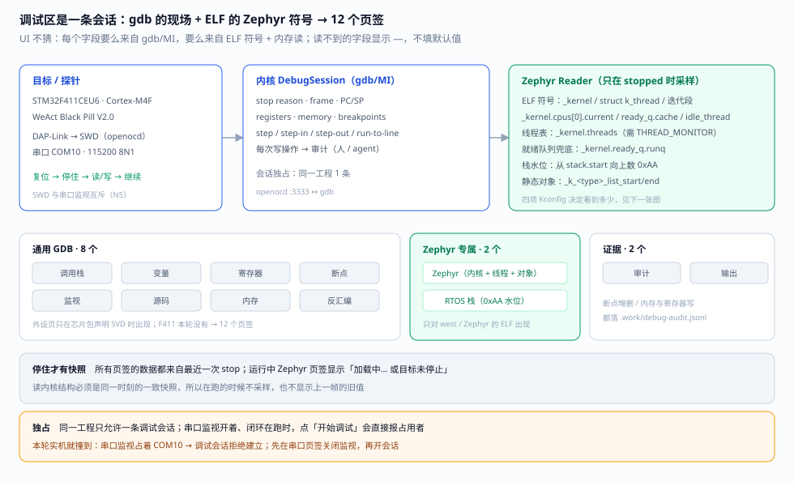

一条会话只做四件事：**复位目标 → 停住 → 读/写 → 继续**。面板本身不持有一部分状态：
停止原因、帧、寄存器、内存来自 gdb/MI；Zephyr 的内核视图则要再用 ELF 里的符号去读内存。
两边读的是**同一个停止时刻**，所以不会出现「调用栈说在 main、线程表说在 idle」这种拼接错位。

页签从会话的 `features` 里长出来，本轮 F411 是 **12 个**：

| 组 | 页签 | 数据来源 |
|---|---|---|
| 通用 GDB（8） | 调用栈 / 变量 / 寄存器 / 断点 / 监视 / 源码 / 内存 / 反汇编 | gdb/MI + ELF 调试信息 |
| Zephyr 专属（2） | **Zephyr** / **RTOS 栈** | `_kernel` 符号 + TCB 内存 + Kconfig 事实 |
| 证据（2） | 审计 / 输出 | 会话事件与写操作日志 |

两个容易误会的点：

- **外设页签不在这 12 个里**。它只在芯片包声明了 SVD 时出现；F411 本轮没有 SVD，所以看不到。
  这不是调试区缺功能，是芯片知识没配（见 §8.4）。
- **Zephyr 页签只对 west 构建的 Zephyr ELF 出现**。classic 工程即使能调试，也不会长出这一页。

> **停住才有快照**：目标在跑时，`_kernel` 和各线程 TCB 的内存一直在变。Zephyr 页签只在
> `stopped` 时采样；运行中点它，只会显示「加载中… 或目标未停止」，**不会拿上一帧的旧值糊弄你**。

---

## 2. 开一条会话：先选「停在哪儿」

### 2.1 三步建立会话

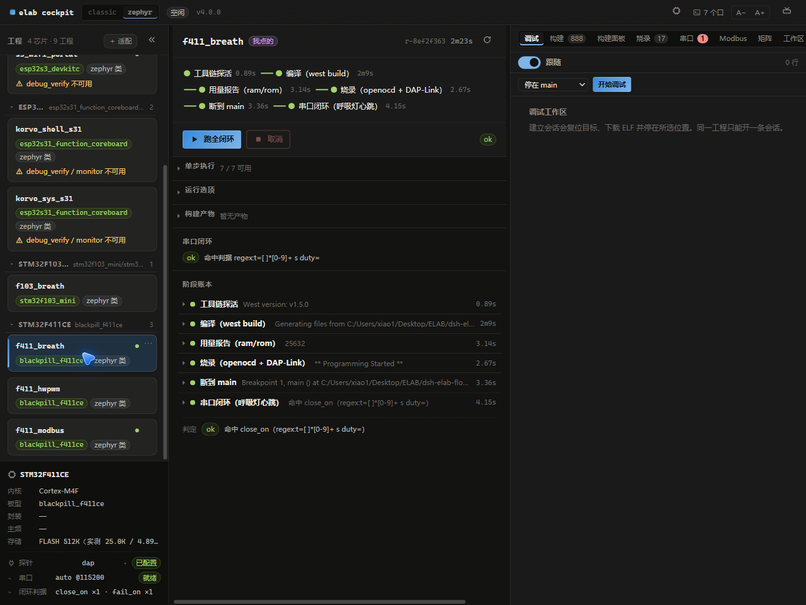

1. 左栏选中工程 `f411_breath`（底部芯片卡确认探针 `dap 已配置`、串口 `auto 115200 就绪`）；
2. 右栏切到 **调试**；
3. 「停止位置」下拉选一项，点 **开始调试**。

三种停止位置的区别：

| 选项 | 建立会话后停在哪 | 适合 |
|---|---|---|
| **停在 main** | 复位 → 加载 ELF → `break main` → run 到 `main` | 日常调试（本文都用它） |
| 停在复位向量 | 复位后立刻 halt，PC 在复位向量 | 查启动早于 `main` 的问题（时钟/看门狗） |
| 下载后直接运行 | 加载 ELF 后直接 continue | 只想下载并让固件自己跑 |

「停在 main」在实机上落到 `main.c:70`——源文件 70 行是函数体的 `{`。GDB 的断点落在函数
prologue 之后的第一条语句，所以停在这一行是正常的，不是跑偏了。

### 2.2 停住之后，面板上有什么

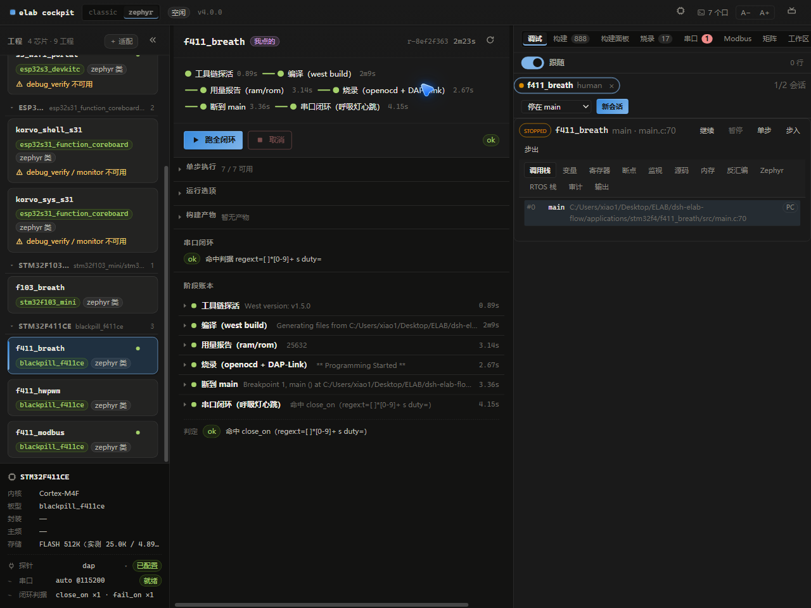

这张图里有四条可以互相印证的事实：

| 位置 | 读数 | 说明 |
|---|---|---|
| 会话条 | `STOPPED  f411_breath  main · main.c:70` | 当前会话属于哪个工程、停在哪 |
| 调用栈 | `#0  main  …/applications/stm32f4/f411_breath/src/main.c:70` | 第 0 帧就是当前 PC |
| 左栏芯片卡 | `FLASH 512K（实测 25.0K / 4.89%）· RAM 128K（实测 5.4K / 4.25%）` | 这份 ELF 的体量，来自构建产物 |
| 中间构建区 | `工具链探活 / 编译 / 用量报告 / 烧录 / 断到 main / 串口闭环` 全绿，判定 `ok` | 会话能开，是建立在这个闭环已经通过的前提上 |

> 「断到 main」这一步（`debug_verify`）本质上就是一次无人值守的会话：只断到 main、打印证据、退出。
> 你手动点「开始调试」，做的是同一件事，只是把会话留给了你。

### 2.3 会话是独占的：串口监视会把它顶掉

本轮实机撞到的原话：

```text
串口监视正在占用 COM10（先在串口页签关闭监视）
```

原因不是 SWD 被占，而是**闭环跑完后，run 的 `monitor` 会话仍然留活**（本轮实测
`serial.monitor.opened_by = auto`，方便你继续看串口），而建立调试会话会复位目标，内核要求
串口/SWD 互斥（约束 N5）。处理顺序只有一条：

1. 右栏切 **串口**；
2. 如果按钮是 **关闭监视**，点它（释放 `COM10`）；若仍显示 **打开监视**，先刷新页面
   （服务端会话已开时，刷新后按钮才会同步成关闭）；
3. 回 **调试**，再点 **开始调试**。

命令行等价（不经过界面时）：

```powershell
Invoke-RestMethod -Method Post http://127.0.0.1:8334/api/serial/monitor `
  -ContentType application/json -Body '{"action":"close"}'
```

同一工程也只能开 **一条**调试会话。要换停止位置，先点会话条右边的 `×` 关掉旧的，再建新的。
关会话默认会 `resume` 目标（本轮日志：`会话已关闭（resume=true）`），板子会继续跑，不会僵在 halt。

---

## 3. Zephyr 页签：先回答「现在谁在跑」

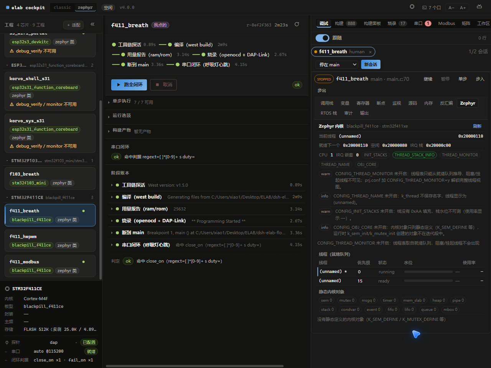

本轮 `main.c:70` 停住时的真实读数：

| 字段 | 值 | 读法 |
|---|---|---|
| 当前线程 | `(unnamed)` · `0x20000110` | `_kernel.cpus[0].current`；名字没开 `THREAD_NAME`，所以是 `(unnamed)` |
| 就绪下一个 | `0x20000110` | `_kernel.ready_q.cache`；和当前是同一个，因为 main 正在跑 |
| 空闲 | `0x20000080` | `_kernel.cpus[0].idle_thread`；它的优先级最低（15） |
| IRQ 栈 | `0x20000c00` | `_kernel.cpus[0].irq_stack`，中断上下文用的栈顶 |
| CPU | `1` | `sizeof(_kernel.cpus)/sizeof(_kernel.cpus[0])`，单核 |
| IRQ 嵌套 | `0` | `_kernel.cpus[0].nested`，停住时不在中断里 |

下面那排 `INIT_STACKS / THREAD_STACK_INFO / THREAD_MONITOR / THREAD_NAME / OBJ_CORE` 是
**Kconfig 事实徽章**：亮 = 开，暗 = 关。再往下四条 warn/info 不是报错，是把「当前视图的边界」
直接写在脸上：

- `THREAD_MONITOR` 未开 → 线程表只能从就绪队列推导，阻塞/挂起线程不可见；
- `THREAD_NAME` 未开 → 线程显示为 `(unnamed)`；
- `INIT_STACKS` 未开 → 栈没有 `0xAA` 填充，水位不可测；
- `OBJ_CORE` 未开 → 内核对象只列静态定义。

> 有趣的是：页签上写 `(unnamed)`，但监视里 `_kernel.cpus[0].current` 却能被 GDB 解析成
> `0x20000110 <z_main_thread>`。名字来自 ELF 的**线程对象符号**，不是 `k_thread` 里的字段——
> 这正好说明「名字」和「线程对象地址」是两件事（见 §6.3）。

### 3.1 线程表与静态对象

线程表标题会明说来源：本轮是 **`线程（就绪队列）`**，只有两行——

| 线程 | 优先级 | 状态 | 水位 | 使用率 |
|---|---|---|---|---|
| `(unnamed) *` | 0 | running | — | — |
| `(unnamed)` | 15 | ready | — | — |

两行分别是 main（运行中）和 idle（就绪）。**阻塞/挂起的线程不在表里**，因为没开
`THREAD_MONITOR`，内核根本没维护全表——不是页面漏读。

静态内核对象一栏本轮全是 `0`，底部一行字写得很清楚：

```text
没有静态定义的内核对象（K_SEM_DEFINE / K_MUTEX_DEFINE 等）
```

`f411_breath` 没定义任何静态信号量/互斥量，`OBJ_CORE` 又没开，所以运行时 `k_sem_init`
创建的对象也不在迭代段里。要看这些计数变成非零，得同时满足「真的有对象」+「开了 OBJ_CORE」。

---

## 4. 线程、栈和「水位」：从 TCB 走到内存

### 4.1 点一行线程，先看 TCB 和栈区间

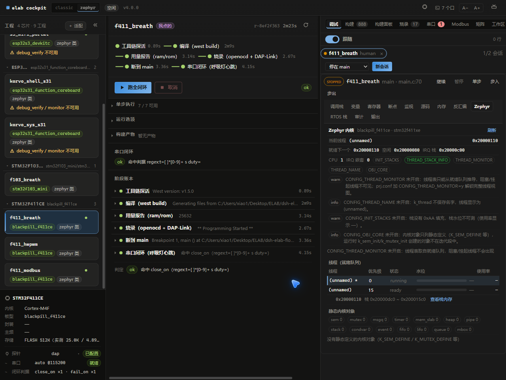

点线程行只是**选中**，不会切换 GDB 的当前线程上下文。选中后多出两样东西：

- `0x20000110`：这个 `k_thread` 的 TCB 地址（后续所有字段都按这个结构读）；
- `栈 0x20000dc0 ~ 0x200015c0`：`stack_info.start` / `start + size`。
  区间长度 `0x800 = 2048 B`，正好对上 `prj.conf` 的 `CONFIG_MAIN_STACK_SIZE=2048`。

### 4.2 「查看栈内存」跳到哪儿

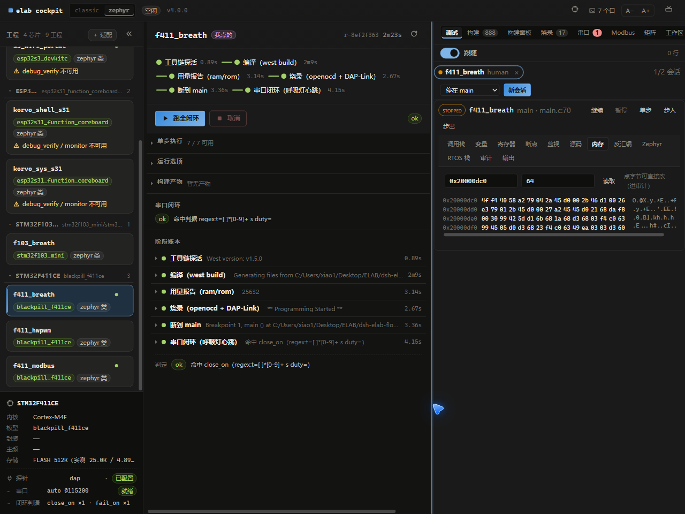

按钮做的事只有两件：把 `memAddr` 设成 `stack_info.start`，把页签切到 **内存**。地址栏预填
`0x20000dc0`、长度 `64`，点「读取」就能看。

这张图同时给出了 `INIT_STACKS=n` 的硬证据：栈底不是 `0xAA AA AA AA…`，而是 `4f f4 48 a2 …`
的随机字节。**没有填充就没有水位**——所以 §3 的「水位/使用率」只能是 `—`，不是 0%。

> 内存页还标了「点字节可直接改（进审计）」。任何写操作（内存、寄存器、变量）都会写进
> `.work/debug-audit.jsonl`，见 §7。

### 4.3 RTOS 栈页：水位是「数出来的」

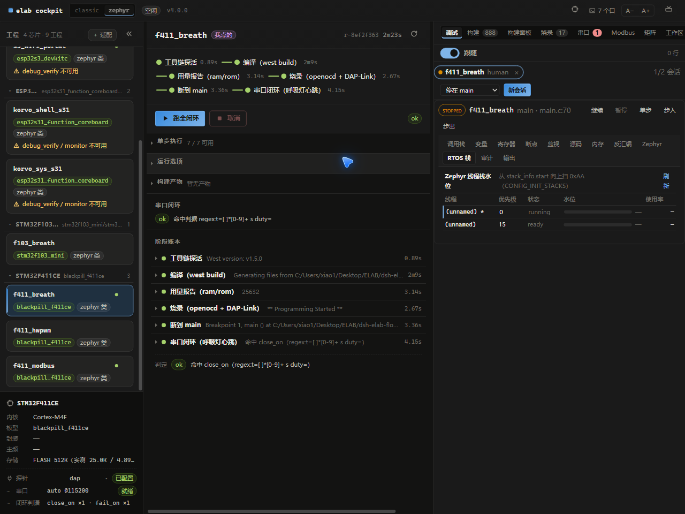

这个页只做一件事：**从 `stack_info.start` 向上数连续的 `0xAA` 字**，数到第一个非 `0xAA`
为止，剩下的就是 free 区。

| 配置 | 面板行为 |
|---|---|
| `INIT_STACKS=n` | 不扫（measure=false），`free_bytes / used_pct` 均为 `null`，显示 `—` |
| `INIT_STACKS=y` | 扫描并给出 `free_bytes/stack_size` 与 `used_pct` |
| `used_pct ≥ 90%` | 标红（爆栈风险） |
| `used_pct ≥ 75%` | 标黄（该留余量了） |

> **不猜**是这一页的原则：没开 `INIT_STACKS` 时它不会拿 0 或「剩余 100%」冒充健康，
> 直接显示 `—`。看到 `—` 应该去改配置，而不是怀疑线程。

---

## 5. 四个开关：你到底能看到多少

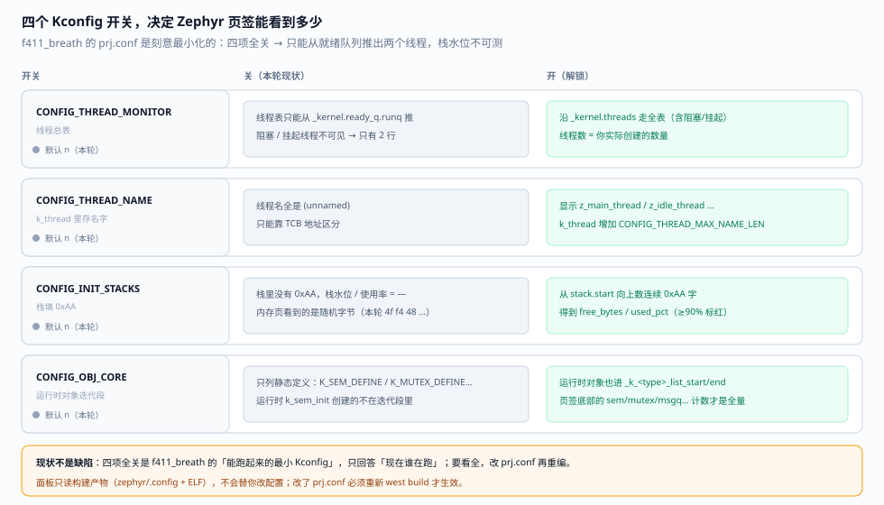

| 开关 | 关（本轮现状） | 开（解锁） | 代价 |
|---|---|---|---|
| `CONFIG_THREAD_MONITOR` | 只能从 `_kernel.ready_q.runq` 推就绪线程 | 沿 `_kernel.threads` 走全表，含阻塞/挂起 | 内核维护线程链表，每线程多一个链节点 |
| `CONFIG_THREAD_NAME` | 全部 `(unnamed)` | `z_main_thread` / `z_idle_thread` … | `k_thread` 里多存 `CONFIG_THREAD_MAX_NAME_LEN` 字节 |
| `CONFIG_INIT_STACKS` | 栈无 `0xAA`，水位 `—` | 向上扫 `0xAA`，得到 free/used% | 启动时给每个栈填一遍，启动变慢 |
| `CONFIG_OBJ_CORE` | 只列 `K_*_DEFINE` 静态对象 | 运行时 `k_sem_init` 等也进迭代段 | 代码体积与对象登记开销 |

`f411_breath` 的 `prj.conf` 是**刻意最小化**的（文件里自己写了「只开能跑起来 + 能看见的几项」），
所以本轮四项全关。第五个徽章 `THREAD_STACK_INFO` 默认就是开的，它提供每个线程的
`stack_info.size`（§4.1 那个 `0x800` 的来源），不是需要你打开的开关。

它仍然能回答最要紧的那个问题——**现在谁在跑**；要看全，按需加这四行：

```conf
# applications/stm32f4/f411_breath/prj.conf
CONFIG_THREAD_MONITOR=y
CONFIG_THREAD_NAME=y
CONFIG_INIT_STACKS=y
CONFIG_OBJ_CORE=y
```

加完必须**重新构建**（`west build` 或面板「跑全闭环」）。面板只读构建产物
（`zephyr/.config` + ELF），不会替你改配置；改完不重编，页签上的徽章和视图都不会变。

> 只想要「线程名 + 水位」这两个最常用的，加 `THREAD_MONITOR` + `THREAD_NAME` + `INIT_STACKS`
> 就够了；`OBJ_CORE` 是给「查谁创建了信号量」用的，不查对象可以先不开。

---

## 6. 断点、继续、单步、监视：一次完整的停—看—跑

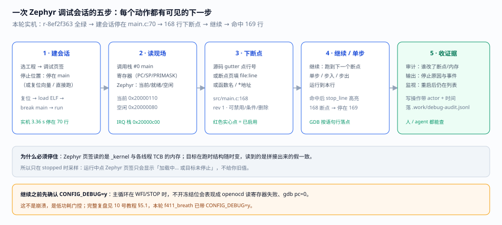

### 6.1 下断点：源码 gutter 是最短路径


三个入口，按使用频率排：

1. **源码页的行号槽**：点行号就设/删断点（红色实心点 = 已启用）；
2. **断点页的输入框**：填 `函数名`、`*地址` 或 `文件:行`（如 `src/main.c:168`）；
3. **运行到本行**：源码页选中某行后点按钮，临时跑到那一行（不留下断点）。

断点页列表里每条都带 `rev`。`rev` 是并发写保护：agent 和你同时改断点时，后写的一方会拿到
冲突而不是覆盖——这是「人的修改优先」的实现方式。

### 6.2 继续：断点 168，实际停在 169

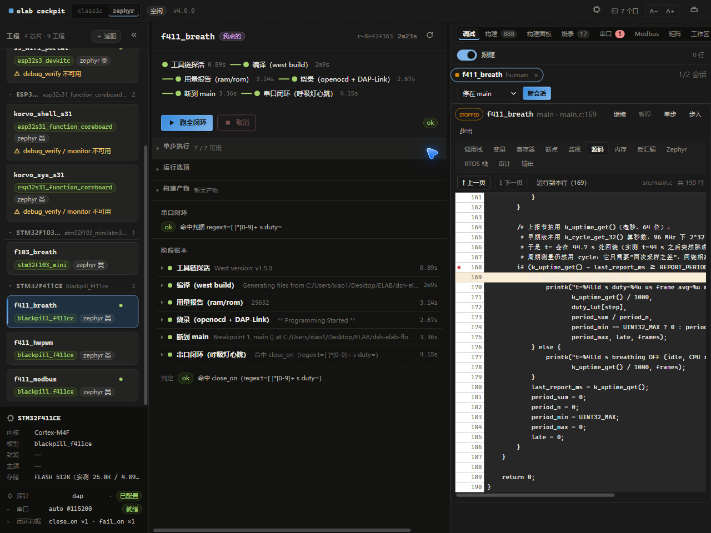

在 `src/main.c:168` 下断点后点 **继续**，会话停在 `main.c:169`：

```text
Breakpoint 2, main () at …/applications/stm32f4/f411_breath/src/main.c:169
```

不是断点漂了，而是 GDB 把断点地址落在 `if (k_uptime_get() - last_report_ms >= …)` 这条语句的
**第一条指令**上，而源码行号映射把它记成了语句体第一行 169。判断方法：**红点在 168，高亮在 169**
就是正常；如果红点消失或停到完全无关的函数，才需要查 ELF 是否最新。

这一停的可见收益是：168 行每 2 秒才经过一次（`REPORT_PERIOD_S=2`），继续之后最多 2 秒内
必然命中，适合演示「按继续 → 命中 → 看变量 → 再继续」的节奏。

### 6.3 监视：把内核结构写成表达式

![监视页：`duty_lut[step]`、`_kernel.cpus[0].current`、`...->base.prio` 三条实机结果](assets/zephyr-debug/14-08-watch.png)

监视页支持 gdb 的普通表达式，也支持内核符号。本轮加的三条与结果：

| 表达式 | 结果 | 读法 |
|---|---|---|
| `duty_lut[step]` | `778` · `0x30a` | 业务变量：当前呼吸 PWM 的 on_us |
| `_kernel.cpus[0].current` | `0x20000110 <z_main_thread>` | 内核当前线程；符号名来自 ELF |
| `_kernel.cpus[0].current->base.prio` | `0 '\000'` | 当前线程优先级 0（协作式最高） |

用法上的三个区别，别混：

- **监视**：**工程级持久**，存在 `projects/<工程>.debug.json`；刷新页面、关会话、第二天重开都还在，
  每次暂停自动刷新，直到你手动删掉；
- **求值**：回车即算，算完即弃，不写进监视列表，适合临时验证 `*p` / `a.b[1].c` / `sizeof(x)`；
- **写**：内存/寄存器/变量的写会进审计；监视/求值只读，不进审计。

### 6.4 单步 / 步入 / 步出 / 运行到本行

| 按钮 | gdb 动作 | 什么时候用 |
|---|---|---|
| 单步 | `next` | 一行一行过，不进函数 |
| 步入 | `step` | 进 `gpio_pin_set_dt` / `k_msleep` 这类函数 |
| 步出 | `finish` | 已经进错函数，想回到调用者 |
| 运行到本行 | 临时断点 + continue | 不想在中间每一行停 |

单步之后 Zephyr 页签会刷新，但**只在 stopped 时**；连续点单步时它可能短暂显示「加载中」，
等停稳再看数值，不要在半路截图下结论。

---

## 7. 审计与输出：谁动了我的内存

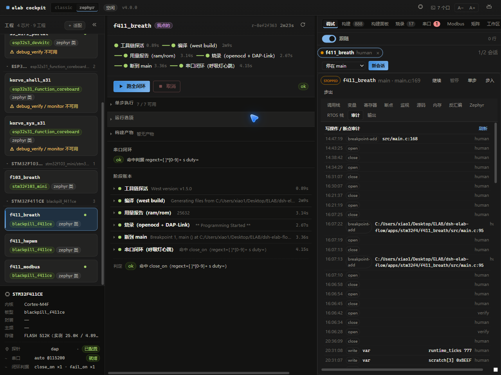

审计页本轮最上面三条就是这次会话的关键动作：

```text
14:47:19  breakpoint-add  src/main.c:168   human
14:43:25  open            f411_breath      human
14:38:42  close           f411_breath      human
```

每条记录的字段是固定的：**时间 · 动作 · 对象 · actor**。动作包括：

| 动作 | 触发点 |
|---|---|
| `open` / `close` | 建立/关闭会话（含 stop_at 与 resume 结果） |
| `breakpoint-add` / `breakpoint-remove` | 源码 gutter、断点页、agent 工具 |
| `write` | 内存、寄存器、变量（带地址与原值/新值） |

为什么值得单独一页：**agent 也能开调试会话、也能改内存**。当数值和你记忆里不一样时，
唯一能回答「谁改的、什么时候改的」的就是这份日志。落盘位置是仓库根的
`.work/debug-audit.jsonl`——**全局一份，不按工程分**，所以会看到别的工程的历史记录，
按时间排序往下翻即可。

「输出」页是会话事件流（停止原因、gdb 原文、断点命中），适合排查「为什么没停/为什么报错」；
它不是审计的替代品：输出可以很多、会滚动，审计只记**有副作用的动作**。

---

## 8. 边界与真坑

### 8.1 串口监视占着 COM10，会话建不起来

见 §2.3。顺序永远是「先关监视，再开调试」，不要反复点「开始调试」——内核不会抢串口。

### 8.2 跑完闭环后，monitor 仍然占着串口

本轮实测：`monitor` 命中 `close_on` 后**没有自动关会话**（`opened_by: auto`，方便你继续看串口）。
代价就是紧接着开调试会被顶掉。注意：本轮串口页签在 run 结束后仍显示 `打开监视`
（页面状态没同步服务端自动开的会话），所以**以调试会话的报错为准**；看到 `COM10` 被占就按
§2.3 关一次监视（必要时刷新页面让按钮变成 `关闭监视`），不要反复点「打开监视」。

### 8.3 构建目录来自旧路径时，`west build` 会拒绝

如果你在构建区看到红字：

```text
ERROR: Build directory "…\build\stm32f4\f411_breath\default" is for application
"…\apps\stm32f4\f411_breath", but source directory "…\applications\stm32f4\f411_breath" was specified
FATAL ERROR: refusing to proceed without --force due to above error
```

说明构建目录是仓库重构前（`apps/`）留下的，工程现在指到 `applications/`。两种处理：

**A. 挪走旧目录（推荐，保留现场），再回面板点「跑全闭环」**

```powershell
Move-Item build\stm32f4\f411_breath\default build\stm32f4\f411_breath\default.stale-20261119
```

**B. 不挪，让 west 用 `--pristine` 原地重建**——会清空该 build 目录里的旧缓存；
要留的东西先复制出去，再在面板里用同一套环境触发全量构建。

本轮用的是 A：挪走后「跑全闭环」重新全量构建（2m9s 编译 + 后续五步），2m23s 全绿。
这只影响「构建」页签的证据，不影响已生成 ELF 的调试；但红着的构建区会让人误判会话状态，
建议按 A 或 B 收干净。

### 8.4 为什么没有「外设」页签

外设页需要芯片包里的 SVD 描述。F411 的适配包本轮没有声明 SVD，所以页签不出现。
要加外设寄存器视图，先把 SVD 补进芯片包，再重开会话；不要指望调试区凭空长出来。

### 8.5 `继续` 看起来像固件崩了

如果 `CONFIG_DEBUG=n`，主循环在 WFI/STOP 时调试口读不到内核寄存器，表现为
`Polling failed / Failed to read memory at 0xe000ed04`、gdb `pc=0`。这不是崩溃，
是低功耗门控。完整复盘见 [10 · Zephyr 模式上手 §5.1](./10-Zephyr模式上手.md)；
`f411_breath` 已经带 `CONFIG_DEBUG=y`。

---

## 9. 命令、文件与一页速查

### 9.1 命令行等价

```powershell
# 无人值守：断到 main、打印证据、退出（CI 用这个）
kharon debug -p f411_breath --verify

# 交互式：起 openocd + gdb，自己在终端里敲 gdb 命令
kharon debug -p f411_breath --run

# 只跑闭环里的调试校验一步
kharon run -p f411_breath --steps debug_verify -v
```

界面里的「开始调试」= `--verify` 的常驻版：同样复位、加载、断到 main，只是把会话留给你操作。

### 9.2 关键文件

| 路径 | 内容 |
|---|---|
| `build/stm32f4/f411_breath/default/zephyr/zephyr.elf` | 调试用的 ELF（符号 + 代码） |
| `build/stm32f4/f411_breath/default/zephyr/.config` | Kconfig 事实；页签徽章从这儿来 |
| `projects/f411_breath.debug.json` | 工程级断点/监视（`rev` 乐观锁；关会话不清） |
| `.work/debug-audit.jsonl` | 审计日志（全局，追加写） |
| `applications/stm32f4/f411_breath/prj.conf` | 四个开关要改这里 |

### 9.3 「我想… → 点哪里」

| 我想 | 点哪里 |
|---|---|
| 现在谁在跑 | 调试 → **Zephyr** → 当前线程 |
| 有没有阻塞线程 | 同上 → 线程表；若标题是「就绪队列」，先开 `THREAD_MONITOR` |
| 某个线程栈用了多少 | **RTOS 栈**；显示 `—` 就先开 `INIT_STACKS` |
| 在某个函数停一下 | **断点** 页输入函数名；或源码 gutter 点行号 |
| 看某个全局/内核字段 | **监视** 输入表达式，回车添加 |
| 谁改了我的内存 | **审计** 页，按时间倒序 |
| 会话建不起来 | 串口页签 → **关闭监视** → 回调试 |
| 线程名全是 `(unnamed)` | `prj.conf` 加 `CONFIG_THREAD_NAME=y` 后重编 |

---

## 10. 小结

调试区的价值不在「能下断点」——那是 gdb 的功劳；而在**把停住那一刻的内核状态翻译成能读的字段**：

- 通用八页回答「代码走到哪、寄存器是什么」；
- Zephyr 两页回答「内核现在谁在跑、栈还剩多少、对象有几个」；
- 审计一页回答「这些值是谁改的」。

三件事都建立在同一个前提上：**目标必须停住**。所以先解决独占（关串口监视），再谈读数；
先看清 Kconfig 边界（四项开关），再判断「看不到」是配置问题还是 bug。

---

> 上一篇：[13 · Zephyr OTA 局域网升级](./13-Zephyr_OTA局域网升级.md)
> 回到主线：[10 · Zephyr 模式上手](./10-Zephyr模式上手.md)｜工作区：[12 · 三种 Zephyr 应用形态](./12-Zephyr工作区三形态.md)
