# 16 · F411 新建工程 → DAC-ADC 回环 → 串口波形（实机全流程）

> **现行口径（2026-11-20）**：本篇是一篇**从零跟做**的记录，不是原理综述。
> 起点是 B 站视频 [BV1uMkWBWEjN](https://www.bilibili.com/video/BV1uMkWBWEjN)
> 在瑞萨 RA6E2 上做的 DAC→ADC 回环；终点是在 **STM32F411CE（WeAct Black Pill）**
> 上，用 Kharon 架构页的「新建工程」向导真正建出一个产品，编译、烧录、串口看到
> 0/1/2/3 V 四档波形，四档全部 PASS。
>
> 本篇所有截图都来自本机 `http://127.0.0.1:8398/` 实机页面；所有串口数字都来自
> `.work/f411-dac-adc-serial.txt` 的真实抓取，不是示意值。
>
> 关键差异先写在最前面：**STM32F411 没有 DAC**。所以“DAC→ADC”在这里是
> **TIM4_CH1(PB6) 的 20 kHz 硬件 PWM 当等效 DAC，ADC1_IN1(PA1) 采回来**。

---

## 0. 一句话版本

**一根杜邦线把 PB6 和 PA1 直连，固件用 20 kHz PWM 的占空比表示 0/1/2/3 V，
ADC 采回方波后按“高电平样本占比 × Vref”还原电压；不接 RC 也能测，接了
1 kΩ + 10 µF 就退化成普通直流回环。**

| 问题 | 答案 |
|---|---|
| 接哪根线 | **PB6 ↔ PA1 直连**（一根杜邦线，母对母） |
| 要不要电阻/电容 | 不接也能跑；想复刻视频的“稳定直流”再接 1 kΩ + 10 µF |
| 串口在哪 | USART1 PA9/PA10 → DAP-Link CDC → **COM10**，115200 8N1 |
| 探针 | DAP-Link（CMSIS-DAP），产品里 `debug.probe: dap` |
| 判据 | 每 2 s 切一档，1 s 统计一次；`abs(err) <= 50 mV` 即 PASS |
| 实测误差 | 0–16 mV（四档全部 PASS） |

---

## 1. 视频里的实验 vs 这块板的事实

视频在 FPB-RA6E2 上做的是：

```text
DAC P014 ── 100~1000 Ω ── ADC P30
程序输出 0/1/2/3 V
等稳定 → 采样 → 打印“设定 / 实测 / 误差”
误差 1~5 mV
```

换到 F411 必须先查两件事，不能照抄设备树：

| 事实 | 证据 | 结论 |
|---|---|---|
| F411 没有 DAC | ST 数据手册只列 1×12-bit ADC；Zephyr `stm32f411.dtsi` 无 `dac1` 节点 | 不能 `DT_NODELABEL(dac1)` |
| 板上有 TIM4_CH1 | `blackpill_f411ce.dts` 的 `&timers4` 下 `pwm4: channel@1 { pin = <PB6>; }` | 用 PWM 当等效 DAC |
| 板上有 ADC1_IN1 | 同一份 DTS 的 `&adc1`，`pinctrl-0 = <&adc1_in1_pa1>` | PA1 直接可采 |

所以本实验的“硬件替换”只发生在一处：

```text
视频：  DAC 输出模拟电压  →  ADC
本板：  PWM 输出方波      →  ADC（统计占空比还原电压）
        PB6                 PA1
```

软件目标完全不变：**设定 0/1/2/3 V → 等稳定 → 采样 → 打印设定/实测/误差**。

---

## 2. 接线：只接一根线

### 2.1 直连（本轮实际采用）

```text
Black Pill
  PB6  ──────────────  PA1
  (TIM4_CH1)           (ADC1_IN1)
```

- 一根母对母杜邦线即可；
- **不要**把 PB6 或 PA1 接到 3.3V / 5V / GND；
- 板子由 DAP-Link 的 USB 供电，串口也走同一根 USB（CDC）；
- 按板上丝印找 `PB6` 和 `PA1`，不要按排针序号猜。

### 2.2 可选 RC（复刻视频的“稳定直流”）

手头有元件时，把直连改成低通：

```text
PB6 ── 1 kΩ ──┬── PA1
              │
             10 µF
              │
             GND
```

为什么不是 100 nF：20 kHz 方波经 1 kΩ + 100 nF，纹波约 0.8 V，ADC 读出来仍在跳；
1 kΩ + 10 µF 把纹波压到约 10 mV，才是真正的直流。

固件对两种接法**自动识别**，不需要改代码、不需要改产品：

| 接法 | ADC 看到 | 固件算法 | `src` |
|---|---|---|---|
| 直连 | 0 / Vref 两档方波，`span` 接近 4095 mV | 高电平样本数 ÷ 总样本数 × Vref | `direct` |
| 1 kΩ + 10 µF | 稳定直流，`span` 只有几十 mV | 样本均值 × Vref / 满量程 | `rc` |

判定阈值写在 `acc_result_mv()`：`span > ADC_FULL_SCALE / 8` 走 direct，否则走 rc。

---

## 3. 用「新建工程」向导建产品（实机截图）

### 3.1 打开架构页

```powershell
cd C:\Users\xiao1\Desktop\ELAB\kharon\kharon-ide
$env:ELAB_HOST = "kharon"
$env:PYTHONPATH = ".;services"
.\.deps\venv\Scripts\python.exe -m cockpit.server --port 8398
```

浏览器打开 `http://127.0.0.1:8398/`，顶栏点「架构」。页面会显示当前工作区的
板级真相、APP 和产品 target 三列：

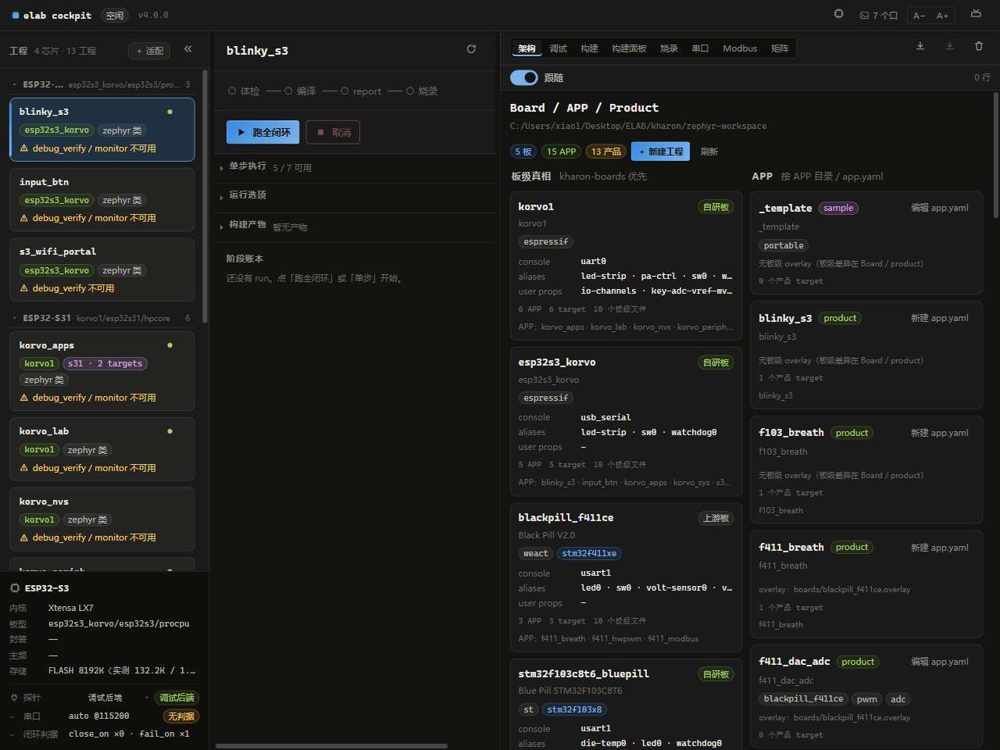

顶部计数是事实源：`5 板` 来自 `kharon-boards` + 上游板，`15 APP` 来自
`applications/**/app.yaml`，`13 产品` 是创建前的产品数。创建完会变成 14。

### 3.2 点「＋ 新建工程」

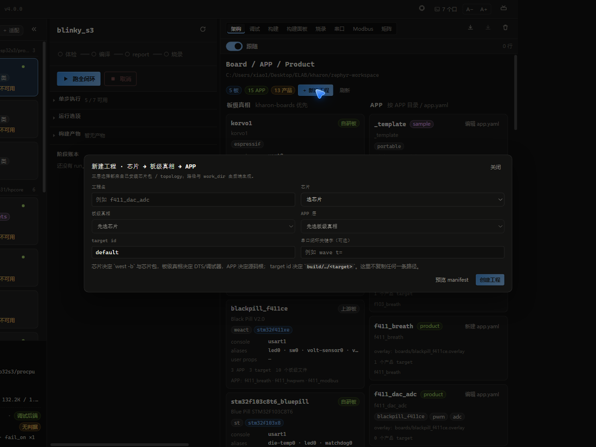

向导刻意**不从当前工程复制**芯片和 APP：打开时所有下拉都是空的。芯片没选时，
“板级真相”和“APP 层”是 disabled 的，提示“先选芯片 / 先选板级真相”；这样不会
出现“ESP32 的 APP 配到 STM32 板上”的错配。

### 3.3 选芯片 → 选板级真相

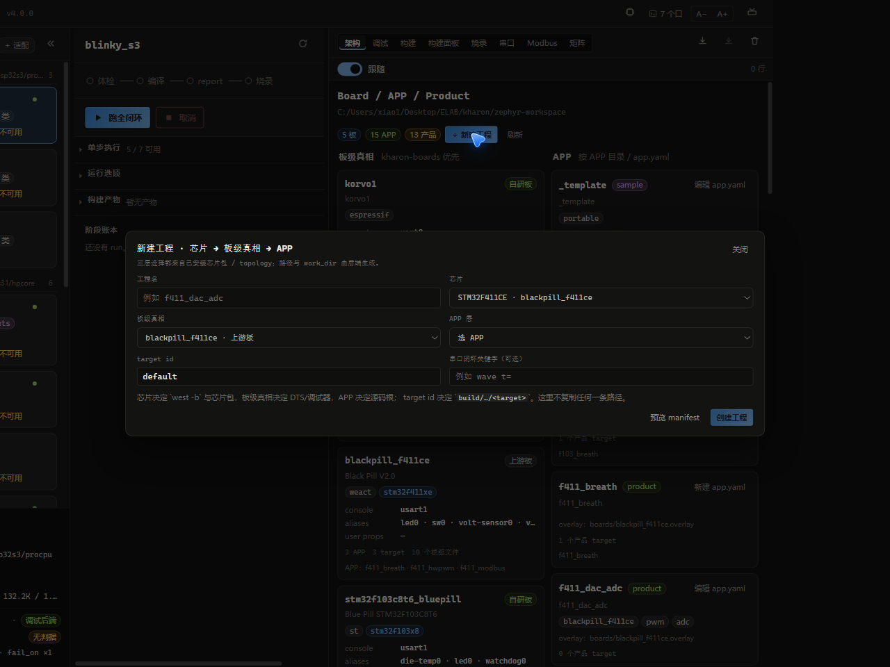

- 芯片下拉的选项来自已安装芯片包（`packs/**/chips/*.yaml`），不是手写列表；
- 选中 `blackpill_f411ce` 后，板级真相下拉只保留这个芯片对应的板；
- 板下拉里会显示 `board.yml` 的 target，例如 `blackpill_f411ce/stm32f411xe`。

向导里的“芯片”与“板级真相”是两张表：芯片回答“内核/内存/part number”，
板级真相回答“这块 PCB 上 console 是哪个 UART、LED 在哪个脚”。两者不能互相代替。

### 3.4 选 APP 层 → 填 target / 串口闭环关键字

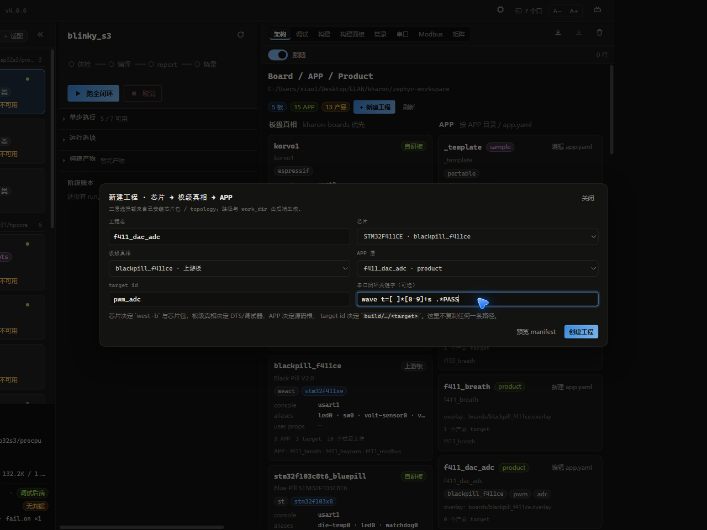

这一步的字段：

| 字段 | 本例填什么 | 说明 |
|---|---|---|
| APP 层 | `f411_dac_adc` | 只列出 `board_scope` 匹配的 APP；`portable` 的 APP 也会保留 |
| target id | `pwm_adc` | 产品里的 target 名，构建目录会带上它 |
| 串口闭环关键字 | `wave t=[ ]*[0-9]+s .*PASS` | 变成 `monitor.close_on` 正则；命中就结束监视 |

APP 选中后，向导会自动带出这个 APP 已有产品里的 target 名，减少手填。四项
（工程名 / 芯片 / 板级真相 / APP）齐全之前，「创建」按钮是灰的。

### 3.5 预览 manifest

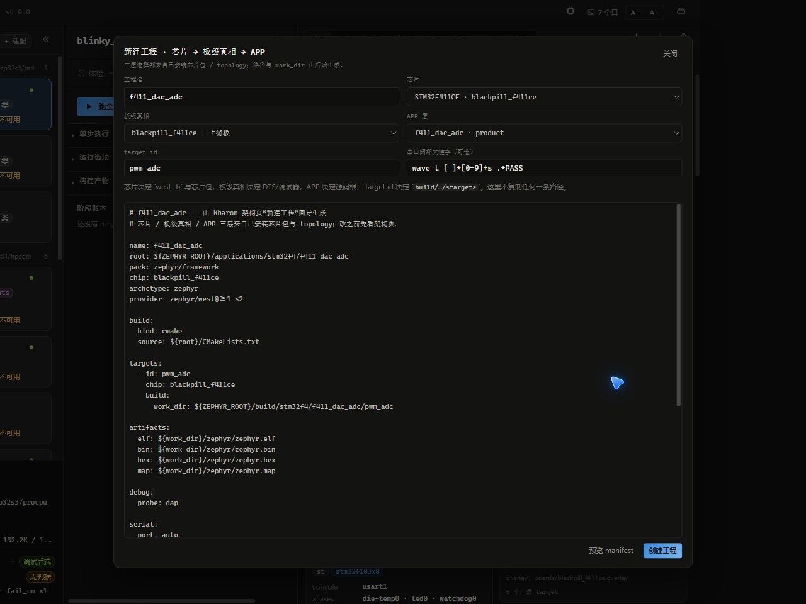

「预览」只渲染、不落盘。预览区是滚动容器，弹窗本身不滚动，所以 40 多行
YAML 也不会把「创建」按钮顶出屏幕（这是本轮修掉的第一个 UI 缺陷，见 §9）。

### 3.6 创建

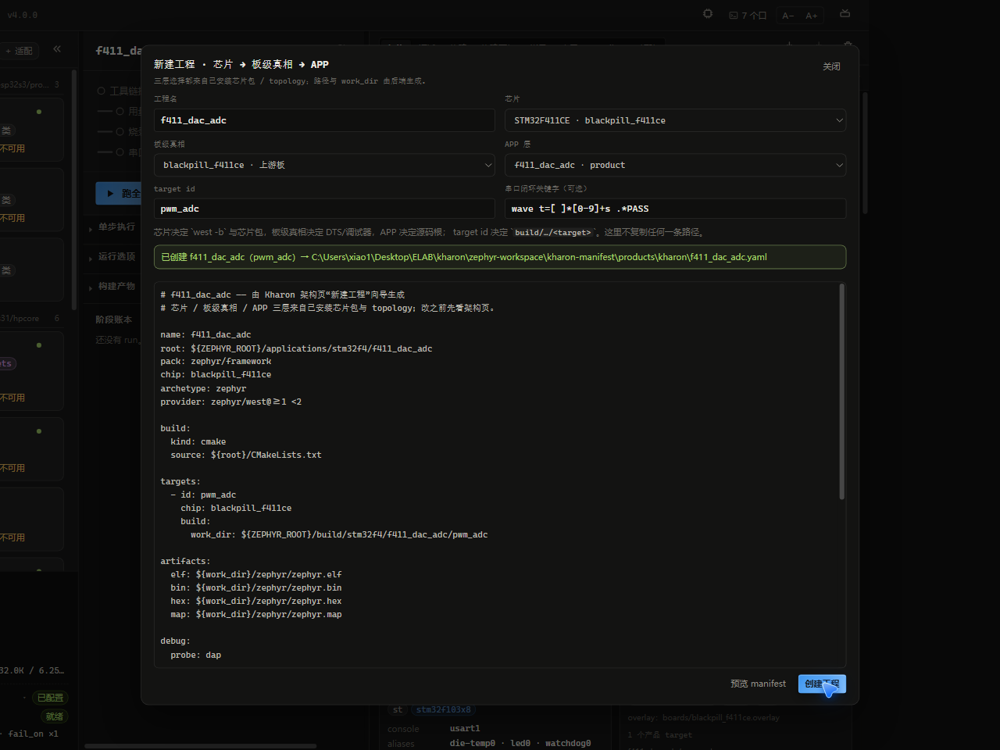

点「创建」后后端做四件事：

1. 校验同名产品不存在；
2. 用临时文件 + `os.replace` 原子写入
   `zephyr-workspace/kharon-manifest/products/kharon/f411_dac_adc.yaml`；
3. `cfg.reload_projects()` 重新加载工程；
4. 前端 `loadAll()` 后自动 `selectProject("f411_dac_adc", "pwm_adc")`。

创建后左栏立刻出现新工程卡，并成为当前工程：

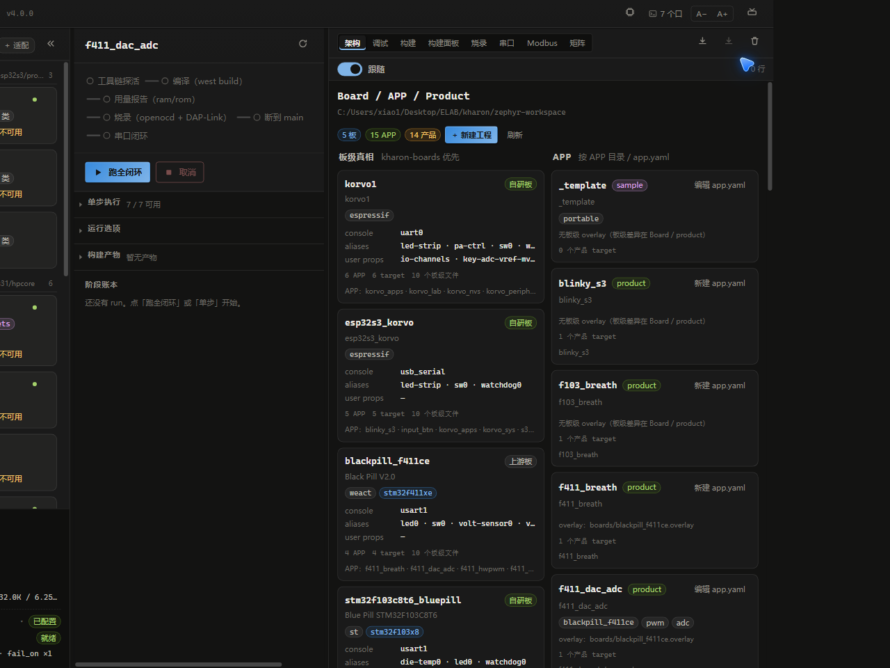

### 3.7 七步闭环

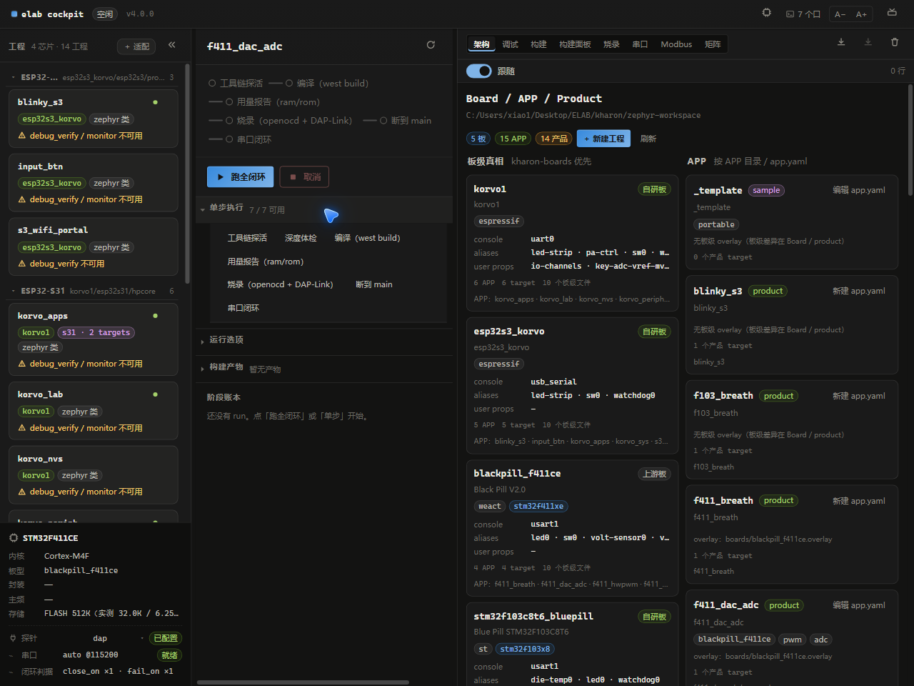

产品生成后不需要再手写命令：阶段轨直接按 target 解析 provider 的七个步骤。
这也是“产品 manifest 是唯一事实源”的直接体现。

---

## 4. 向导到底写了什么

### 4.1 产品 manifest

`zephyr-workspace/kharon-manifest/products/kharon/f411_dac_adc.yaml`：

```yaml
name: f411_dac_adc
root: ${ZEPHYR_ROOT}/applications/stm32f4/f411_dac_adc
pack: zephyr/framework
chip: blackpill_f411ce
archetype: zephyr
provider: zephyr/west@>=1 <2

targets:
  - id: pwm_adc
    chip: blackpill_f411ce
    build:
      work_dir: ${ZEPHYR_ROOT}/build/stm32f4/f411_dac_adc/pwm_adc

debug:
  probe: dap

serial:
  port: auto
  baud: 115200

monitor:
  close_on:
    - { kind: regex, pattern: "wave t=[ ]*[0-9]+s .*PASS" }
```

三个容易踩的点：

1. `work_dir` 必须写在 `targets[].build.work_dir`，不能写在产品顶层再用
   `${target}` 插值——旧写法会把目录变成字面量 `${target}`。
2. `monitor.close_on` 命中**第一行 PASS** 就关闭串口；想看完整四档波形，
   用串口页的「打开监视」手动看，不要用闭环的 monitor。
3. `port: auto` 会选当前唯一一个 USB 串口；本机是 `COM10`。多串口环境请显式写
   `port: COM10`。

### 4.2 APP 契约

`applications/stm32f4/f411_dac_adc/app.yaml`：

```yaml
name: f411_dac_adc
kind: product
board_scope: blackpill_f411ce
requires:
  - pwm
  - adc
optional:
  - gpio
```

`board_scope` 决定架构页的 APP 下拉会不会出现它；`requires` 是能力声明，不是
引脚声明。

### 4.3 板级 overlay：只开外设，不抢引脚

`applications/stm32f4/f411_dac_adc/boards/blackpill_f411ce.overlay`：

```dts
&pwm4 {
	status = "okay";
};

&adc1 {
	status = "okay";
};
```

引脚 `PB6` / `PA1` 来自上游板级 DTS，APP 不重写。这样换 APP 不改板子，
换板子不改 APP——与 [15 · 双根与 Board / APP / Product](15-Zephyr工作区双根与板级APP产品.md)
的分层规则一致。

---

## 5. 固件关键：PWM 当 DAC，ADC 统计算占空比

完整源码在 `applications/stm32f4/f411_dac_adc/src/main.c`。这里只挑四个关键点。

### 5.1 20 kHz PWM 的周期

```c
#define PWM_CHANNEL 1
#define PWM_FREQ_HZ 20000U
#define PWM_PERIOD_NS (1000000000U / PWM_FREQ_HZ)   /* 50000 ns */
```

`pwm_set()` 的第三个参数是周期 ns，第四个参数是高电平 ns：

```c
static int pwm_set_mv(uint16_t mv)
{
	uint64_t pulse_ns;

	if (mv >= vref_mv) {
		pulse_ns = PWM_PERIOD_NS;
	} else {
		pulse_ns = (uint64_t)mv * PWM_PERIOD_NS / vref_mv;
	}
	return pwm_set(pwm, PWM_CHANNEL, PWM_PERIOD_NS, pulse_ns,
		       PWM_POLARITY_NORMAL);
}
```

1 V 对应 50000 × 1000 / 3300 ≈ 15152 ns 高电平；3 V 对应 45455 ns。

### 5.2 采样间隔必须是 513 µs，不是 510 µs

```c
#define ADC_SAMPLE_INTERVAL_US 513U
```

PWM 周期 50 µs。510 µs 正好是 10.2 个周期，5 个采样点就回到同一相位，
30.3% 的占空比会被读成 40%；513 µs = 10.26 个周期，相位每次前进 13/50 个周期，
50 个点遍历全部相位，统计才无偏。这是本实验最容易忽略的一个数。

### 5.3 直连与 RC 的自动判别

```c
span = (uint16_t)(acc_max - acc_min);
if (span > (ADC_FULL_SCALE / 8U)) {
	*mode = "direct";
	return (uint16_t)(((uint64_t)acc_high * vref_mv) / acc_n);
}
*mode = "rc";
return (uint16_t)(((uint64_t)acc_sum * vref_mv)
		  / ((uint64_t)acc_n * ADC_FULL_SCALE));
```

直连时分子是“高电平样本数”，分母**只除样本数**，不能再除 4095；否则读数
永远是 0（本轮真踩过这个坑）。

### 5.4 串口一行数值 + 一行波形

```c
printk("wave t=%3llds set=%4umV adc=%4umV err=%4dmV span=%4umV hi=%lu/%lu src=%s %s\n",
       k_uptime_get() / 1000, setpoints_mv[step], mv, err,
       span_mv, (unsigned long)acc_high, (unsigned long)acc_n,
       mode, aerr <= 50 ? "PASS" : "FAIL");
wave_push(mv);
wave_print(mv);
```

`hi=583/1872` 就是“1 s 内 1872 个样本里有 583 个高电平”，583/1872 ≈ 31.1%，
乘 3300 mV 就是 1027 mV，正好落在 1 V 档。

---

## 6. 编译：第一次 4m43s，之后 2.5 s

先看一次完整闭环的总账：七步全绿，总耗时 19.69 s，其中编译 2.53 s、烧录
3.38 s、断到 main 4.39 s、串口闭环 2.56 s。

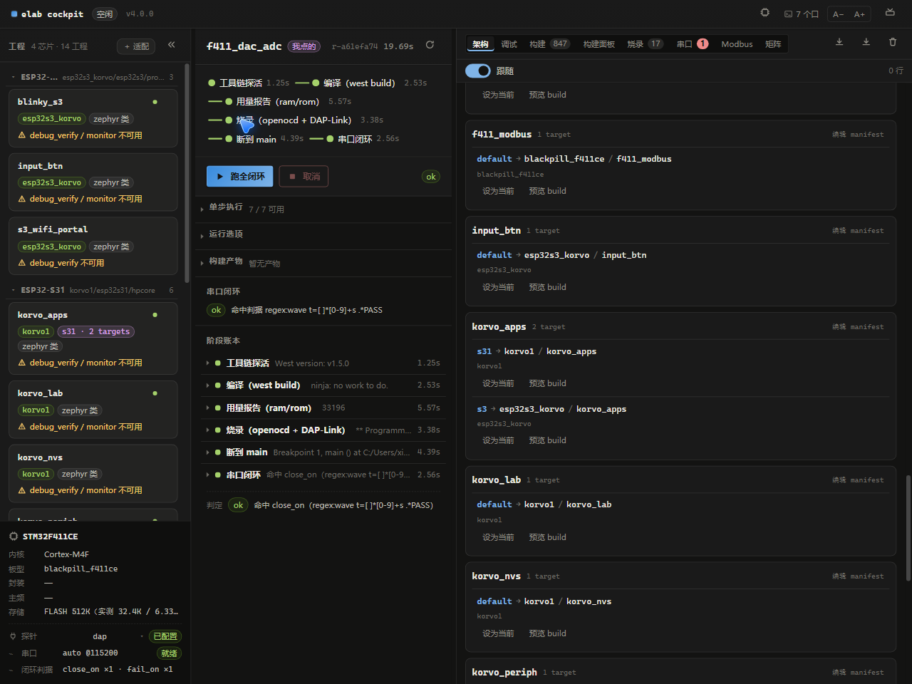

### 6.1 界面里编译

在阶段轨点「跑全闭环」，或展开「单步执行」只跑 `build`。构建页会实时显示
west 的输出、告警计数和最终 `exit=0`：

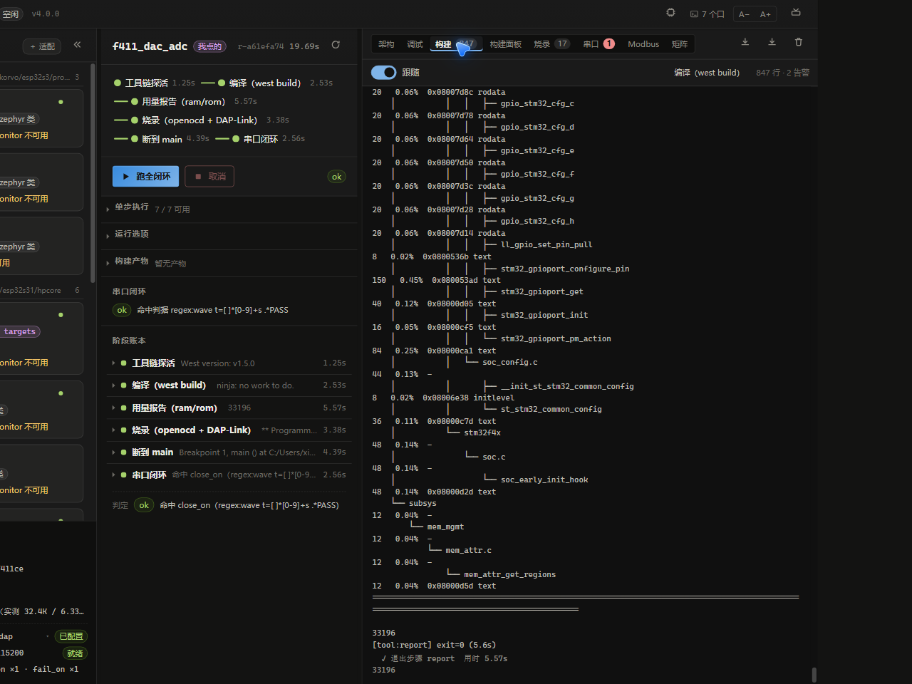

首次构建要跑 CMake configure + 全量编译，本机实测 **4m43s**，其中 configure
约 175 s。之后命中缓存，构建只有 2.5 s（无改动）到 9–14 s（改一个 C 文件）。

### 6.2 命令行等价

```powershell
cd C:\Users\xiao1\Desktop\ELAB\kharon\kharon-ide
$env:ELAB_HOST = "kharon"
.\kharon.cmd build -p f411_dac_adc --target pwm_adc -j 8 -v
```

本轮修掉“每次 build 都重跑 configure”的问题后，日志里的命令会从固定带
`-b <board> <app> -d <dir>` 变成：

```text
[tool:build] build · 增量
$ ...python.exe -m west build -d ...\build\stm32f4\f411_dac_adc\pwm_adc --build-opt=-j8
```

判定条件很简单：`<work_dir>/CMakeCache.txt` 存在就复用，不再传 `-b`、应用位置
参数和 `-D...`。如果删掉构建目录，下一次会自动回到全量 configure。

内存占位：

```text
FLASH: 33204 B / 512 KB (6.33%)
RAM:    5952 B / 128 KB (4.54%)
```

---

## 7. 烧录：DAP-Link + OpenOCD

阶段轨点「烧录」，或跑全闭环。烧录页会同时显示 OpenOCD 日志和“断到 main”的
验证结果：

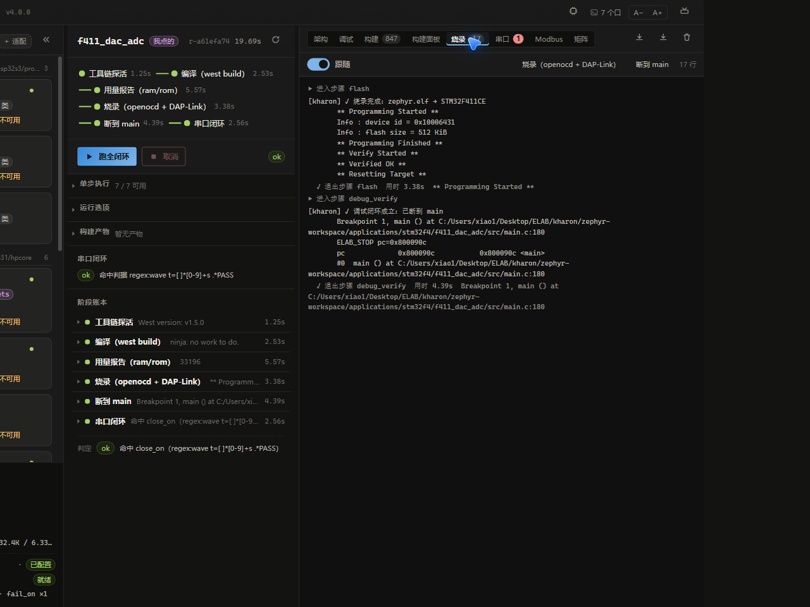

关键四行：

```text
Info : device id = 0x10006431
Info : flash size = 512 KiB
** Programming Finished **
** Verified OK **
** Resetting Target **
```

`device id = 0x10006431` 是 F411CE 的识别值；`flash size = 512 KiB` 与芯片包
`blackpill_f411ce.yaml` 的 `part: STM32F411CE` 对得上。烧录后产品还会做一次
`debug_verify`：OpenOCD 断到 `main()`，证明 ELF 与源码行号能对上。

---

## 8. 串口：四档电压与 ASCII 波形

### 8.1 闭环模式（只看第一行 PASS）

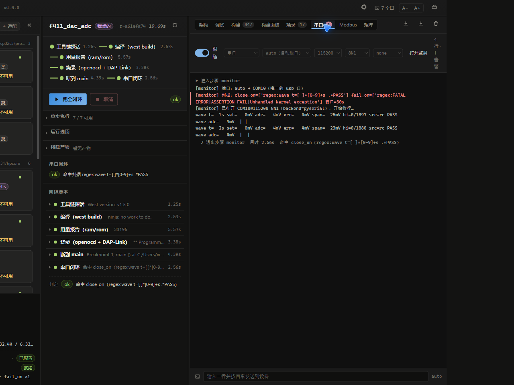

串口面板会打印本次判据、端口、后端和结束原因：

```text
[monitor] 端口：auto → COM10（唯一的 usb 口）
[monitor] 判据：close_on=['regex:wave t=[ ]*[0-9]+s .*PASS'] ...
[monitor] 已打开 COM10@115200 8N1（backend=ctypes），开始收行…
wave t=  1s set=   0mV adc=   4mV err=   4mV span=  25mV hi=0/1897 src=rc PASS
wave adc=   4mV  | |
wave t=  2s set=   0mV adc=   4mV err=   4mV span=  23mV hi=0/1880 src=rc PASS
✓ 串口闭环：OK（命中 close_on）
```

注意 `set=0mV` 时 `src=rc`：PWM 占空比为 0，没有开关动作，ADC 看到的是稳定 0 V，
`span` 只有二十几 mV，所以走均值分支。这是正常现象，不是识别失败。

### 8.2 手动监视：看完整四档

想看 0→1→2→3 V 的完整循环，在串口页点「打开监视」，让它跑 8 s 以上：

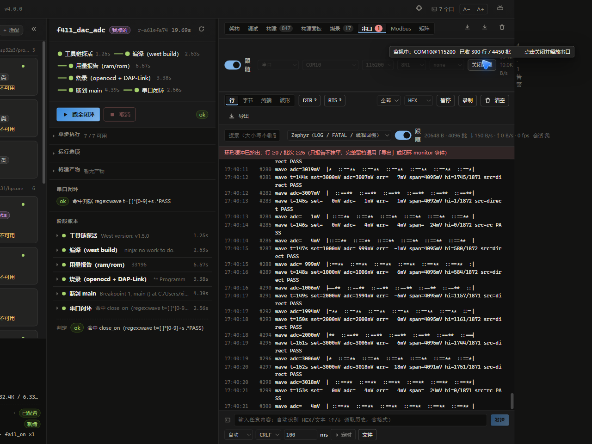

截取其中一段：

```text
wave t=147s set=1000mV adc= 999mV err=  -1mV span=4095mV hi=580/1872 src=direct PASS
wave adc= 999mV  |===**  ::==**  ::==**  ::==**  ::==**  ::==**  ::|
wave t=148s set=1000mV adc=1006mV err=   6mV span=4095mV hi=584/1872 src=direct PASS
wave adc=1006mV  |==**  ::==**  ::==**  ::==**  ::==**  ::==**  ::|
wave t=149s set=2000mV adc=1994mV err=  -6mV span=4095mV hi=1157/1871 src=direct PASS
wave adc=1994mV  |**  ::==**  ::==**  ::==**  ::==**  ::==**  ::==|
wave t=150s set=2000mV adc=2000mV err=   0mV span=4095mV hi=1161/1872 src=direct PASS
wave adc=2000mV  |*  ::==**  ::==**  ::==**  ::==**  ::==**  ::==*|
wave t=151s set=3000mV adc=3006mV err=   6mV span=4095mV hi=1744/1871 src=direct PASS
wave adc=3006mV  |  ::==**  ::==**  ::==**  ::==**  ::==**  ::==*|
```

48 个字符就是 48 个 1 s 窗口的电压历史，8 级字符 `" .:-=+*#"` 对应 0–3.3 V。
因为每 2 s 切一档，波形呈阶梯状：0 V 是空格，1 V 约 `:`，2 V 约 `+`，3 V 约 `#`。

### 8.3 实测数据

从 16 s 连续抓取里取四档代表值：

| 设定 | 实测范围 | 误差范围 | `hi` / 样本 | `src` | 判定 |
|---|---|---|---|---|---|
| 0 mV | 1–4 mV | +1–4 mV | 0–1 / ≈1872 | `rc`（0 占空比无开关） | PASS |
| 1000 mV | 1000–1008 mV | 0–+8 mV | 583–588 / 1872 | `direct` | PASS |
| 2000 mV | 1998–2001 mV | −2–+1 mV | 1164–1165 / 1872 | `direct` | PASS |
| 3000 mV | 3008–3016 mV | +8–+16 mV | 1753–1757 / 1872 | `direct` | PASS |

`583/1872 = 31.14% → 1028 mV`，`1164/1872 = 62.18% → 2052 mV`（Vref 实测 3300 mV），
与设定值的偏差主要来自 3.3 V 实际不是精确 3300 mV、以及 PWM 边沿的采样相位。

---

## 9. 本轮修掉的四个 IDE 缺陷

教程不是“只记录成功”，这些是实机操作时真踩到的：

| # | 现象 | 根因 | 修复 |
|---|---|---|---|
| 1 | manifest 预览 40+ 行把「创建」按钮顶出屏幕 | `.modal` 整体滚动，按钮跟着走 | `.modal` 加 `overflow:hidden`；只让 `.command` 预览区 `flex:1; min-height:0; overflow:auto`；`.modalActions` 固定 |
| 2 | 工程运行中，左栏工程名/按钮被横向裁掉 | run 时“取消/耗时/running”撑宽列，`overflow:auto` 触发横向滚动 | `StageRail.module.css` 改 `overflow-y:auto; overflow-x:hidden`；`.head/.bar` 加 `flex-wrap` 与 `min-width:0` |
| 3 | 每次 build 都重跑 CMake configure，首次 4m43s | provider 的 build 命令固定带 `-b <board> <app> -d <dir>` | `provider.py` 加 `_reuse_west_build()`：检测 `CMakeCache.txt` 后裁成 `west build -d <dir> --build-opt=-jN` |
| 4 | 1280 宽窗口下产品 target 的「设为当前 / 预览 build」被挤出卡片，只能看到一行 target 文本 | `.targetRow` 是 `1fr auto` 两列，第三列宽度不够，按钮被裁 | 改成单列，`.targetActions` 换行到 target 文本下方；1280 宽也能点到 |

第 4 条直接导致“明明创建了产品，却在架构页点不到设为当前”。修完后同一个
1280×960 窗口里，target 行是：

```text
pwm_adc → blackpill_f411ce / f411_dac_adc
blackpill_f411ce
[设为当前] [预览 build]
```

---

## 10. 排错表

| 现象 | 先查什么 | 处理 |
|---|---|---|
| `device not ready: pwm=0 adc=0` | overlay 是否 `status="okay"`；板级 DTS 是否有 `pwm4`/`adc1` | 打开 `boards/blackpill_f411ce.overlay`；查上游 DTS |
| 串口只有启动头，没有 `wave` | `prj.conf` 是否 `CONFIG_ADC=y` / `CONFIG_PWM=y` | 补配置后重新 build |
| `adc=0mV` 恒定 | 直连公式是否把 `high*vref/n` 又除了一次 4095 | 改成 `high*vref/n` |
| 1 V 读成 1.3 V、2 V 读成 2.6 V | 采样间隔是否 510 µs（相位锁死） | 改 513 µs |
| 3 V 读成 3.3 V | `vref_mv` 是否取到 3300 但实际 VDDA 偏高 | 正常误差，±50 mV 判据内 |
| `src=rc` 但接的是直连 | PWM 是否为 0 占空比 | 0 V 档正常；1/2/3 V 档应为 `direct` |
| 烧录报 `device id` 不对 | 探针选错 / 板子没供电 | 确认 DAP-Link、`debug.probe: dap` |
| 闭环 monitor 2 s 就结束 | `close_on` 命中第一行 PASS | 想看完整波形改用手动「打开监视」 |

---

## 11. 命令速查

```powershell
# 1. 起驾驶舱
cd C:\Users\xiao1\Desktop\ELAB\kharon\kharon-ide
$env:ELAB_HOST = "kharon"
$env:PYTHONPATH = ".;services"
.\.deps\venv\Scripts\python.exe -m cockpit.server --port 8398

# 2. 命令行编译（与 UI 同一条 provider 链）
.\kharon.cmd build -p f411_dac_adc --target pwm_adc -j 8 -v

# 3. 烧录
.\kharon.cmd flash -p f411_dac_adc --target pwm_adc

# 4. 只抓串口，不触发 close_on
.\.deps\venv\Scripts\python.exe .work\serial_capture.py COM10 16

# 5. 查构建目录缓存是否存在（决定是否增量）
Test-Path C:\Users\xiao1\Desktop\ELAB\kharon\zephyr-workspace\build\stm32f4\f411_dac_adc\pwm_adc\CMakeCache.txt
```

---

## 12. 验收清单

- [x] 架构页「新建工程」能选芯片、板级真相、APP、target、串口关键字；
- [x] 创建后产品 yaml 落在 `kharon-manifest/products/kharon/f411_dac_adc.yaml`；
- [x] 产品自动成为当前工程，阶段轨 7/7 步可用；
- [x] 编译成功，FLASH 33204 B / 6.33%，RAM 5952 B / 4.54%；
- [x] 烧录 `Verified OK`，`debug_verify` 断到 `main()`；
- [x] 串口四档 0/1000/2000/3000 mV 全部 PASS，误差 ≤16 mV；
- [x] 直连（无 RC）与 1 kΩ+10 µF 两种接法共用同一份固件，`src=direct/rc` 自动切换；
- [x] 1280 宽窗口下 target 的「设为当前」可见可点。

下一步可以做的两件事：把 `fail_on` 补上 `device not ready` / `adc_read failed`；
或者给同一份 APP 加第二块板（例如 F103 Blue Pill），只加 target、不改源码。
