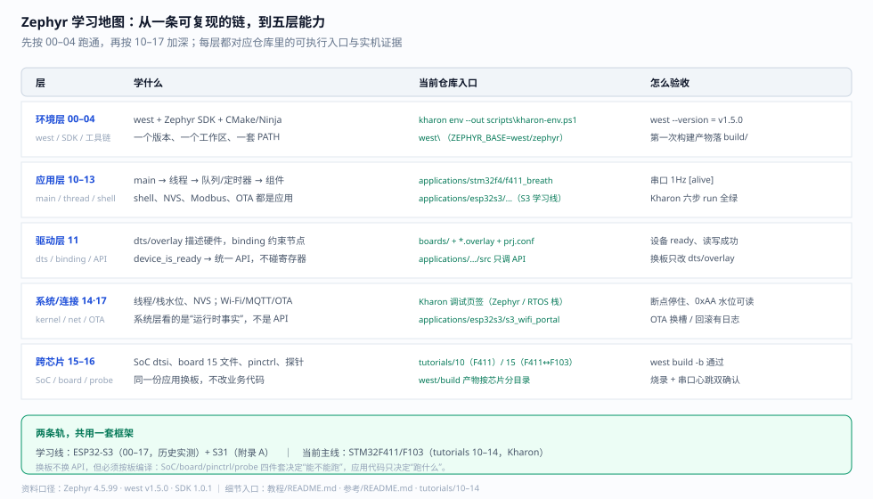

# Zephyr 学习笔记 · 总索引

> **状态（2026-11-19）**：这套笔记原本是 ESP32-S3 / ESP32-S31-Korvo-1 的独立学习线，
> 文中保留当时的实测数字与踩坑过程作为证据；**当前仓库的主线已经切到 Kharon
> （Zephyr 单链 + STM32F411/F103）**，操作教程以 [`docs/tutorials/10–14`](../tutorials/10-Zephyr模式上手.md) 为准。
>
> **路径已校准**：源码在 `applications/<family>/<app>/`，west 工作区在仓库根 `west/`，
> `ZEPHYR_BASE=west/zephyr`；旧文中的 `apps/`、`zephyr_k` 是历史叫法，
> 只在 `变更记录/` 里按原文保留。
>
> **旧布局 → 现布局**：`apps/` → `applications/`；`env.ps1` → `kharon env --out scripts\kharon-env.ps1`；
> `boards/riscv/korvo1/` → `zephyr_modules/elab-boards/boards/espressif/`；
> `tools/read_serial.py` 不再随仓分发，串口证据统一走 `kharon monitor`。
> 早期章节若仍出现这些旧路径，按本表替换即可；命令根目录统一为 `kharon-ide`。
>
> **配图口径**：概念/结构图统一手绘 SVG（980 宽、`#fbfcfe` 底、蓝/绿框）；
> 面板与实机操作图用 CDP 抓真实浏览器，不用渲染图；历史实拍只在原章节保留。

一句话：**先看这一页，再决定翻哪一层。** 四层按“文档性质”分开，不按主题混放：
`教程/` 按顺序读 · `课程同款/` 做对照 · `参考/` 按需查 · `变更记录/` 留证据。



## 四层各是什么

| 层 | 给谁 | 内容 | 入口 |
|---|---|---|---|
| **教程/** | 想从零走一遍 Zephyr 的人 | 学习主线：00–06 环境与上手 + 10–17 能力组 + 附录 A | [`教程/README.md`](教程/README.md) |
| **课程同款/** | 跟着课程学、要对照差异的人 | 课程还原线，**00–09 连续编号** | [`课程同款/README.md`](课程同款/README.md) |
| **参考/** | 已经上手、要查具体事实的人 | 环境、管脚、IDF→Zephyr 对照、平台坑、编译速度、工程结构、构建产物、依赖树 | [`参考/README.md`](参考/README.md) |
| **变更记录/** | 想知道“当初为什么这么改”、要回滚的人 | 带日期的决策与重构记录（历史原文，路径不追改） | [`变更记录/`](变更记录) |

一句话区分：**教程教你做，参考让你查，课程同款帮你对，变更记录解释为什么。**

## 三条阅读路线

### A. 在当前仓库里上手（推荐）

1. **F411 最小闭环**：[`tutorials/10-Zephyr模式上手`](../tutorials/10-Zephyr模式上手.md) —— 同一块 F411、六步闭环（比 classic 多一步“用量报告”）。
2. **工作区形态**：[`tutorials/12-Zephyr工作区三形态`](../tutorials/12-Zephyr工作区三形态.md) —— standalone / 工作区应用 / 仓库应用怎么接。
3. **调试区**：[`tutorials/14-Zephyr调试区操作`](../tutorials/14-Zephyr调试区操作.md) —— 12 个页签、内核态读数、`0xAA` 水位、断点与审计。
4. **协议与 OTA**：[`tutorials/11-Zephyr_Modbus从站`](../tutorials/11-Zephyr_Modbus从站.md)、[`tutorials/13-Zephyr_OTA局域网升级`](../tutorials/13-Zephyr_OTA局域网升级.md)。
5. classic（CubeMX/FreeRTOS）路径不在本仓：旧仓 `dsh-elab-flow` 的 `docs/tutorials/01`、
   `04` 只作历史参考；本仓以 Zephyr 单链为准。

### B. 从零学 Zephyr

`教程/README.md` 的“建议的阅读顺序” 00 → 01 → 02 → 03 → 04 → 05，然后 10 的阶段 0–4；
再按 11 驱动 → 13 应用 → 14 系统 → 16 外设进阶 → 17 无线能力递进。

### C. 换芯片 / 搬工程

先读 [`教程/15-Zephyr跨芯片/README.md`](教程/15-Zephyr跨芯片/README.md)（六步清单 + 命令速查），
再看 [`参考/工程结构与可迁移性.md`](参考/工程结构与可迁移性.md)；
同厂商换系列看 `换芯片实战-STM32F103.md`，换厂商看 `换芯片实战-STM32F411.md`。

## 当前版本与环境（2026-11-19 实测）

| 项 | 当前值 | 怎么看 |
|---|---|---|
| Zephyr | `4.5.99`（`west/zephyr/VERSION`） | `Get-Content west\zephyr\VERSION` |
| commit | `34e025569cbb27660b71db809627c3a7402e2111` | `git -C west\zephyr log -1 --oneline` |
| west | `v1.5.0`（`.deps/venv`） | `python -m west --version` |
| SDK | `C:\Users\xiao1\zephyr-sdk-1.0.1` | `kharon env` 生成的脚本里有 `ZEPHYR_SDK_INSTALL_DIR` |
| 工作区 | `west/`（仓库根） | `kharon where` |
| `ZEPHYR_BASE` | `west/zephyr` | `kharon where` / `kharon env` |
| 环境脚本 | `scripts/kharon-env.ps1`（按需生成） | `kharon env --out scripts\kharon-env.ps1` |

> 旧笔记里的 `zephyr_k` 工作区、`riscv32-esp-elf` cross-compile 和 `env.ps1`
> 都已不是当前仓库的默认路径；复现旧章节时按上面的映射替换，新做工程优先用 `kharon` 单链。

## 编号规则

| 规则 | 说明 |
|---|---|
| 00–06 | 环境与上手，顺序读，缺一步后面会卡住 |
| 07–09 | **空号**（历史留白）；新增章节从 **18** 往后接，不复用空号 |
| 10–17 | 能力组，可跳读；第 15 组跨芯片，含 S31↔S3、ESP32→F411、F411→F103 三篇 |
| 附录 A | 不占主线编号，随时可读 |
| 单文件 vs 同名目录 | 单主题用 `.md`；多子页用同名目录 + `README.md` |

> `课程同款/` 是另一套编号（00–09 连续），与教程编号无关。

## 目录自检

```powershell
cd C:\Users\xiao1\Desktop\ELAB\kharon-ide
Get-ChildItem docs\zephyr-learn -Directory | Select-Object Name
# 检查 zephyr-learn 内部相对链接（含 .md 与图片）
Select-String -Path docs\zephyr-learn\**\*.md -Pattern '\]\(([^)#]+\.(md|svg|png))' |
  ForEach-Object { $_.Matches.Groups[1].Value }
```
