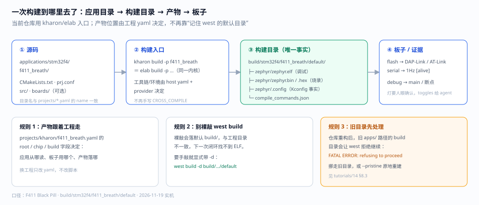

# 04 · 编译与运行

> **现状校准（2026-11-19）**：本章的 `west build` 原文是 **2026-11-14 目录重构之前**的写法
> （不写 `-d`，产物落在工作区根的 `build\`），作为历史实跑记录保留。当前仓库的构建入口是
> `kharon build -p <project>`（或 `elab build -p <project>`），产物统一落
> `build\<芯片>\<工程>\<配置>`；直接裸敲 `west build` 会落到默认目录，不推荐。
> 新写法见 [`tutorials/10`](../../tutorials/10-Zephyr模式上手.md) 与
> [`参考/构建入口与产物规则.md`](../参考/构建入口与产物规则.md)。



> **主线约定**：本书主线是 **ESP32-S3**（`esp32s3_devkitc/esp32s3/procpu`）。本章命令在 S3 上跑时，只需把 `-b esp32s31_function_coreboard/esp32s31/hpcore` 换成 `-b esp32s3_devkitc/esp32s3/procpu`，其余完全不变。
> 本章贴的输出原文是本机在 **Korvo-1（S31）** 上抓的，属于**附录 A** 的证据；S3 的对应输出在 `README.md` 后半段“第二块板”和 `15-Zephyr跨芯片\换芯片实战.md` 里。

这一章的命令和输出都来自本机实测（2026-11-13，Korvo-1 + PR #119851）。

## 一条命令

```powershell
cd C:\Users\xiao1\Desktop\ELAB\kharon-ide\west
west build -p -b esp32s31_function_coreboard/esp32s31/hpcore `
    "C:\Users\xiao1\Desktop\ELAB\kharon-ide\west\zephyr\samples\hello_world"
```

拆开看：

| 片段 | 含义 |
|---|---|
| `-p` | pristine，先删 `build/` 再配。改过 dts / prj.conf 必须加 |
| `-b esp32s31_function_coreboard/esp32s31/hpcore` | 板名/SoC/核，三段缺一不可 |
| 最后那个路径 | 应用源码目录（**必须是绝对路径或相对当前目录的路径**） |

### 第一个坑：源码路径

在 `west` 目录下写 `samples/hello_world` 会直接报：

```
ERROR: source directory samples/hello_world does not exist
```

因为 sample 在 `west\zephyr\samples\`，不在工作区根。两种修法：`cd zephyr` 再构建，或者给绝对路径。

## 构建过程发生了什么

实测耗时：**配置约 256 秒，编译约 90 秒**（首次，冷缓存）。

关键日志（原样摘录）：

```
-- Zephyr version: 4.5.99
-- Board: esp32s31_function_coreboard, qualifiers: esp32s31/hpcore
-- Found toolchain: cross-compile (C:/Espressif/tools/riscv32-esp-elf/esp-15.2.0_20251204/riscv32-esp-elf/bin/riscv32-esp-elf-)
-- Could NOT find Dtc (missing: DTC) (Required is at least version "1.4.6")
-- Found BOARD.dts: .../esp32s31_function_coreboard_hpcore.dts
-- Generated zephyr.dts: build/zephyr/zephyr.dts
-- Generated pickled edt: build/zephyr/edt.pickle
-- Espressif HAL path: .../west/modules/hal/espressif
-- Image partition address: 0x2000
-- Configuring done (256.3s)
-- Generating done (4.8s)
-- west build: building application
[1/286] Generating include/generated/zephyr/version.h
...
esptool v5.6.0
Creating ESP32-S31 image...
Merged 10 ELF sections.
Successfully created ESP32-S31 image.
```

三件事值得注意：

1. **`Could NOT find Dtc` 只是提示**，不是错误。DTS 由 Python 侧的 edtlib 处理，`zephyr.dts` 照样生成。
2. **`Image partition address: 0x2000`** 决定了烧录偏移，后面的 `west flash` 会自动带上，手动用 esptool 时必须写 `0x2000`。
3. **`esptool v5.6.0` 出现在构建阶段**：因为板级 cmake 会在编译完后生成 `zephyr.bin`（ESP 系列特有）。

## 产物在哪

```
build\samples\esp32s31\hello_world\default\zephyr\
├── zephyr.elf      ← 带符号，调试用
├── zephyr.bin      ← 烧录用（已按 0x2000 偏移组织）
├── zephyr.dts      ← 最终生效的设备树（排查 DT 问题必看）
└── .config         ← 最终生效的 Kconfig（排查 CONFIG 问题必看）
```

**`zephyr.dts` 和 `.config` 是排查问题的两把钥匙**：
- 引脚没生效 → 看 `zephyr.dts` 里那个节点最终长什么样；
- `CONFIG_XXX` 没打开 → 看 `.config` 里是不是 `# CONFIG_XXX is not set`。

## 换一个应用、多个构建目录

```powershell
west build -p -b esp32s31_function_coreboard/esp32s31/hpcore `
    "C:\Users\xiao1\Desktop\ELAB\kharon-ide\applications\esp32s31\korvo_shell" `
    -d "C:\Users\xiao1\Desktop\ELAB\kharon-ide\build\esp32s31\korvo_shell\s31-debug"
```

`-d` 指定构建目录。不加的话所有应用共用 `build/`，切来切去会互相覆盖。

## 只编译不烧录时，怎么确认镜像"合理"

```powershell
Get-Item build\zephyr\zephyr.bin | Select-Object Name,Length
```

本机 hello_world 的镜像约 **132 KB**。明显小于 50 KB 通常意味着链接出问题；超过 1 MB 则可能误开了大量子系统。

## 常见错误对照

| 报错 | 原因 | 处理 |
|---|---|---|
| `source directory ... does not exist` | 路径相对错 | 用绝对路径 |
| `Zephyr was unable to find the toolchain` | `CROSS_COMPILE` 用了反斜杠，被 CMake 当转义吃掉 | 全部换正斜杠，并设 `TOOLCHAIN_HOME` |
| `Could NOT find Dtc` | 没装 dtc | 忽略，不是错误 |
| `Could NOT find Ccache` | 没装 ccache | 忽略 |
| `undefined reference to __riscv_...` | 工具链 ISA 不匹配 | 换 Zephyr SDK，或核对 `-march` |
| 配置阶段卡在 `Parsing Kconfig` 很久 | 首次解析慢，正常 | 等 |

## 自检

- `-p` 去掉会怎样？改了 `app.overlay` 后不 `-p`，引脚会变吗？（可能不变——CMake 缓存了旧 dts，这正是 `-p` 的意义）
- `build/zephyr/zephyr.dts` 里 `pa_ctrl` 节点的 `gpios` 是什么？和你写的一致吗？
- 为什么 `esptool` 会出现在"编译"日志里？
