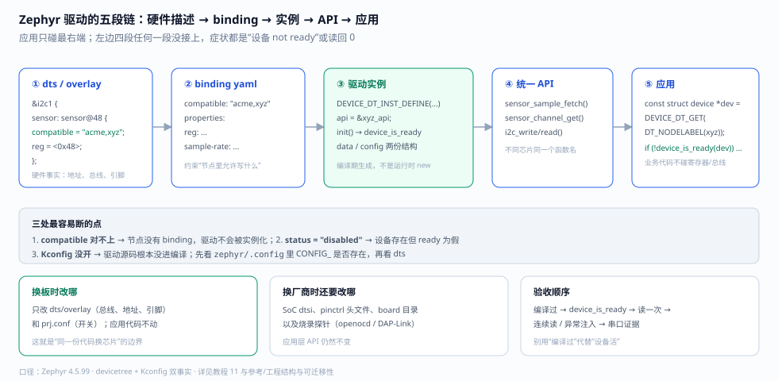

# Zephyr 驱动（Korvo-1 实机版）

> **现状校准（2026-11-19）**：本组是 S31 学习线的驱动实测，路径已统一到
> `applications/esp32s31/…`；当前仓库主线换到 F411/F103，但**驱动五段链完全同构**
> （dts → binding → 实例 → API → 应用），F411 的实机读法见
> [`tutorials/14`](../../../tutorials/14-Zephyr调试区操作.md)。

这一组页面是**驱动层**的逐接口教程。和前面 04 / 10 篇的区别只有一个：这里每个 API 都有一份能在这块板子上跑出结果的代码，页面里贴的输出是**本机 COM9 串口抓下来的原样文本**，不是示意。

> 板子：ESP32-S31-Korvo-1（`esp32s31_function_coreboard/esp32s31/hpcore`）
> 树：本地 `west`，`VERSION` 4.5.99 + PR #119851，commit `34e025569cbb`
> 串口：COM9 / 115200 8N1
> 实验工程：`applications/esp32s31/korvo_lab`，构建目录 `build\esp32s31\korvo_lab\s31-debug`



## 为什么单独做 korvo_lab

`applications/esp32s31/korvo_shell` 是阶段 2 的"能跑就行"工程，只放了 `korvo pins` / `korvo pa` 两个命令。驱动这一层要验证的东西多得多：输出能不能写、能不能回读、输入怎么读、中断进不进、总线扫不扫得到器件、ADC 要几位分辨率、WS2812 走哪个外设——每个都是一次独立的实测。

所以新建 `applications/esp32s31/korvo_lab`，把四类外设做成四个 shell 子命令，**烧一次，四个实验全测**：

| 子命令 | 外设 | 覆盖的接口 |
|---|---|---|
| `lab gpio` | PA_CTRL(GPIO7)、BOOT 键 | `gpio_pin_configure_dt`、`gpio_pin_set_dt`、`gpio_pin_get_dt`、`gpio_pin_toggle_dt`、`gpio_port_get_raw`、`gpio_port_*_bits_raw`、`gpio_port_toggle_bits`、`gpio_add_callback`、`gpio_pin_interrupt_configure_dt`、`gpio_get_pending_int` |
| `lab key` | BOOT 键（绕开驱动读寄存器） | 直接 `sys_read32` 读 `IN` / `IN1` / `ENABLE1` |
| `lab i2c` | i2c0（ES8389 @0x10、0x14） | `i2c_configure`、`i2c_get_config`、`i2c_write`、`i2c_read`、`i2c_reg_read_byte`、`i2c_write_read`、`i2c_burst_read`、`i2c_transfer` |
| `lab adc` | adc0 的 8 个通道 | `adc_channel_setup`、`adc_read`、`adc_raw_to_millivolts` |
| `lab led` | WS2812(GPIO37) | `led_strip_length`、`led_strip_update_rgb` |

## 工程结构

```
applications/esp32s31/korvo_lab/
├── CMakeLists.txt
├── prj.conf          # GPIO/I2C/ADC/LED_STRIP/WS2812_STRIP_PULSE_IO/SHELL
├── app.overlay       # i2c0 引脚、rmt 引脚、adc0 打开、PA_CTRL 别名
└── src/main.c        # 四个子命令
```

`prj.conf` 里和驱动直接相关的只有这几行：

```conf
CONFIG_GPIO=y
CONFIG_I2C=y
CONFIG_ADC=y
CONFIG_LED_STRIP=y
CONFIG_WS2812_STRIP_PULSE_IO=y
```

`app.overlay` 做三件事：给 i2c0 指定 SDA/SCL 引脚、给 rmt 指定 GPIO37、把 adc0 从 `disabled` 打开：

```dts
&pinctrl {
	i2c0_korvo: i2c0_korvo {
		group1 {
			pinmux = <I2C0_SDA_GPIO0>, <I2C0_SCL_GPIO1>;
			bias-pull-up;
			drive-open-drain;
			output-high;
		};
	};

	rmt_korvo: rmt_korvo {
		group1 {
			pinmux = <RMT_OUT0_GPIO37>;
		};
	};
};

&i2c0 {
	pinctrl-0 = <&i2c0_korvo>;
	pinctrl-names = "default";
	clock-frequency = <I2C_BITRATE_FAST>;
	status = "okay";
};

&rmt    { pinctrl-0 = <&rmt_korvo>; pinctrl-names = "default"; status = "okay"; };
&adc0   { status = "okay"; };
```

## 构建 + 烧录 + 抓输出

```powershell
. .\scripts\kharon-env.ps1
cd west
west build -b esp32s31_function_coreboard/esp32s31/hpcore ..\applications\esp32s31\korvo_lab -d build\esp32s31\korvo_lab\s31-debug
west flash -d build\esp32s31\korvo_lab\s31-debug --esp-device COM9
```

串口抓取用仓库里的 `tools/zephyr/serial_cmd.py`，命令后面可以跟 `@秒数` 指定这条命令的采样窗口：

```powershell
.\.deps\venv\Scripts\python.exe tools\zephyr\serial_cmd.py COM9 "lab i2c@9" "lab adc@4" "lab led@6"
.\.deps\venv\Scripts\python.exe tools\zephyr\serial_cmd.py COM9 "lab gpio@16"   # 里面等 10 秒按键
```

本机实测的构建结果（`logs/build-lab.log`）：

```
Memory region         Used Size  Region Size  %age Used
           FLASH:      147584 B   16776960 B      0.88%
     sram0_0_seg:       88192 B     503728 B     17.51%
```

烧录结果（`logs/flash-lab.log`）：

```
Wrote 244096 bytes at 0x00002000 in 3.6 seconds (542.6 kbit/s).
Verifying written data...
Hash of data verified.
Hard resetting via RTS pin...
```

启动后首屏：

```text
*** Booting Zephyr OS build 34e025569cbb ***

=== Korvo-1 lab ===
lab gpio / lab i2c / lab adc / lab led
uart:~$
```

## 页面索引

| 页面 | 内容 | 实测状态 |
|---|---|---|
| [GPIO.md](GPIO.md) | 12 个 GPIO 接口逐个过一遍，含 ESP32 驱动在该板上的三处偏差 | ✅ 全部有输出 |
| [I2C.md](I2C.md) | 7 个 I2C 接口，扫到 0x10 / 0x14 两颗器件，读 ES8389 寄存器 | ✅ 全部有输出 |
| [ADC.md](ADC.md) | 17 位分辨率、8 通道、mV 换算、未补偿警告 | ✅ 全部有输出 |
| [WS2812.md](WS2812.md) | `led_strip` + `pulse_io` + RMT，RGB 依次点亮 | ✅ 全部有输出 |
| [未实测的部分.md](未实测的部分.md) | PWM / UART 为什么这块板子上没法做可观测演示 | 📖 只有代码 |

## 这一组页面反复出现的三件事

1. **"返回 0"不等于"有效果"。** `gpio_pin_set_dt(&pa, 1)` 返回 0，但紧接着 `gpio_pin_get_dt` 读回 0；`i2c_configure` 返回 0 也可能只是把参数塞进了寄存器。每次都要有一路独立观测（回读、扫总线、串口日志、灯亮）。
2. **ESP32 的驱动分 bank。** `gpio0` 管 GPIO0–31，`gpio1` 管 GPIO32–63；但这套 PR 里 `gpio1` 的抽象层还不完整，`lab key` 就是为这件事专门加的探针。
3. **分辨率、地址位宽这类参数由 SoC 说了算。** `adc` 只认 17 位；`i2c` 的 10 位地址、1 MHz 速率在别家的驱动上会回 `-ENOTSUP`，在 ESP32 上却回 0——所以教程里凡是"参数"都要以**你树里这份驱动**为准。

---

下一篇：[GPIO](GPIO.md)
