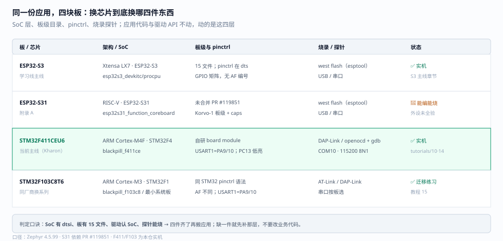

# 15 · Zephyr 跨芯片（同一套方法，四块板）

> **现状校准（2026-11-19）**：本组三篇全部实机完成，路径已统一到
> `applications/<family>/<app>`；F411 现在是仓库主线（`tutorials/10`），F103 是
> 同厂商换系列的对照板。跨芯片的四件套没有变：SoC dtsi、板级目录、pinctrl、烧录探针。

> 这一组回答三个递进的问题：
> ① **"我手上已经有能跑的应用代码了，再加一块完全不同的芯片（RISC-V → Xtensa），要改多少东西？"** → 板子差异全在 devicetree / overlay 这一层，应用逻辑一行都不用动。
> ② **"如果换的是另一家厂商（ESP32 → ST STM32F411，ARM Cortex-M4F），还要多改什么？"** → 多出三层：工具链目标（`arm-zephyr-eabi`）、厂商 HAL 模块（`modules/hal/stm32` + `cmsis_6`）、烧录探针（DAP-Link 覆盖板级 ST-Link 配置）。
> ③ **"同一家厂商的下一代（STM32F411 → STM32F103），探针和工具链都复用，还要补什么？"** → 补的是"系列"这一层：`stm32f1xx` HAL、`core_cm3.h`、F1 的 pinctrl、LL shim 的第二条分支，以及小容量芯片的"容量分母"。

本组有三篇正文，依次是"同一份代码换架构"、"换厂商走完整条链路"、"同一支探针跨系列"：

| 页面 | 内容 | 状态 |
|---|---|---|
| **换芯片实战.md** | RISC-V（Korvo-1）→ Xtensa（ESP32-S3）：工具链、控制台口、能力探测、分区表、实测原文、坑表 | ✅ 实机 |
| **换芯片实战-STM32F411.md** | ESP32 → STM32F411CEU6（Black Pill）：SDK 第三个目标、HAL 模块离线复原、板目标一段式、`chosen` 控制台、**PC13 无定时器通道 → 软件 PWM**、DAP-Link 烧录、开机横幅原文、12 条坑表、迁移检查表 | ✅ 实机 |
| **换芯片实战-STM32F103.md** | STM32F411 → STM32F103C8T6（Blue Pill）：**两条路线**（拉齐 `west.yml` 上游仓 / 离线复原退路）、补 `stm32f1xx` HAL / `core_cm3.h` / F1 pinctrl、42 个 LL shim 加 F1 分支、**两段式板目标**、64 KB flash 的真实容量改写、同一个 DAP-Link 换 `stm32f1x.cfg`、13 条坑表 | ✅ 实机 |
| README.md（本页） | 组内路线图、四板对照、命令速查 | — |



---

## 一、这一组和前面 14 组的关系

```
00–06  基础：环境 / 取码 / 编译 / 烧录          （全部在 Korvo-1 上完成）
10     主干：阶段 0–4                            （全部在 Korvo-1 上完成）
11     驱动：GPIO / I2C / ADC / WS2812           （全部在 Korvo-1 上完成）
12     组件：shell / logging / settings          （全部在 Korvo-1 上完成）
13     应用：RGB / 四键 / 功放                    （全部在 Korvo-1 上完成）
14     系统：复位原因 / 温度 / RNG / NVS          （全部在 Korvo-1 上完成）
15     ★ 跨芯片：同一份 apps 源码 → ESP32-S3       （Korvo-1 + ESP32-S3 双板实测）
            ↳ 第二篇：同一套六步 → STM32F411      （Black Pill + DAP-Link 实测）
            ↳ 第三篇：同一支探针 → STM32F103      （Blue Pill，补"系列"这一层）
```

**为什么这三篇要放在最后**：跨芯片这件事的价值，只有在你已经有一份"在 A 板上确实能跑"的代码时才成立。如果一开始就并行，你分不清"这是板子差异"还是"这是我没学会"。第二篇还要再往前一步——它假定你已经接受"差异写进 overlay"这个结论，然后告诉你**当厂商、架构、探针三样同时换掉时，overlay 之外还有三层要补**。第三篇则把问题再收窄一层：厂商没换、架构同一族（Cortex-M4 → M3）、探针还是那支 DAP-Link，**唯一换掉的是"系列"**——于是你会看到模块复原、pinctrl、LL shim 这三样全部要按系列再来一遍，而 `main.c` 依然只改引脚与主频相关的几行。

---

## 二、四块板的基本盘

| | Korvo-1（ESP32-S31） | ESP32-S3 最小开发板 | **Black Pill V2.0（STM32F411CEU6）** |
|---|---|---|---|
| 架构 | RISC-V（`rv32imafc`） | Xtensa LX7 | **ARM Cortex-M4F** |
| 板目标 | `esp32s31_function_coreboard/esp32s31/hpcore` | `esp32s3_devkitc/esp32s3/procpu` | **`blackpill_f411ce`**（一段式） |
| 工具链 | **同一个 Zephyr SDK 1.0.1** 的 `riscv64-zephyr-elf`（`VARIANT=zephyr`） | 同 SDK 的 `xtensa-esp32s3-zephyr-elf` | 同 SDK 的 **`arm-zephyr-eabi`** |
| 额外模块 | `hal_espressif` | `hal_espressif` | **`hal_stm32` + `cmsis_6`** |
| 串口 | `COM9`，CP2102 桥 | `COM11`，芯片内置 USB-Serial-JTAG | **`COM10`，DAP-Link 的 CDC 接口** |
| 烧录 | esptool，偏移 `0x2000` | esptool，偏移 `0x0000` | **OpenOCD + DAP-Link（SWD），烧 `.hex`** |
| 灯 | RGB(GPIO37)，WS2812 | RGB(GPIO48)，WS2812 | **单色 PC13，低电平亮，无定时器通道** |
| 键 | IO42 四键（ADC 分压） | BOOT(IO0) | **PA0，低电平按下 + 内部上拉** |
| 本工程实测 | 5 个工程全部跑过 | `hello_world` + 同一份 `korvo_apps`（含 NVS 跨复位） | **`f411_breath`：呼吸灯 + 按键 + 串口；`f411_hwpwm`：TIM4 硬件 PWM 对照** |

**这张表里最该注意的不是"少了什么"，而是"哪些东西换了层"**：灯从 RGB 变单色（第一行还只是引脚，最后一行却是"芯片能力"）、控制台从 `uart0` 换 `usb_serial` 再换 `usart1`、烧录从 esptool 换 OpenOCD。前两处差异属于"dts 层"，第三处属于"探针层"——组内正文分别讲这两层（第二篇讲工具链+HAL+探针，第三篇讲"系列"这一层怎么再补一遍）。

### 2.1 第四块板：STM32F103C8T6（Blue Pill）

它和第二篇的 Black Pill **外形几乎一样、探针也是同一支**，所以最容易被误判成"照抄就行"。差异全在"系列"这一层：

| | Black Pill（STM32F411CEU6） | **Blue Pill（STM32F103C8T6）** |
|---|---|---|
| 内核 | ARM Cortex-M4F（带 FPU） | **ARM Cortex-M3，无 FPU** |
| 主频 | 100 MHz | **72 MHz**（HSE 8 MHz × PLL 9） |
| 板目标 | `blackpill_f411ce`（**一段式**） | **`stm32f103_mini/stm32f103xe`（两段式，qualifier 是 SoC 名）** |
| flash / RAM（分母） | 512 KB / 128 KB | **64 KB / 20 KB**（板级 dts 写的是 `stm32f103xe`，须在 overlay 里改成真实容量） |
| 模块缺口 | `stm32cube\stm32f4xx\` + `core_cm4.h` + `dts\st\f4\` 的 pinctrl | **同样再缺一遍**：`stm32cube\stm32f1xx\` + `core_cm3.h` + `dts\st\f1\` 的那一个 pinctrl + 42 个 LL shim 的 F1 分支 |
| 探针 | DAP-Link，`target/stm32f4x.cfg` | 同一个 DAP-Link，**`target/stm32f1x.cfg`** |
| 灯 / 键 | PC13 低电平亮 / PA0 内部上拉 | 同构（**但板级 dts 里没有 `sw0` 别名，照抄会直接编译报错**） |
| 本工程实测 | `f411_breath`、`f411_hwpwm`（TIM4 硬件 PWM） | **`f103_breath`：`bin=17104 B`、FLASH 26.10%、RAM 25.55%、50 s `late=0 frames=49047`** |

---

## 三、组内阅读路线

1. **先看正文第 1 节**：把"官方镜像"这个预期修正过来。Zephyr 不发 `.bin`，"官方支持"= 树里的板级定义 + 官方 SDK。
2. **第 2 节** 是全篇最硬的一段：为什么 ESP-IDF 的 Xtensa 工具链编不了 Zephyr（附原始报错）。**如果你只想记住一件事，记这个**——它省掉你半天试错。
3. **第 3 节**：统一工具链——一个 SDK、两个目标、一套变量。很多人以为"两块板必须两套工具链"，其实只是装 SDK 时少勾了一个目标。
4. **第 4 → 5 节**：先跑通 `hello_world`，再修"串口哑巴"。**顺序不要颠倒**——没日志你根本不知道第 4 节过没过。
5. **第 6 节**：能力探测。这是"无缝换芯片"真正的技术核心。
6. **第 7 → 8 节**：分区表 + 实测原文。看完你会相信 `store.c` 真的不用改。
7. **第 9 → 10 节**：六步清单 + 坑表，以后加第三块板就翻这两节。

**第二篇（STM32F411）的读法**：

1. **第 2 节**：先把"跨了几层"对齐——比第一篇多出"厂商 HAL"和"烧录探针"两层，其余四层是同构的。
2. **第 3 → 4 节**：SDK 第三个目标怎么装（含 md5 校验与国内网络现实）、HAL 模块目录长什么样、少一个 `core_cm4.h` 会报什么错。
3. **第 5 → 6 节**：板目标为什么是一段式；`chosen zephyr,console` 与"设备管理器里哪个 COM 才是它"。
4. **第 7 节**：**全篇最值钱的一节**——PC13 没有定时器通道，所以"呼吸灯"只能软件 PWM，附实测代价。这条与板子无关，与**芯片复用表**有关。
5. **第 9 → 10 → 11 节**：编译（走 SDK，含冷/热耗时）→ DAP-Link 烧录（为什么要覆盖板级 `support\openocd.cfg`）→ 开机横幅原文逐行解读。
6. **第 12 → 15 节**：12 条坑表、软件 PWM 的四条替代、下一块 STM32 板的检查表、6 道自检答案。

**第三篇（STM32F411 → STM32F103）的读法**：

1. **第 2 ~ 5 节**：模块缺口逐项补 —— HAL 系列目录、pinctrl 只搬"板子真正 include 的那一个"、CMSIS 的 `core_cm3.h`。
   **重点不是记住文件清单，而是记住"缺口按系列划分"这个结构**，将来加 F0/F7 只是再补一遍同样四类。
2. **第 6 节**：`stm32f1xx_hal_conf.h` 为什么不能拿 Cube 的 `_template` 改名 —— 这是本轮最典型的一个"看起来能成的错解"。
3. **第 7 节**：42 个 `stm32_ll_*.h` 统一入口加第二条 `#elif` 分支，是"跨系列 shim"这个做法的实操样本。
4. **第 9 ~ 11 节**：两段式板目标、真实容量 overlay、`bin`/FLASH/RAM 三个百分比的读法。
5. **第 12 → 14 节**：13 条坑表、三板（S3/F411/F103）迁移对照、自检答案。

---

## 四、命令速查

### 4.1 环境（当前仓库，一套就够）

```powershell
cd C:\Users\xiao1\Desktop\ELAB\kharon-ide
.\kharon.cmd env --out scripts\kharon-env.ps1   # host/provider 变更后才需重跑
. .\scripts\kharon-env.ps1
```

脚本会设置 `ZEPHYR_BASE=west/zephyr`、`ZEPHYR_SDK_INSTALL_DIR`，并把
`.deps\venv`、CMake、Ninja、ccache、三个 `arm/xtensa/riscv64` 目标链前置到 PATH。
**换板不用改变量，只换 `-b` 或工程名。**

旧命令到当前入口的映射：

| 旧写法（历史） | 当前写法 |
|---|---|
| `. "$root\tools\zephyr\env.ps1"` | `. .\scripts\kharon-env.ps1` |
| `.\tools\zephyr\build.ps1 -App … -Board …` | `kharon build -p <project>` |
| `.\tools\zephyr\build.ps1 … -Flash` | `kharon flash -p <project>` |
| `.\tools\zephyr\bootstrap.ps1`（旧布局） | `kharon deps --check`（只读；旧脚本不要直接跑） |
| `.venv` / `.tools` | `.deps\venv` / `.deps\tools` |

### 4.2 编译 / 烧录 / 看日志

```powershell
# S3：hello_world
west build -b esp32s3_devkitc/esp32s3/procpu "$root\west\zephyr\samples\hello_world" -d "$root\build\samples\esp32s3\hello_world\default"
west flash -d "$root\build\samples\esp32s3\hello_world\default" --esp-device COM11

# S3：同一份应用代码
west build -p always -b esp32s3_devkitc/esp32s3/procpu "$root\applications\esp32s31\korvo_apps" -d "$root\build\esp32s3\korvo_apps\s3-debug"
west flash -d "$root\build\esp32s3\korvo_apps\s3-debug" --esp-device COM11

# 抓日志（原生 USB 口专用，别用 read_serial.py，它硬编码 COM9）
python "$root\tools\zephyr\probe_serial.py" COM11 8 --reset

# 发 shell 命令（原生 USB 口专用，别用 serial_cmd.py，它会 RST 复位导致重新枚举）
python "$root\tools\zephyr\usb_cmd.py" COM11 --reset "app stats@3" "app saved@4"
```

### 4.2b STM32F411：一条入口搞定编 + 烧（DAP-Link）

```powershell
$root = "C:\Users\xiao1\Desktop\ELAB\kharon-ide"
. "$root\scripts\kharon-env.ps1"          # 三个目标都进 PATH；打印 OpenOCD 探测结果

# 编（产物落 build\stm32f4\f411_breath\default）
.\kharon.cmd build -p f411_breath

# 编 + 烧（内核按 projects/kharon/f411_breath.yaml 选 DAP-Link + openocd）
.\kharon.cmd flash -p f411_breath

# 硬件 PWM 对照工程（TIM4 → PB6/PB7；第一次加 --clean，让新 overlay 生效）
.\kharon.cmd build -p f411_hwpwm --clean
.\kharon.cmd flash -p f411_hwpwm

# 抓串口（DAP-Link CDC = COM10；注意 --reset 对它无效）
python "$root\tools\zephyr\probe_serial.py" COM10 10

# 想抓开机横幅：先起抓取，再让 OpenOCD 复位放开
#   注意：没接 nRESET 时 "reset run" 常报 Failed to read memory at 0xe000ed04，
#   最稳的是按板上 R（NRST）键或重新插拔 USB
openocd -f "$root\applications\stm32f4\common\dap_link_openocd.cfg" `
        -c "init" -c "reset_config srst_only srst_nogate" `
        -c "reset halt" -c "reset run" -c "shutdown"
```

### 4.2c STM32F103：同一个入口，只换工程名

```powershell
$root = "C:\Users\xiao1\Desktop\ELAB\kharon-ide"
. "$root\scripts\kharon-env.ps1"          # 三个目标都在 PATH 里，F103 用的还是 arm-zephyr-eabi

# 编（产物落 build\stm32f1\f103_breath\default）
.\kharon.cmd build -p f103_breath

# 编 + 烧（内核按工程 yaml 切到 applications\stm32f1\common\dap_link_openocd.cfg）
.\kharon.cmd flash -p f103_breath

# 校验模块是否齐（先看清单，不联网、不改文件）
pwsh -File .\tools\zephyr\pull-stm32-modules.ps1 -DryRun
# 现存的四个仓（hal_stm32/cmsis_6/mbedtls/tf-psa-crypto）HEAD 对不对得上 west.yml
Set-Location .\west; west list | Select-String "hal_stm32|cmsis_6|mbedtls|tf-psa"
```

**两段式板目标**：`-Board stm32f103_mini` 后面可以跟 `/stm32f103xe` 显式限定 SoC；
不写时由板级 dts 自推出（日志里 `board: stm32f103_mini/stm32f103xe` 就是 `CONFIG_BOARD_TARGET` 的原样输出）。

### 4.3 核对 dts / Kconfig（排查"没输出""没驱动"的常用三连）

```powershell
Select-String -Path build\esp32s3\korvo_apps\s3-debug\zephyr\zephyr.dts -Pattern "zephyr,console|led_strip|pa-ctrl"
Select-String -Path build\esp32s3\korvo_apps\s3-debug\zephyr\.config  -Pattern "CONSOLE|USB_SERIAL_JTAG|NVS|LED_STRIP"
Select-String -Path build\esp32s3\korvo_apps\s3-debug\zephyr\zephyr.dts -Pattern "storage_partition" -Context 0,4
```

### 4.4 串口口别选错（半小时能省下来）

```powershell
Get-CimInstance Win32_PnPEntity | Where-Object { $_.Name -match "\(COM\d+\)" } |
  ForEach-Object { "{0} | {1}" -f $_.Name, $_.DeviceID }
# VID_303A&PID_1001 → 芯片原生 USB（USB-Serial-JTAG）
# VID_10C4 / Silicon Labs → CP2102 桥
```

---

## 五、这一组产出的东西

| 产物 | 说明 |
|---|---|
| `applications\esp32s31\korvo_apps\boards\esp32s3_devkitc_esp32s3_procpu.overlay` | **新增**。S3 板级差异全部集中在这一个文件：`/delete-property/ pa-ctrl`、WS2812(GPIO48)、`&rmt`、`&adc0/&adc1`、控制台切 `usb_serial` |
| `applications\esp32s31\korvo_apps\src\main.c` | **改**。`HAS_STRIP`/`HAS_PA` 能力探测、线程空转分支、`app pa` 的 `-ENOTSUP`、`ADC 分辨率` 运行时探测（17→12）、横幅用 `CONFIG_BOARD_TARGET` |
| `tools\zephyr\probe_serial.py` | **新增**。被动抓串口（不碰 DTR/RTS），适配原生 USB 口 |
| `tools\zephyr\usb_cmd.py` | **新增**。不主动复位的命令工具，适配原生 USB 口 |
| `C:\Users\xiao1\zephyr-sdk-1.0.1\` | **新增安装**。官方 Zephyr SDK 1.0.1 + `gnu\xtensa-espressif_esp32s3_zephyr-elf` |
| `C:\Users\xiao1\zephyr-sdk-1.0.1\gnu\arm-zephyr-eabi\` | **新增安装**（第二篇）。SDK 的第三个目标，官方 7z 79,217,349 B、md5 `5292327efe175468b0552f0302e87935` 校验通过 |
| `applications\stm32f4\f411_breath\` | **新增**（第二篇）。`CMakeLists.txt` / `prj.conf` / `src\main.c`（零引脚号）/ `boards\blackpill_f411ce.overlay` / `CMakePresets.json` |
| `applications\stm32f4\f411_hwpwm\` | **新增**（13.3 的对照工程）。TIM4 CH1/CH2 → PB6/PB7，`boards\blackpill_f411ce.overlay` 里 `&timers4 { st,prescaler = <1>; }` |
| `applications\stm32f4\common\dap_link_openocd.cfg` | **新增**（第二篇）。CMSIS-DAP + SWD（板级 `support\openocd.cfg` 是 ST-Link 专用） |
| `west\modules\hal\stm32\`、`...\cmsis_6\`、`...\crypto\mbedtls\`、`...\crypto\tf-psa-crypto\` | **换装**（第三篇补轮）。从"离线复原目录"换成按 `west.yml` revision 落地的**真 git 仓**（`hal_stm32` @`2fd0502` 稀疏检出 F1/F4；`cmsis_6` @`1c1840a`、`mbedtls` @`c43f34b`、`tf-psa-crypto` @`765af96` 整仓）；`west list` 四行都对得上 pin |
| `applications\stm32f1\f103_breath\` | **新增**（第三篇）。`CMakeLists.txt` / `prj.conf` / `src\main.c`（零引脚号、无按键）/ `boards\stm32f103_mini.overlay`（真实容量 64 KB/20 KB） |
| `applications\stm32f1\common\dap_link_openocd.cfg` | **新增**（第三篇）。同一支 CMSIS-DAP，目标层换成 `target/stm32f1x.cfg` |
| `tools\pull-stm32-modules.ps1` | **新增**（第三篇）。读 `west.yml` revision → 备份旧目录 → 无 blob 克隆 + 稀疏检出（`-Full` 整仓）→ 校验 HEAD 与六个关键路径；失败自动挪回 |
| `west\modules\hal\stm32\stm32cube\stm32f1xx\`、`...\dts\st\f1\…pinctrl.dtsi`、`cmsis_6\…core_cm3.h` | **新增**（第三篇）。按上游 `hal_stm32` revision 取；**都在 `west\`，不纳库** |
| `build\samples\esp32s3\hello_world\default`、`build\esp32s3\korvo_apps\s3-debug` | **新增构建目录** |
| `build\stm32f4\f411_breath\default` | **新增构建目录**（第二篇） |
| `build\stm32f1\f103_breath\default` | **新增构建目录**（第三篇） |
| `logs\serial-s3-hello.txt`、`serial-s3-apps-1/2/4.txt`、`probe-com11.txt` | 第一篇的串口原文 |
| `logs\f411-build-sdk.log`、`f411-build-sdk2.log`、`f411-flash-openocd.log`、`f411-serial-boot.txt`、`f411-serial-key.txt`、`f411-hwpwm-build.log`、`f411-hwpwm-serial.txt` | 第二篇的构建（首编 + 改统计后重编 + 硬件 PWM）/ 烧录 / 开机横幅 / 按键实录 / 硬件 PWM 寄存器回读原件 |

---

## 六、第二篇与第三篇的诚实清单（STM32 部分哪些是实测）

| 结论 | 状态 |
|---|---|
| SDK 第三个目标 `arm-zephyr-eabi` 装好、`kharon env` 一套变量编三块板 | ✅ 实测（`Found toolchain: zephyr 1.0.1`、`GNU 14.3.0`） |
| STM32 板级 dts 的 LED / 控制台与实物一致（PC13 / PA9-PA10） | ✅ 实测（开机横幅 `led0: gpio@40020800 pin 13`，串口有日志、灯在呼吸） |
| 按键 PA0（`sw0: gpio@40020000 pin 0`）能切呼吸 | ✅ 实测：真人按了 10 次，串口 10 次 `KEY pressed -> breathing OFF/ON`，0 误触发 0 漏触发（实录 `logs\f411-serial-key.txt`） |
| 关灯态不吃 CPU、统计不乱 | ✅ 实测：关灯后打印 `breathing OFF (idle, CPU released, frames=…)`，`frames` 停止增长；旧版把 `k_msleep(1)` 的 1094 µs 帧算成"迟到"的缺陷已修 |
| DAP-Link + OpenOCD 烧录 | ✅ 实测（`wrote 32768 bytes ... 1.52 s`、`flashed OK`；末尾 `0xe000ed04` 噪音已解释） |
| PC13 无定时器通道 → 软件 PWM | ✅ 复用表 + dts 反证；呼吸效果肉眼确认 |
| PB6/PB7 硬件 PWM（TIM4） | ✅ 实机：`applications\stm32f4\f411_hwpwm` 跑起来，串口寄存器回读 `psc=1 arr=47999 ccr1=duty×48` → 正好 1 kHz；没有示波器量波形 |
| 软件 PWM 的抖动 | ⚠️ 只测帧周期分布（avg 1005 / max 1021 µs），没接示波器 |
| 同一份 `main.c` 编到 ESP32-S3 | 📖 未做（S3 板级 dts 没有 `led0` 别名，要先加 overlay；本轮不碰 S3 板） |
| **F103 完整链路：SDK 编 → DAP-Link 烧 → 串口横幅** | ✅ 实测（`Cortex-M3 r1p1`、`board: stm32f103_mini/stm32f103xe`、`flash size = 64 KiB`、`k_busy_wait(1000 us)=72429 cycles=1005 us`） |
| **F103 呼吸灯帧率与迟到统计** | ✅ 实测：50 s 采样 `avg=1010 µs late=0 frames=49047`（72 MHz 无 FPU 仍稳在 1 kHz 软 PWM） |
| **F103 的硬件 PWM 对照（TIM4 → PB6/PB7）** | 📖 未做（F1 上同样有 TIM4 通道，本轮需求只到"呼吸灯闭环"） |
| **F103 按键** | 📖 无硬件（板级 dts 无 `sw0`，`main.c` 写的是"无按键"分支） |
| **F103 的示波器验证** | ⚠️ 未做（与 F411 一样只有帧周期统计） |

---

## 七、组内自检

**第一篇（S31→S3）**，答案见 `换芯片实战.md` 第 11 节的 12 题：

1. 你能不能只用一句话说清"S3 的官方镜像"到底该去哪找？
2. 你现在能不能在同一个 pwsh 窗口里，从 Korvo 切到 S3 并成功编一次？切换时你清了哪两个变量？
3. 如果明天拿到一块 ESP32-S3 SuperMini（不是 DevKitC-1），第 9 节的六步清单里哪一步会最先绊你？（提示：RGB 脚号和有没有 UART 桥）
4. 为什么本组的所有 dts 改动都放在 `boards\...overlay`，而不是改 `app.overlay`？（提示：不是"更干净"，而是**二选一**——`boards\<board>.overlay` 一旦存在，`app.overlay` 在整个 S3 构建里根本不会被执行，见正文 6.3 的更正框）
5. "同一份代码"到底同一到什么程度？哪些东西必须不同，哪些东西必须相同？

**第二篇（ESP32→STM32F411）**，答案见 `换芯片实战-STM32F411.md` 第 15 节：

6. 树里明明有 `boards\weact\blackpill_f411ce\`，为什么光有它还是编不出 ARM 固件？还缺哪两样？
7. PC13 为什么不能 `pwm_pin_set_usec()`？换成 PB6/PB7 后要动哪几处？
8. `west flash` 在 ESP32 上选 esptool、在 STM32 上选 OpenOCD，这个选择从哪来？板级 `support\openocd.cfg` 为什么对 DAP-Link 无效？

**第三篇（STM32F411→STM32F103）**，答案见 `换芯片实战-STM32F103.md` 第 14 节：

9. 树里已经装好了 `stm32f4xx`，为什么 F103 还得再补一次 `stm32f1xx`？这三类缺件（HAL 目录 / pinctrl / `core_cm3.h`）分别是谁在什么时候要求的？
10. `-Board stm32f103_mini` 和 `-Board stm32f103_mini/stm32f103xe` 差在哪一段？后半段这个名字从哪个文件来？
11. 板级 dts 说 flash 是 `0x20000`（128 KB），实际芯片只有 64 KB —— 为什么必须改、改在哪、编完怎么回读确认？
12. `stm32f1xx_hal_conf.h` 为什么不能把 Cube 的 `_template` 改个名就用？
13. 同一支 DAP-Link 换了芯片，为什么只需要换 `target/stm32f1x.cfg`？如果换成 F0 呢？
