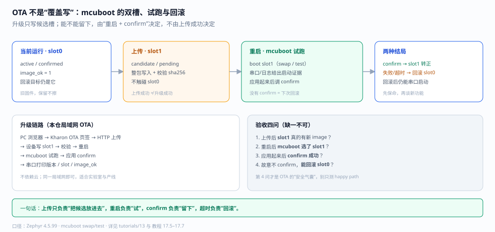

# 17 · S3 无线能力：Wi-Fi 与 BLE

> **现状校准（2026-11-19）**：本组是 S3 学习线的无线/配网/OTA 实测；当前仓库主线
> F411 不带 Wi-Fi，但 **OTA 的双槽、试跑、confirm、回滚机制与芯片无关**，F411 的局域网
> OTA 见 [`tutorials/13`](../../../tutorials/13-Zephyr_OTA局域网升级.md)。

> 这一组是"跨芯片"之后最硬的一块：**把乐鑫的闭源射频协议栈（blob）补齐，然后在 S3 上真的把 Wi-Fi 扫出 AP、把 BLE 广播发出去**。
>
> 结论先放这儿：
>
> - Wi-Fi：`samples\net\wifi\shell` 编成 **704916 B** 烧进 COM11，`wifi scan` 扫到 **11 个 AP**（含 SSID / 信道 / RSSI / 加密方式）。
> - **Wi-Fi 配网门户（新增，成品级）**：独立工程 `applications\esp32s3\s3_wifi_portal` 把 APSTA + DHCP server + mDNS + 内置 HTML 配网页 + WS2812 状态灯 + NVS 凭据持久化 + 上电自动重连（最多 3 次）全做完了。实机连真路由器拿到 `10.168.1.226`，重启后自动重连成功，手机连热点自动弹配网页（Captive Portal）。镜像 **760644 B**。
> - BLE：`samples\bluetooth\peripheral` 编成 **428452 B**，控制器初始化 OK（MAC `f0:9e:9e:0e:f4:c2`），host `bt_enable()` OK，`Advertising successfully started`；PC 侧用 bleak 扫到 RSSI **-32 ~ -40** 的广播，带 180D / 180F / 1805 三个标准服务和一个自定义 UUID。
> - 中间踩了 **4 个坑**，每个都值一段教程：blob 目录搬家、缺 mbedtls/tf-psa-crypto、控制台走 uart0 而板子只接了 USB、HCI 流控命令被 btdm 拒绝。
> - 做配网门户时又踩了 **15 个坑**（iterable section、socket service、net_context 池、系统工作队列栈……），统一整理在第九节的坑表里。

---



## 章节拆分（2026-11-15 新增）

本轮把「局域网内可监控 + 可远程操作」这一整套能力按功能拆成独立章节，不再续写在这一个 README 里：

| 章节 | 讲什么 |
|---|---|
| [17.1 配网门户与状态监控](17.1-配网门户与状态监控.md) | `/api/status` 全部字段、页面卡片、命令行验收、常见误判 |
| [17.2 远程 Shell（Telnet 与网页）](17.2-远程Shell（Telnet与网页）.md) | 三个 shell 后端的分工、`/api/shell` 语义、板上真实命令 |
| [17.3 SNTP 对时与出网自检](17.3-SNTP对时与出网自检.md) | `netcheck` / `dns` / `sntp` 三组自检怎么读，为什么不能只看 connected |
| [17.4 配网页鉴权与日志持久化](17.4-配网页鉴权与日志持久化.md) | `k=` 口径与头捕获缺陷、`boot` 崩溃计数、`wlog` 断连日志 |
| [17.5 OTA 升级链路（分层与实机验收）](17.5-OTA升级链路（分层与实机验收）.md) | S0–S6 的落地、协议与拒绝码、打点判据、回滚缺口 |
| [17.6 OTA 断点续传（段锚点与回读校验）](17.6-OTA断点续传（段锚点与回读校验）.md) | 段锚点记录、stale 校验、回读重算、完整实机证据链 |
| [17.7 Flash 布局与 mcuboot 换槽](17.7-Flash布局与mcuboot换槽.md) | 4 MB 分区实数、OFFSET vs MOVE、为什么 `mcuboot.conf` 不生效 |
| [17.8 故障排查实录](17.8-故障排查实录.md) | Telnet 卡死=栈溢出、编译 commit 内存、一串"假 bug" |
| [17.9 回滚方案评估（DIRECT_XIP 与自证窗口）](17.9-回滚方案评估（DIRECT_XIP与自证窗口）.md) | 四条候选路线逐条判可行性、`/api/ota/slots` 实测两个槽的真实内容 |
| [17.10 页面受众分离（用户配网页与开发者台）](17.10-页面受众分离（用户配网页与开发者台）.md) | 手机侧只见配网页、局域网侧才是调试台：三层分离、按来源判身份、`/api/wifi`、生成式页面、Telnet 关闭、`psk` 里 `k=` 的鉴权 bug、断连账本落 NVS、真浏览器页面 OTA |
| [17.11 无 USB 的远程运维](17.11-无USB的远程运维（OTA·命令·掉电与断连证据）.md) | 只接电源、拔掉 USB 时能做什么：远程 OTA 协议与门禁顺序、`/api/shell`、断连账本、掉电只可能"事后记账"、以及一个把远程升级锁死的 nonce 毫秒坑 |

下面「一～十一」保持原样，是 Wi-Fi / BLE 从零跑通的基线记录。


## 一、为什么 Wi-Fi/BLE 不能"直接编"

先说清楚这段代码的层次，不然会在错误的地方debug：

```
你的应用 (wifi shell / bluetooth peripheral)
        ↓
Zephyr 子系统 (net / bluetooth host)          ← 开源，在这棵树里
        ↓
乐鑫驱动 (drivers\wifi\esp32, drivers\bluetooth\hci\hci_esp32.c)  ← 开源，是"壳"
        ↓
闭源二进制协议栈 (libnet80211.a / libpp.a / libbtdm_app.a ...)   ← blob，不在 git 里
        ↓
PHY / RF（libphy.a） + 硬件
```

驱动只是壳，真正干活的（802.11 状态机、蓝牙基带、射频校准参数）在乐鑫的 `.a` 里。所以"编不出来"的真实含义是：**驱动在等一个不存在的符号**。

判断能不能做，看四层（比第 16 组的"三层"多一层板级）：

| 层 | Wi-Fi | BLE |
|---|---|---|
| ① devicetree | `wifi { compatible="espressif,esp32-wifi" }`，板级 dts `status="okay"` | `esp32_bt_hci`，**默认 disabled**，要 overlay 打开 |
| ② 驱动 | `drivers\wifi\esp32\` | `drivers\bluetooth\hci\hci_esp32.c` |
| ③ blob | `zephyr\blobs\lib\esp32s3\` 下 9 个 `.a` | 同目录，含 `libbtdm_app.a` / `libbtbb.a` / `libcoexist.a` |
| ④ 板级细节 | devkitc 板级 dts 已 `&wifi status="okay"` | 要 overlay + 一条 `bt-hci-quirks` |

---

## 二、坑一：blob 目录搬家了（本轮最大发现）

以前（很多博客、甚至旧版 HAL）的路径是：

```
modules\hal\espressif\lib\esp32s3\*.a        ← 旧结构，本版本无效
```

这棵树上（Zephyr 4.5.99 / PR#119851）改成了：

```
modules\hal\espressif\zephyr\blobs\lib\esp32s3\*.a   ← 正确位置
```

三处硬证据（都在树里，可以直接自己核）：

| 文件 | 内容 |
|---|---|
| `zephyr\scripts\zephyr_module.py:43` | `MODULE_BLOBS_PATH = PurePath('zephyr/blobs')` |
| `zephyr\scripts\zephyr_module.py` 的 `process_blobs()` | 用 `Path(module)/'zephyr/blobs'` 拼绝对路径做 sha256 比对 |
| `modules\hal\espressif\zephyr\cmake\esp_blobs.cmake:14` | `set(blobs_dir ${ZEPHYR_HAL_ESPRESSIF_MODULE_DIR}/zephyr/blobs/lib/${CONFIG_SOC_SERIES})` |

### 为什么放错位置就编不出来（这机制很值得记）

`zephyr_module.py` 的 `process_blobs()` 会按 `module.yml` 里每条 blob 的 `path` + `sha256` 去核，然后：

```python
taint_blobs = any(status != BLOB_NOT_PRESENT)   # 只要有一个 blob 在位
...
kconfig_module_opts[module.name]['ZEPHYR_HAL_ESPRESSIF_MODULE_BLOBS'] = 'y'
```

也就是说：**"文件放对位置"就是唯一的开关**，不需要你手写 `CONFIG_ZEPHYR_HAL_ESPRESSIF_MODULE_BLOBS=y`。反过来，放错位置 → 这个符号不置位 → `drivers\wifi\esp32\Kconfig.esp32` 里

```
depends on ... ZEPHYR_HAL_ESPRESSIF_MODULE_BLOBS || BUILD_ONLY_NO_BLOBS
```

不满足 → `WIFI_ESP32` 直接消失 → 报 Kconfig 错误。我第一次就是这么失败的，把 9 个 `.a` 从 `...\lib\esp32s3\` Move 到 `...\zephyr\blobs\lib\esp32s3\` 之后才过。

---

## 三、拉 blob：9 个文件、5 MB、约 2 分钟

blob 清单不要手抄，从 `modules\hal\espressif\zephyr\module.yml`（597 行）里取：每条都是 `type: lib` + `version '1.0'` + `sha256` + `url`。本项目只需要 `esp32s3` 那 9 条。

| 文件 | 大小 | sha256（前 12 位） | 来源仓库 |
|---|---|---|---|
| `libcore.a` | 5 KB | `64e8ab87fbec` | esp32-wifi-lib |
| `libespnow.a` | 65 KB | `5374e802eb92` | esp32-wifi-lib |
| `libnet80211.a` | 1412 KB | `0a9259152e71` | esp32-wifi-lib |
| `libpp.a` | 689 KB | `152d3b09e9ff` | esp32-wifi-lib |
| `libmesh.a` | 972 KB | `d71e16bfabcb` | esp32-wifi-lib |
| `libbtdm_app.a` | 1508 KB | `513488f088f7` | esp32c3-bt-lib |
| `libbtbb.a` | 23 KB | `4d60de87cad0` | esp-phy-lib |
| `libphy.a` | 251 KB | `038ac2bc37dc` | esp-phy-lib |
| `libcoexist.a` | 107 KB | `81ef0c4b60fb` | esp-coex-lib |

（完整 sha256 见 `tools\fetch_s3_blobs.ps1` 里的哈希表，脚本会自己核，核不对会重下。）

### 脚本 `tools\fetch_s3_blobs.ps1` 的设计

```
1. 对每个文件：本地已存在且 sha256 正确 → 打印 SKIP，不发请求
2. 否则按 镜像列表 顺序试：gh-proxy.com → ghfast.top → github.moeyy.xyz → gh.llkk.cc → 直连
3. 下完立刻 Get-FileHash 核对，不对就删掉换下一个镜像
4. 全部结束打印 ALLDONE + 文件清单
```

实际跑的结果（`logs\blobs-fetch.txt`）：**第一个镜像 `https://gh-proxy.com/` 全成功，约 2 分钟拉完 5 MB，9/9 sha256 通过**。

> 这里有个"经验法则"值得单独记：**这类 GH 直连慢到不可用的环境，用 `https://gh-proxy.com/<github-url>` 前缀拼一下就行**，小/中文件（< 10 MB）基本一次过；大包（≥ 100 MB）才需要分段。

---

## 四、坑二：还缺两个 crypto 模块

补完 blob 后第一次 `west build` 过了 blob 门，紧接着报：

```
MBEDTLS ... depends on PSA_CRYPTO && 0
```

原因是 Wi-Fi 驱动 `select MBEDTLS_*` / `PSA_CRYPTO`，而**本机 west 工作区里只有 `modules\hal`**，没有 crypto 模块。接着又报：

```
add_subdirectory given source "${ZEPHYR_TF_PSA_CRYPTO_MODULE_DIR}" which is not an existing directory
```

缺 `tf-psa-crypto`。两个都用"下 zip 解压"的方式补（**不用 git clone，因为它只是普通目录，不参与 `west update`**）：

| 模块 | 落地目录 | commit |
|---|---|---|
| mbedtls | `west\modules\crypto\mbedtls` | `c43f34b93797e81fd0257c30004dcd0ae332ae51` |
| tf-psa-crypto | `west\modules\crypto\tf-psa-crypto` | `765af96a20a2b408474dcd950372ba9af4d26b62` |

> 这里也踩了一个坑：`tf-psa-crypto` 第一次 curl 中断（exit 56，文件停在 1.55 MB），用 `-C -` 续传**每次都卡在 1.55 MB**（续传偏移已损坏），`zipfile` 报 `BadZipFile`。**正确做法是删掉文件重下，不要续传**。判完整性用：
>
> ```
> .venv\Scripts\python.exe -c "import zipfile;z=zipfile.ZipFile(r'xxx.zip');print(len(z.namelist()), z.testzip())"
> ```
>
> `testzip()` 返回 `None` 才是好的。

`tf-psa-crypto-drivers`（manifest 里另一个）**不需要拉**——不拉也能编过。

---

## 五、Wi-Fi：编、烧、扫

### 5.1 命令行

```powershell
$root = "C:\Users\xiao1\Desktop\ELAB\kharon-ide"
. "$root\env.ps1"                       # 统一 SDK（riscv64 + xtensa 双目标）

west build -b esp32s3_devkitc/esp32s3/procpu `
  "$root\west\zephyr\samples\net\wifi\shell" `
  -d "$root\build\samples\esp32s3\shell\default" `
  -DEXTRA_DTC_OVERLAY_FILE="$root\applications\esp32s3\korvo_wifi\boards\esp32s3_devkitc_esp32s3_procpu_usb_serial.overlay"

west flash -d "$root\build\samples\esp32s3\shell\default" --esp-device COM11
```

产物 `build\samples\esp32s3\shell\default\zephyr\zephyr.bin = 704916 B`，日志 `logs\s3-wifi-build2.txt`（`[613/613] Linking C executable zephyr\zephyr.elf`）。

### 5.2 坑三：控制台在 uart0，而板子只接了 USB

板级 `esp32s3_devkitc_procpu.dts` 的 `chosen` 是：

```
zephyr,console    = &uart0
zephyr,shell-uart = &uart0
```

而这块最小板只接了一根原生 USB 线（`usb_serial: uart@60038000`，即 USB-Serial-JTAG，COM11）。只烧第一版时：ROM 日志和 `soc_init` 早期日志有（那时 console 还没切），但 **shell 完全不响应**——敲 `wifi scan` 只回显输入，没有任何输出。

修法是写一个最小 overlay，只做两件事：

```dts
/* applications\esp32s3\korvo_wifi\boards\esp32s3_devkitc_esp32s3_procpu_usb_serial.overlay */
/ {
	chosen {
		zephyr,console    = &usb_serial;
		zephyr,shell-uart = &usb_serial;
	};
};

&usb_serial {
	status = "okay";
};
```

> 为什么官方 sample 不给你这个 overlay？因为官方默认你用的是**板载 USB-UART 桥**（那根标着 UART 的口）。这块最小板没有桥，只有 SoC 原生 USB，所以必须切。

### 5.3 实机输出（`logs\s3-wifi-scan2.txt`）

```
I (pp): pp rom version: e7ae62f
I (net80211): net80211 rom version: e7ae62f
I (wifi_init): rx ba win: 6
*** Booting Zephyr OS build 34e025569cbb ***
uart:~$ wifi scan
Scan requested
Scan request done
```

扫到 11 个 AP（原文摘录，列是 SSID / len / Chan / Band / RSSI / Security / BSSID / MFP）：

```
CMCC-603             ch2  2.4  -70  WPA2
OPPLE-395E           ch1  2.4  -47  OPEN
501A                 ch1  2.4  -44  WPA2
MERCURY_00C0         ch6  2.4  -89  WPA2
Xiaomi_DCFD          ch6  2.4  -87  WPA2
老谦别刷视频          ch13 2.4  -48  WPA2
...
```

**这 11 行是整组最硬的证据**：它证明 blob 真的被链接进来了、PHY 真的做了射频校准、802.11 扫描状态机真的跑完了。任何一层缺，这里只会是 `wifi_init: ... failed` 或者干脆没提示符。

### 5.4 后来都做完了

下面这些在 `samples\net\wifi\shell` 上是命令行验证（`wifi connect <ssid> <psk>` → `net iface` → `net ping`），已经跑通过；
但**命令行不算成品**，所以另开了独立工程把它做成「手机点开网页就能配网」的门户，见下面第六节。

`wifi connect` 这条路径现在在 `applications\esp32s3\s3_wifi_portal` 里是用 `net_mgmt(NET_REQUEST_WIFI_CONNECT, ...)` 做的，
参数结构体 `wifi_connect_req_params` 的五个关键字段：`ssid` / `ssid_length` / `psk` / `psk_length` / `security`
（`security` 别写死成 PSK，开放网络要 `WIFI_SECURITY_TYPE_NONE`，否则连不上）。

---

## 六、Wi-Fi 配网门户实战：`applications\esp32s3\s3_wifi_portal`

这一节是"从能扫到 AP"到"手机点开网页就能配网"的完整落地。工程独立在 `applications\esp32s3\s3_wifi_portal`，
详细说明另有一份 `applications\esp32s3\s3_wifi_portal\README.md`（面向使用者），这里是**面向学习者**的原理与踩坑。

### 6.1 需求 → 技术映射

| 用户需求 | 技术点 | 关键符号 |
|---|---|---|
| 板子自己开热点，同时还能连路由器 | AP + STA 共存 | `CONFIG_WIFI_NM=y`、`CONFIG_WIFI_USAGE_MODE_STA_AP=y`（驱动内部会调 `esp_wifi_set_mode(APSTA)`） |
| 手机连上能拿到 IP | DHCPv4 server | `CONFIG_NET_DHCPV4_SERVER=y` + `net_dhcpv4_server_start()` |
| 用域名访问 | mDNS responder | `CONFIG_MDNS_RESPONDER=y`、`CONFIG_NET_HOSTNAME="s3portal"` → `s3portal.local` |
| 网页看扫描结果、填密码 | HTTP server + 4 个精确 handler | `HTTP_SERVICE_DEFINE` / `HTTP_RESOURCE_DEFINE`（`/`、`/api/scan`、`/api/status`、`/api/connect`） |
| 连上自动弹网页 | Captive Portal 三件套 | DNS 劫持(UDP 53) + `HTTP_SERVER_RESOURCE_WILDCARD` + DHCP option 114 |
| 红灯/蓝灯/绿灯呼吸 | WS2812 over RMT | `CONFIG_LED_STRIP`，复用第 13 组的呼吸灯写法 |
| 下次上电自动重连 | settings + NVS | 键 `portal/wifi`，`SETTINGS_STATIC_HANDLER_DEFINE` |

### 6.2 一处必须讲清的结构：`http_resource` 是 iterable section

`HTTP_RESOURCE_DEFINE` 不是普通变量注册，而是往链接器段里塞描述符：

```
HTTP_RESOURCE_DEFINE(portal_index, portal_service, "/", &index_detail);
        ↓
__attribute__((section("._http_resource_desc_portal_service.static.portal_index")))
```

于是链接时必须有 `_http_resource_desc_portal_service_list_start/_end` 这两个符号。
**如果你的工程没声明这个段，链接直接报 undefined**（我第一次就是这样，`zephyr_iterable_section()` 单独用也没用，
生成的 `linker_zephyr_pre0.cmd` 里根本没有这一段）。

正解是工程里放一个 `sections-rom.ld`：

```
ITERABLE_SECTION_ROM(http_resource_desc_portal_service, 4)
```

再在 `CMakeLists.txt`：

```cmake
zephyr_linker_sources(SECTIONS ${CMAKE_CURRENT_SOURCE_DIR}/sections-rom.ld)
```

> 记住这条通用规律：**凡是你自己 `XXX_DEFINE` 出来的资源（HTTP 资源、shell 命令、iterable 列表），
> 只要它落在某个 `ITERABLE_SECTION` 里，应用侧就要负责把段声明出来**。这不是本工程特例。

### 6.3 Captive Portal 为什么会「自动弹」

系统判断「这是个要登录的网络」靠的是**探测失败**，不是靠广播什么标志位。
连上热点后它会主动请求一个固定地址，拿到预期内容 = 能上网；拿到 302/登录页/超时 = 门户，于是弹登录界面。

| 环节 | 手机在做什么 | 我们必须做什么 |
|---|---|---|
| DNS 解析 | 查 `captive.apple.com` / `connectivitycheck.gstatic.com` | DHCP 下发的 DNS 必须是我们自己：`CONFIG_NET_DHCPV4_SERVER_OPTION_DNS_ADDRESS="192.168.4.1"` |
| DNS 应答 | 名字必须能解析 | 自己开 UDP 53 应答器，任何 A 查询都回 `192.168.4.1`（`dns_hijack_thread`） |
| HTTP 探测 | `GET /hotspot-detect.html`、`/generate_204`、`/connecttest.txt` | 通配资源 `"/*"` 一律 `302 → http://192.168.4.1/index.html` |
| DHCP 提示 | Android/Windows 读 option 114 | `CONFIG_NET_DHCPV4_SERVER_OPTION_CAPTIVE_PORTAL=y`（URI 自动生成为 `http://192.168.4.1/generate_204`） |

**少任何一环都不弹**。我第一版只有 Web 页面，所以手机只显示「已连接，无法访问互联网」——这就是坑 11 的由来。

匹配顺序也要知道：`http_server_find_resource()` 先做**全等匹配**，再用 `fnmatch()` 走通配，
所以 `"/*"` 不会抢 `/api/scan` 这类精确资源，只有"谁都没接住"的探测请求才会被 302。

### 6.4 凭据持久化：为什么用 settings 而不是直接开 NVS

`CONFIG_SETTINGS=y` + `CONFIG_NVS=y`，键空间 `portal`、子键 `wifi`，值是定长 blob：

```c
struct cred_blob {
	uint8_t ssid_len;
	uint8_t psk_len;
	char ssid[WIFI_SSID_MAX_LEN + 1];
	char psk[65];
};

SETTINGS_STATIC_HANDLER_DEFINE(portal_cred, "portal", NULL, cred_settings_set, NULL, NULL);
```

后端自动落在板级 `storage_partition`（本板 `0x3b0000`，192 KB）——`settings_nvs.c` 的选择逻辑是：
有 `zephyr,settings-partition` chosen 就用它，否则回退 `storage_partition`，本板走回退分支，
所以**不需要自己改分区表**。

写盘时机很关键：只在 `NET_EVENT_WIFI_CONNECT_RESULT` 且 `status == 0` 时写，
并且和内存里的 `g_cred` 做 `memcmp`，避免每次重连都擦一次 flash。

> **更新（见 6.10）**：上面这套手写的定长表已经从主路径换成了 Zephyr 官方
> `wifi_credentials` 子模块。旧键 `portal/wifi` 只在升级后第一次启动时读一遍做迁移，
> 迁完立即 `settings_delete()`；此后凭据真值全在 `wifi_credentials` 里，
> 内存表 `g_creds` 退化为给 UI/自动连接用的快照。

### 6.5 自动重连的状态机

```
                    ┌─────────────── 断电重启，NVS 有凭据 ───────────────┐
                    ↓                                                   │
  IDLE(红) ──submit──> CONNECTING(蓝) ──CONNECT_RESULT(status=0)──> CONNECTED(绿)
     ↑                     │                                             │
     │                30 s 超时 / status≠0                               │
     │                     ↓                                             │
     └── attempts>=3 ── RETRY(3 s 退避) ── attempts<3 ──> CONNECTING ────┘
```

几个容易做错的地方：

- `K_WORK_DELAYABLE_DEFINE(x, NULL)` **是死代码**：handler 没绑定，超时永远不触发。必须绑定真实回调。
- 网页发起的连接要把 `g_auto_reconnect` 清零，否则用户手填的错误密码会被自动重试 3 次刷屏。
- 重连计数在**失败/超时**里自增，成功清零；`>= 3` 就停回 IDLE，等网页操作。

#### 6.5.1 「上电重连」和「运行期掉线重连」是两套计数，别合成一套

上面那套状态机只管一件事：**上电时 NVS 里有凭据，试 3 次连不上就放弃**。
它管不了另一个更常见的场景——**本来连着，后来掉线了**（路由器重启、走出范围、切信道）。

只写上电重连的话，`NET_EVENT_WIFI_DISCONNECT_RESULT` 里通常只做"Oh，断了，改回 IDLE"，
结果是：板子永久停在红灯，必须复位或打开网页重新填。这个坑很隐蔽，因为
"上电自动重连"验收过了，人就以为重连都做完了。

正确做法是分成两套：

| 场景 | 计数变量 | 间隔 | 上限 | 超限后 |
|---|---|---|---|---|
| 上电，NVS 有凭据 | `g_auto_reconnect` / `g_auto_attempts` | 固定 3 s | 3 次 | 红灯静置，等网页重填 |
| 连上之后再掉线 | `g_rt_reconnect` / `g_rt_attempts` | 3→6→12→24 s 退避 | 10 次 | 红灯静置，等网页重填 |

两个设计要点，都是踩过才知道的：

**① 退避而不是固定 3 s。** 路由器重启一般要 10–30 s 才恢复。固定 3 s 会把 10 次机会
在 30 秒内全烧完，然后板子就此罢工。退避到 24 s 封顶时，10 次覆盖约 3 分钟，
足够等一次路由器重启。

**② 别在"连上"那一刻就清零计数。** 第一版写成 `CONNECT_RESULT status==0 → g_rt_attempts = 0`，
看起来天经地义，实际是个漏洞：信号边缘会出现"连上 2 秒又掉"的循环，
每次连上都清零，10 次上限就永远触发不了，变成无限重连。
正确判定是**看这次连接维持了多久**：

```c
/* DISCONNECT_RESULT 里 */
uint32_t now = k_uptime_get_32();
if (g_connected_at != 0 && (now - g_connected_at) >= 30000U) {
    g_rt_attempts = 0;      /* 连满 30 s 才算真恢复，重新给满 10 次 */
}
g_connected_at = 0;
```

还要注意一条边界：**连接过程中的掉线不要在 DISCONNECT 里二次计数**。
用 `was_connecting = (g_state == LINK_CONNECTING)` 判断，是连接中就让
`CONNECT_RESULT` 的失败分支去算，否则两处都会 +1，3 次机会瞬间变 1.5 次。

最后补一个"顺手但有价值"的东西：把重连成功次数 `g_reconnects` 暴露到 `/api/status`。
不然板子掉过线、悄悄连回来，你根本看不出来——**只有这个计数能告诉你"它中途断过"**。

### 6.6 实机验收日志（这两条是重点）

```
<inf> portal: dns hijack ready on udp/53
<inf> portal: self-test: GET /api/status -> "HTTP/1.1 200"
<inf> portal: self-test: GET /api/scan -> "HTTP/1.1 200"
<inf> portal: self-test: GET /generate_204 -> "HTTP/1.1 302"   ← 通配 302 生效
<inf> portal: dns self-test: captive.apple.com -> 192.168.4.1  ← DNS 劫持生效
<inf> fs_nvs: 8 Sectors of 4096 bytes
<inf> portal: NVS credential loaded: "501A"                    ← 凭据从 NVS 读回
<inf> portal: auto reconnect to saved network "501A"
<inf> portal: connecting to "501A" ...
<inf> net_dhcpv4: Received: 10.168.1.226
<inf> portal: STA got IP: 10.168.1.226
<inf> portal: connected to "501A"                              ← 自动重连成功
```

> 这套自检的价值：**不用手机就能判断链路通不通**。上电自动 GET 自己的 `/api/status`、`/api/scan`、
> `/generate_204`，再发一次 DNS 查询看应答是不是自己——四行日志覆盖了 AP 静态 IP、TCP、HTTP、路由段、DNS 劫持。

#### 6.6.1 运行期掉线重连的实测日志（`portal drop` 触发）

不用拔路由器，串口里敲 `portal drop` 就能复现"已连上后掉线"，下面是 2026-11-14 这一版固件的真实输出：

```
[00:00:50.952] <inf> portal: disconnected
[00:00:50.954] <inf> portal: runtime reconnect 1/10, retry in 3000 ms   ← 退避第 1 次
[00:00:53.958] <inf> portal: runtime reconnect attempt 1/10             ← 3 s 后真正发起
[00:00:53.967] <inf> portal: connecting to "501A" ...
[00:00:57.110] <inf> net_dhcpv4: Received: 10.168.1.226
[00:00:57.114] <inf> portal: STA got IP: 10.168.1.226
[00:00:57.119] <inf> portal: reconnected to "501A" (total 1)
```

丢线到重新拿到 IP 共 **6.2 s**（3 s 退避 + 约 3 s 关联/DHCP）。

读这段日志要盯两个细节：

- **`1/10` 而不是 `2/10`**。`schedule_runtime_retry()` 里先自增再打印，`retry_work_handler`
  里如果再 `+1` 就会多算一位——第一版就是这么错的，日志骗人比没日志更坏。
- **`total 1` 对应 `/api/status` 的 `reconnects=1`**。如果日志说连回来了、`reconnects` 还是 0，
  说明计数没在 `CONNECT_RESULT` 成功分支里加，网页就看不到"它中途断过"。

同期 `portal status` 的输出（这就是二档要的可观测性）：

```
state=2 ssid="501A" ip=10.168.1.226 rssi=-43 reconnects=1 uptime=71s
```

`state=2` = 绿灯呼吸，`env` 在 4–99 之间来回跑（三角波），`err=0 fails=0` 表示每帧
`led_strip_update_rgb()` 都成功。**如果灯看着不呼吸而这里 `err=0`，先怀疑亮度而不是驱动**——
我们这次就是亮度上限只有 80/255（约 31%），远看像常亮。

### 6.7 验证「手机自动弹窗」的正确姿势

Captive 探测**只在首次接入时做**。iPhone/Android 对已经连过的 SSID 不会重新探测，所以：

1. 手机 Wi-Fi 设置里**忘记** `S3-Portal`；
2. 重新连接；
3. iOS 会自动拉起迷你浏览器，Android 通知栏出现「登录网络」。

已知边界：部分 Android 12+/iOS 新版探测走 HTTPS（`https://www.google.com/generate_204`），
本工程只跑 HTTP（没上 TLS），这类探测会握手失败。系统通常仍判「无互联网」并提示，但不保证一定弹窗；
手输 `192.168.4.1` 永远可用。

> **⚠️ 「忘记网络重连」这条验证法有副作用**：手机会换一个随机 MAC，DHCP 认为来了个新客户端。
> 默认池只有 4 个地址、租约 24 小时，所以忘记重连 4 次左右，池就满了，之后**所有设备都连不上**
> （手机表现为一直转圈）。本项目已把池扩到 16、租约缩到 900 s（见坑表第 22 条），
> 但在旧固件上反复验证弹窗时，记得每验证一两次就断电重启一次。

---

### 6.8 Zephyr 与 ESP-IDF 的 Wi-Fi 能力对照（实测清单）

这一节回答一个很自然的问题：「乐鑫在 Zephyr 里没有官方 WiFi 库吗？怎么感觉比 ESP-IDF 更底层、更复杂？」

**感觉很准，而且不是错觉。** 结论一句话：**乐鑫在 Zephyr 里只提供"驱动那一层"，策略层被整个拿走了。**

#### 6.8.1 乐鑫实际交付了什么（本仓库实证）

| 交付物 | 位置 | 规模 |
|---|---|---|
| 预编译射频库 | `modules\hal\espressif\zephyr\blobs\lib\esp32s3\libnet80211.a`、`libpp.a`、`libcoexist.a`、`libcore.a`、`libwpa_supplicant.a` 等 | 二进制 blob，无源码 |
| Wi-Fi 驱动 | `zephyr\drivers\wifi\esp32\src\esp_wifi_drv.c` | 约 2000 行 |
| Mesh 驱动 | 同目录 `esp_wifi_mesh.c` | 1 个文件 |
| 协处理器方案 | `esp_hosted` / `esp_at`（ESP 当外挂网卡） | 可选模块 |

对比其他厂商在 Zephyr 里的投入：`nrf_wifi` 几十个源文件、`siwx91x` 5 个。**ESP32 就两个源文件。**

也就是说，**"扫描 → 选网 → 存密码 → 断线重连 → AP/STA 协同"这一整套，乐鑫一个都没给**，全在应用层自己写。这正是本项目需要 2000+ 行代码的原因。

#### 6.8.2 API 一对一映射（这就是"更底层"的具体含义）

| 你要做的事 | ESP-IDF | Zephyr |
|---|---|---|
| 连一个 AP | `esp_wifi_connect()` 一行 | `net_mgmt(NET_REQUEST_WIFI_CONNECT, ...)` + `NET_EVENT_WIFI_CONNECT_RESULT` 回调 + 自己维护状态机 |
| 拿连接结果 | 同步返回 `ESP_OK` | 异步事件；`status` 字段要自己翻译成人类可读提示 |
| 扫描 | `esp_wifi_scan_start()` → `esp_wifi_scan_get_ap_records(&n, buf)` 一次拿数组 | `NET_REQUEST_WIFI_SCAN` → 逐条 `NET_EVENT_WIFI_SCAN_RESULT` 回调，**自己攒列表** |
| 存密码 | `nvs_set_blob()` 自己组织格式 | `wifi_credentials_set_personal_struct()`（官方库，见 6.10）；不用它就得自己拼 settings 表 |
| 断线重连 | 默认就有（`esp_wifi_set_auto_connect(true)`） | 自己写退避重试，两套计数（上电 / 运行期） |
| AP + STA 共存 | 配置里填 `WIFI_MODE_APSTA` | 自己管信道对齐（见 6.9 坑④） |

**最直观的体感差异**：ESP-IDF 里"连上"是一个返回值；Zephyr 里"连上"是**一个事件**，而且事件可能晚到、可能不到、可能带失败码。所以本工程页面上能看到 `connect failed 4` 这种提示——ESP-IDF 里你根本不会去解析 `4`。

#### 6.8.3 这不是"没做"，是架构原则

Zephyr 的驱动接口（`wifi_mgmt`）被 CYW43439、nRF70、SiWx91x、ESP32 共用同一套：

```
应用层  ── net_mgmt(NET_REQUEST_WIFI_CONNECT) ──>  wifi_mgmt  ──>  driver
```

驱动只负责**设置/查询硬件**，策略（重连、持久化、优先级）一律归应用层。
好处是**跨芯片可移植**——把 `s3_wifi_portal` 换到 nRF70 板子上，网络层代码基本不用改；
坏处是**单芯片场景要自己补齐 ESP-IDF 白送的那层**。

反直觉的地方在于：正因为策略在自己手里，UI 才能如实显示"掉线重连 3 次""connect failed 4"。ESP-IDF 的自动重连是黑盒，你只能看到"又连上了"。

#### 6.8.4 什么时候该用 `esp_hosted` / `esp_at`

如果目标只是"ESP32 当网卡"，不想写策略层：让 ESP32 跑 AT 固件或 `esp_hosted`，主控通过串口/SDIO 走代理实现。
本项目没走这条路，因为配网门户需要 AP+STA 同时工作、还要在板子本地跑 HTTP server，协处理器方案会被串口带宽卡住。

### 6.9 本轮四个坑的现场记录

四个坑都是**在实机上撞出来的**，不是推演。串口原文在 `logs\` 下。

#### 6.9.1 坑①：HTTP GET 参数跨请求串味（最隐蔽，也最像"前端 bug"）

**症状**（用户视角，四个现象其实是同一个 bug）：

- 断开后点已保存网络，连不上；
- 点「忘记」，列表里的 `501A` 不消失；
- 搜到的其他 WiFi 也连不上；
- 页面一直"连接中"，但板子其实已是"未连接"。

**排查关键**：给 `forget` 的响应加上 ssid 回显，连续打三次不同参数：

```
forget A: {"ok":false,"ssid":"AlphaTest"}
forget B: {"ok":false,"ssid":"AlphaTest?ssid=BetaTest2"}
forget C: {"ok":false,"ssid":"BetaTest2?ssid=GammaTest33"}
```

**第二次、第三次的 SSID 被上一次的 query 拼接了**——于是 `cred_remove()` 拿着 `"AlphaTest?ssid=BetaTest2"` 去查表，当然找不到，返回 `ok:false`，前端列表不动。

**根因**：`struct http_request_ctx`（`include\zephyr\net\http\server.h`）**只有 `data` / `data_len` / `headers`，没有 `url` 字段**。GET 的 query 本身就是作为 `data` 送进回调的，而 `client->url_buffer` 和自定义静态 `body_buf` 都是**跨请求复用的缓冲**；`HTTP_SERVER_MAX_CLIENTS=4` 时多连接还会互相写。

**修法**（分层后在 `src\l1\api_wifi.c` —— `/api/connect` 与 `/api/forget` 两个 handler 口径一致；改造前这两处在 `src\main.c`）：

- GET **只解析 `request_ctx->data`**（当前请求的权威数据），完全不碰共享缓冲；
- 只有 POST 才累积到 `body_buf`（POST body 分片才需要攒）；
- **删掉"body 失败就退回 url"的兜底**——那个兜底正是把残留读进来的入口；
- `forget` 响应回显 `ssid`（`g_forget_json` 从 32 扩到 128 字节），以后这类问题看 HTTP 返回即可，不用抓串口。

**验证**（修复后连续三次不同参数，`logs\portal-getsafe-api.txt`）：

```
forget A: {"ok":false,"ssid":"AlphaTest"}
forget B: {"ok":false,"ssid":"BetaTest2"}
forget C: {"ok":false,"ssid":"GammaTest33"}
connect : {"ok":true,"msg":"already connected"}
status  : connected / 501A / -54 dBm
```

**教训**：Zephyr HTTP server 的回调参数里，**任何"缓冲"都不能假设是本次请求独占的**。要用 `request_ctx` 给的 `data` + `data_len`。

#### 6.9.2 坑②：首页是静态资源，被手机缓存成旧版

**症状**：改了页面逻辑（GET 请求、按钮绑定），手机刷新还是旧行为——按钮只填表不发请求。

**根因**：`http_resource_detail_static` 会把 HTML 当静态资源，响应没有 `Cache-Control`，手机浏览器直接命中本地缓存。

**修法**：改成动态资源 `index_handler` + 自定义 `html_header[]`：

```c
static const struct http_header html_header[] = {
	{ .name = "Content-Type",  .value = "text/html; charset=utf-8" },
	{ .name = "Cache-Control", .value = "no-store" },
};
```

`/` 与 `/index.html` 共用同一个 `index_detail`，避免两个资源各存一份模板。

**教训**：配网页面**天然**会被反复打开，必须显式 `no-store`，否则你改的每一版都可能"没生效"。

#### 6.9.3 坑③：两个编译期坑，报错信息都不指向真因

| 现象 | 真因 | 修法 |
|---|---|---|
| `WIFI_STATE_AP_ENABLED` 未定义 | 本版 Zephyr 的 STA 用 `enum wifi_iface_state`，AP 用另一套 `enum wifi_sap_iface_state` / `WIFI_SAP_IFACE_ENABLED` | 改用 `WIFI_SAP_IFACE_ENABLED`，或干脆不查状态 |
| `k_work_schedule` 对 `K_WORK_DEFINE` 报错 | `k_work_schedule()` 只接 delayable work | 非 delayable 用 `k_work_submit()` |

**教训**：Zephyr 的 work 分两类（`k_work` / `k_work_delayable`），调度 API 不通用；改 API 前先看类型。

#### 6.9.4 坑④：单射频 APSTA，信道冲突会让 STA 关联超时（`status 4`）

**症状**：手机连着 `S3-Portal`（AP 在 ch1），点连 `501A`（ch9）→ 反复 `connect failed 4`；断开后重连也偶发。

**机制**：ESP32-S3 单射频，SoftAP 与 STA **必须同信道**。用户点「断开」→ STA 断 → AP 回 ch1 → 手机重连 ch1 → 此时 STA 去连 ch9 必然被踢（`ESP_REASON_ASSOC_EXPIRE = 4`）。

**修法**（分层后在 `src\l2\wifi_link.c` 的 `connect_work_handler` 入口做信道预对齐；`ap_reopen_handler` 在 `src\l2\portal_ap.c`）：

```
target_ch != 0 && target_ch != cur_ch
  → g_ap_retarget_channel = target_ch
  → net_mgmt(NET_REQUEST_WIFI_AP_DISABLE)
  → 900 ms 后 ap_reopen_handler：按目标信道重开 SoftAP
  → 1500 ms 后 connect_defer_handler：再提交 connect_work
```

**实测边界**：

- `wifi_iface_status` 对 AP 只返回**配置值**（配 `WIFI_CHANNEL_ANY` 就永远读 0），拿不到真实信道；
- 在系统工作队列里同步等 `NET_REQUEST_WIFI_IFACE_STATUS` 有卡死风险；
- 所以改成**纯内存状态** `g_ap_active_channel`，`enable_softap()` 时按配置更新，零 mgmt 调用。

**尚未收尾的部分**（如实记录）：AP 在 ch1 且**没有客户端**时，STA 连 ch9 有时也能成功——说明信道冲突不是必然阻塞，`status 4` 是间歇性的。驱动 `esp_wifi_drv.c` 里**没有任何 coexist 优先级配置**，只剩 `libcoexist.a` 的默认策略，这是"AP 有客户端时 STA 关联易超时"的可能机理，**本轮未验证**。

### 6.10 凭据存储改用官方 `wifi_credentials`（本轮改造）

原来是自己拼一张定长表塞进 `settings_save_one("portal/wifi", ...)`（见 6.4）。本轮换成 Zephyr 官方子模块。

#### 6.10.1 Kconfig

```conf
CONFIG_WIFI_CREDENTIALS=y
CONFIG_WIFI_CREDENTIALS_MAX_ENTRIES=8
# 关掉库自带的"上电自动连已存网络"：否则它会自己发 CONNECT，和本工程的状态机抢 STA
CONFIG_WIFI_CREDENTIALS_CONNECT_STORED=n
CONFIG_WIFI_CREDENTIALS_SHELL=n
```

后端由 `CONFIG_WIFI_CREDENTIALS_BACKEND_SETTINGS` 自动选定（`BUILD_WITH_TFM` 才走 PSA），落在同一块 `storage_partition`。

#### 6.10.2 代码映射

| 原实现 | 现实现 |
|---|---|
| `cred_flush()` → `settings_save_one(整表)` | `wifi_credentials_set_personal_struct(&cred)`（同 SSID 覆盖不新增） |
| `cred_remove()` → 改内存 + 整表重写 | `wifi_credentials_delete_by_ssid(ssid, len)` |
| `cred_index()` 查内存表取 psk | 内存表保留（UI/自动连接用）；真值在官方库 |
| 启动 `cred_settings_set()` 回调填表 | `wifi_credentials_for_each_ssid()` + `get_by_ssid_personal_struct()` 重建内存快照 |

内存表 `g_creds` 仍然存在，但**只作为快照**：`/api/saved` 渲染、上电自动选网、shell `portal saved` 都读它，写操作双写（先改内存，再落库）。

#### 6.10.3 三个实际踩到的坑

**① `for_each_ssid` 是持锁回调的，回调里不能再取密码**

```c
void wifi_credentials_for_each_ssid(cb, arg)
{
	k_mutex_lock(&wifi_credentials_mutex, K_FOREVER);
	...
	cb(arg, ssid_cache[i], len);      /* ← 仍持锁 */
	k_mutex_unlock(...);
}
```

`wifi_credentials_get_by_ssid_personal_struct()` 会再拿同一把 `k_mutex`，而 Zephyr 的 mutex **不可重入** → 直接死锁。
**修法**：分两段——回调只把 SSID 抄进本地数组，出锁后再逐个取密码。

**② 迁移完删掉旧键，`g_ssid` 没恢复 → 重启不自动连**

旧固件是 `cred_settings_set()` 顺手把表头填进 `g_ssid/g_psk`。迁到官方库后旧键被 `settings_delete()` 删掉，重启时 `cred_settings_set` 不再被调用，`g_ssid_len == 0` → `main()` 里 `if (g_creds.count > 0 && g_ssid_len > 0)` 不成立 → **明明存着网络却永远不自动连**（实测表现就是板子 ping 不通、页面一直"未连接"）。
**修法**：新增 `cred_pick_default()`，迁移后从内存表表头补一次 `g_ssid/g_psk`。

**③ 旧数据必须迁移，否则用户升级后全部丢失**

NVS 里已经有 `portal/wifi`。首次启动新固件时：

```
settings_load()  → cred_settings_set() 读旧表进 g_creds
wifi_credentials_is_empty() ?
  ├─ 是 → 逐条 cred_store_save() → cred_store_sync() → settings_delete("portal/wifi")
  └─ 否 → cred_store_sync()（以库为准）→ settings_delete("portal/wifi")
```

#### 6.10.4 迁移实测日志（COM11，上电 6 秒内）

```
[00:00:06.244] <inf> portal: wifi_credentials: 2 saved network(s)
[00:00:06.251] <inf> portal: default network for boot: "501A"
[00:00:06.256] <inf> portal: auto reconnect to saved network "501A" (2 saved)
[00:00:13.504] <inf> portal: STA got IP: 10.168.1.226
[00:00:13.508] <inf> portal: connected to "501A"
```

接口侧：

```json
/api/saved → {"saved":[{"ssid":"501A","sec":true,"current":true},
                       {"ssid":"6803","sec":true,"current":false}]}
```

两条都迁过来了，`current` 标记正确，7 秒完成上电重连。

#### 6.10.5 自动重连：逐条轮换（本轮改造）

**上电和运行期都不再"死磕一条"**，也不再是"扫一遍"。

**上电**：

- 从 `items[0]` 开始，每条最多 `AUTO_RETRY_MAX = 3` 次（每次 20 s 超时，失败后 `AUTO_RETRY_DELAY_MS` 再试）；
- 3 次用满就 `cred_advance()` 换下一条，计数归零重新给满 3 次；
- 下标转回 0 即"轮完一圈" → 停，页面提示 `all saved networks failed`。

**运行期掉线**：

- 先按退避重试当前网络：3 s → 6 s → 12 s → 24 s 封顶，最多 `RT_RETRY_MAX = 10` 次；
- 次数用满再 `cred_advance()` 换一条，退避从头算；
- 同样只轮一圈，不在两条都不稳定的网络之间来回跳。

**实现要点**：

| 符号 | 作用 |
|---|---|
| `cred_apply(idx)` | 把 `items[idx]` 装进 `g_ssid / g_psk` |
| `cred_advance()` | `(g_cred_try + 1) % count`，回到 0 返回 false |
| `connect_failed_now()` | 所有失败出口（超时 / `CONNECT_RESULT` 非 0）的统一处理 |
| `g_cred_try` | 当前试到第几条；连接成功后 `cred_upsert` 会把当前网络挪到 `items[0]`，所以同步归零 |

网页手动连接会清 `g_rt_reconnect`，并把 `g_cred_try` 对齐到用户点的那一条，避免"换网从错误位置开始"。

**实测日志①：正常上电（`logs/` 见 `portal-wcred-*`）**

```
[00:00:06.259] wifi_credentials: 2 saved network(s)
[00:00:06.271] try saved network [0] "501A"
[00:00:06.276] boot reconnect: 2 saved network(s), start with "501A"
[00:00:12.354] STA got IP: 10.168.1.226
[00:00:12.358] connected to "501A"
```

**实测日志②：第一条必然失败时的换网（决定性证据）**

构造方式：临时在 `main()` 里把第一条的 `g_psk` 改成错的（**只改内存、不写 NVS**，连接失败不会触发 `cred_upsert`，真实密码不受影响），烧录后观察：

```
[00:00:06.263] try saved network [0] "501A"
[00:00:11.277] connect failed, status 3          ← 第 1 次
[00:00:14.283] auto reconnect attempt 2/3         ← 第 2 次
[00:00:17.454] connect failed, status 3
[00:00:20.458] auto reconnect attempt 3/3         ← 第 3 次
[00:00:23.630] connect failed, status 3
[00:00:23.634] try saved network [1] "6803"       ← 3 次用满，立刻换下一条
[00:00:26.639] auto reconnect attempt 1/3         ← 新网络计数从 1 开始
```

`status 3` = `ESP_REASON_AUTH_LEAVE`，正是"密码不对"的典型返回。验证完临时改动已删除，固件恢复干净。

**这次实测顺带修掉一个计数错位**：`g_auto_attempts` 原来从 0 起，首次连接直接 `k_work_submit()` 不打印，于是日志里"标 3 次、实际试 4 次"。现在从 1 起（表示"第 1 次正在试"），换网时也置 1，日志和实际次数对齐。

**已知边界**：

- `portal drop`（串口主动断开）属于"用户主动断开"，按设计**不会**触发运行期重连，日志里只会看到 `led: state=0`；要连回来用 `portal conn`。
- `cred_advance()` 用 `g_cred_rounds`（本轮已换次数）判断"轮完一圈"，不再用"下标回到 0"——后者在起点不在 0 时会少轮一次。`g_cred_rounds` 在三个地方归零：上电、连接成功、网页手动连接。

### 6.11 配网页补完三项（失败原因翻译 / AP 客户端表 / RSSI 历史）

配网链路顺了之后发现的三个"看得见"的缺口，都在应用层，不动协议栈。

#### 6.11.1 失败原因翻成"人话"

`NET_EVENT_WIFI_CONNECT_RESULT` 的 `wifi_status.status` 是驱动直接透传的 ESP reason code。原来页面只显示 `connect failed 4`，用户根本分不清是密码错还是信道被踢。

加 `reason_text(int)` 做映射（ESP-IDF `wifi_err_reason_t` 的定义），写进 `g_msg`：

```c
case 1:   return "路由器没响应（信号弱，或 2.4G 信道被占）";
case 3:   return "被路由器拒绝（最常见的原因：密码不对）";
case 4:   return "关联超时（单射频信道冲突，或信号太弱）";
case 15:
case 204: return "四次握手超时（密码不对最常见）";
```

实测（COM11，上电重连时正好撞上信道冲突）：

```
[00:00:09.116] <wrn> portal: connect failed, status 4 (关联超时（单射频信道冲突，或信号太弱）)
[00:00:12.123] <inf> portal: auto reconnect attempt 2/3
[00:00:19.150] <inf> portal: STA got IP: 10.168.1.226
```

`status 4` 的解释和 6.9.4 里分析的单射频信道冲突完全对上。

#### 6.11.2 两个"状态混用"的连带 bug（实测才暴露）

想验证 6.11.1，用一个不存在的 SSID 触发失败（`/api/connect?ssid=NoSuchAP-ZZ`），结果暴露两个更早的问题：

**① 状态被错误打成 `idle`。** `connect_failed_now()` 在"网页手动连接失败"这条路上直接 `g_state = LINK_IDLE`。但实测：连 bogus SSID 失败后 **IP 仍是 10.168.1.226、页面照样能打开**——STA 压根没离开原来那条。页面于是显示"未连接"却还能上网，是假状态。

修法：以实际链路为准，`wifi_rssi() != 0` 就拉回 `LINK_CONNECTED`。同时 `-EALREADY` 分支也不再只打日志，要把状态补回 connected（否则点一次已保存网络，状态永远回不到绿色）。

**② SSID 显示错人。** `g_ssid` 同时承担"本次连接的目标"和"已连上的网络"两个语义。点了 `NoSuchAP-ZZ` 之后 `g_ssid` 被改成它，页面就显示"已连接 NoSuchAP-ZZ"。

修法：拆出 `g_link_ssid`（只在 `CONNECT_RESULT status==0` 时赋值，断开/主动断开时清空），`/api/status` 的 `ssid`、`/api/saved` 的 `current` 标记、`portal status` 全部改读它。

**③ 失败原因会丢。** 状态拉回 connected 后 `g_msg` 变成 `"connected"`，失败原因就没了。所以另开一个 `g_last_err[96]`，进 `/api/status` 成 `last_err` 字段——**状态和错误分开存**，两者都不丢。前端轮询只要看到 `last_err` 非空就立刻结束等待并显示原因，不用干等 14 轮。

修完的实测：

```
basis          state=connected  ssid=501A  last_err=''
连 bogus 后    state=connected  ssid=501A  last_err='connect failed 1 · 路由器没响应（信号弱，或 2.4G 信道被占）'
连回 501A 后   state=connected  ssid=501A
```

#### 6.11.3 AP 客户端表：靠事件自己维护

这版 Zephyr **没有**"查询 AP 客户端"的 `net_mgmt` 请求——`NET_REQUEST_WIFI_AP_*` 只有 enable/disable，`wifi_mgmt_raise_ap_sta_connected_event()` 是**驱动侧**上报用的。所以只能订阅 `NET_EVENT_WIFI_AP_STA_CONNECTED` / `_DISCONNECTED` 自己记一张表。

而且 `struct wifi_ap_sta_info` 里只有：

```c
enum wifi_link_mode link_mode;
uint8_t mac[WIFI_MAC_ADDR_LEN];
uint8_t mac_length;
bool twt_capable;
```

**没有 RSSI，没有 IP**（DHCP server 侧也没暴露租约查询）。所以 `/api/apclients` 只能给 `MAC + 在线时长`，不假装有拿不到的数据。上限跟 `CONFIG_WIFI_MGMT_AP_MAX_NUM_STA=8` 一致，满表时顶掉最老的一条。

> **未实测部分**：接口和事件维护已就绪，但本机（MT7902 只连 5GHz `501A_5G`）连不上 2.4G 的 `S3-Portal`，手机此刻也没连 AP，所以只验证到 `{"count":0,"max":8,"clients":[]}` 这条空路径。**非空路径需要在手机连热点时再验一次。**

#### 6.11.4 RSSI 历史：10 秒一个点，环 60 个

只有瞬时 RSSI 看不出"信号是不是在变差"。用 `K_WORK_DELAYABLE_DEFINE` 起一个 10 s 周期的采样 work，存 60 点（10 分钟）环形缓冲，`/api/rssi_hist` 按"最老 → 最新"输出。

两个细节：

- **只在 `LINK_CONNECTED` 时采样**。断开时 `wifi_rssi()` 返回 0，若也记进去，折线会被一个"0 dBm"尖峰污染。
- 环形缓冲装满后从 `g_rssi_head` 绕一圈输出，前端拿到的就是能直接画折线的时间序列。

实测增长正常：`{"points":[-43,-45,-43,-42],"interval":10}`。页面用内联 SVG `polyline` 画，不引入图表库。

#### 6.11.5 这一轮新增的符号

| 符号 | 作用 |
|---|---|
| `reason_text(int)` | ESP reason → 人话 |
| `g_last_err[96]` | 上一次失败原因，与 `g_msg` 分开 |
| `g_link_ssid[]` | 真的连上的 SSID，与"目标" `g_ssid` 分开 |
| `ap_client_add()` / `ap_client_remove()` | 事件驱动的 AP 客户端表 |
| `g_ap_clients[8]` | 上限对齐 `WIFI_MGMT_AP_MAX_NUM_STA` |
| `rssi_sample_handler()` / `rssi_sample_work` | 10 s 采样 |
| `g_rssi_hist[60]` / `g_rssi_head` / `g_rssi_cnt` | 环形缓冲 |
| `/api/apclients`、`/api/rssi_hist` | 两个新资源 |

`g_msg`（48→96）、`g_status_json`（320→640）都因为要放整句原因而扩容。


## 七、BLE：编、烧、修流控、扫

### 7.1 overlay（`applications\esp32s3\korvo_wifi\boards\esp32s3_ble.overlay`）

```dts
&esp32_bt_hci {
	status = "okay";
	bt-hci-quirks = "no-auto-dle", "no-flow-control";
};

/ {
	chosen {
		zephyr,console    = &usb_serial;
		zephyr,shell-uart = &usb_serial;
	};
};

&usb_serial { status = "okay"; };
```

`&esp32_bt_hci` 默认是 `status="disabled"`（在 `esp32s3_common.dtsi` 里），所以 BLE **必须**写 overlay；Wi-Fi 不用，因为 devkitc 板级 dts 已经打开了（`boards\espressif\esp32s3_devkitc\esp32s3_devkitc_procpu.dts:152` `&wifi { status = "okay"; }`）。

### 7.2 坑四：`opcode 0x0c33 status 0x11` → `bt_enable()` 返回 -5

第一次烧完，控制器起来了但 host 挂了（`logs\s3-ble-serial.txt` 原文）：

```
I (BLE_INIT): BT controller compile version [51d9dfd]
I (BLE_INIT): Feature Config, ADV:1, BLE_50:1, DTM:1, SCAN:1, CCA:0, SMP:1, CONNECT:1
I (BLE_INIT): Bluetooth MAC: f0:9e:9e:0e:f4:c2
[00:00:00.046] <wrn> bt_hci_core: opcode 0x0c33 status 0x11
Bluetooth init failed (err -5)
```

怎么读这条日志：

| 片段 | 含义 |
|---|---|
| `opcode 0x0c33` | OGF = `0x0c33 >> 10` = 3，OCF = `0x33` → **Host Buffer Size** |
| `status 0x11` | `Unsupported Feature or Parameter Value`（不是"没实现"，是"参数不接受"） |
| `err -5` | `-EIO`，host 把 HCI 命令失败翻译成了 IO 错误 |
| 为什么发这条 | `subsys\bluetooth\host\hci_core.c:2382` 的 `set_flow_control()` 里 `bt_hci_cmd_send_sync(BT_HCI_OP_HOST_BUFFER_SIZE, ...)`，被 `CONFIG_BT_HCI_ACL_FLOW_CONTROL` 门控 |

而 `CONFIG_BT_HCI_ACL_FLOW_CONTROL` 是被谁打开的？`drivers\bluetooth\hci\Kconfig.esp32:14`：

```
configdefault BT_HCI_ACL_FLOW_CONTROL
	default y
```

**ESP32 的 HCI 驱动自己把这个开关打开了**，于是 host 就去和 btdm 谈流控，而 btdm 说"我不接受这个参数"。

### 7.3 两条修法，选了语义更准的那条

| 方案 | 做法 | 评价 |
|---|---|---|
| A. 关 Kconfig | prj.conf 里 `CONFIG_BT_HCI_ACL_FLOW_CONTROL=n` | 能绕过，但等于"把 ESP32 驱动的意图否掉"，而且这个符号没有 prompt，只能硬覆盖 |
| B. 打 quirk | overlay 里 `bt-hci-quirks = "no-auto-dle", "no-flow-control";` | **语义最准**：Zephyr 4.5 就是为"宣称支持但拒绝执行"这类控制器加的这个 quirk |

证据链（都在树里）：

| 位置 | 内容 |
|---|---|
| `doc\releases\release-notes-4.5.rst:731` | “``BT_HCI_QUIRK_NO_FLOW_CONTROL`` HCI device quirk for controllers that advertise but reject the controller to host flow control commands.” |
| `include\zephyr\drivers\bluetooth.h:76` | `BT_HCI_QUIRK_NO_FLOW_CONTROL = BIT(2)` |
| `subsys\bluetooth\host\hci_core.c:2361` | `if (drv_quirk_no_flow_control()) { LOG_WRN("Controller to host flow control disabled by quirk"); return 0; }` |
| `dts\bindings\bluetooth\bt-hci.yaml:25` | `bt-hci-quirks` 是 `string-array`，枚举里就是小写串（`no-reset` 等） |
| `dts\bindings\bluetooth\espressif,esp-hosted-mcu-bt-hci.yaml:19` | 注释写着"会宣称但拒绝"，默认 `["no-flow-control"]`，**但 ESP32 片上 BT 那个 binding 只给了 `no-auto-dle`** |

> 所以这其实是**上游 binding 的一个缺口**：esp-hosted（外挂协处理器）加了 no-flow-control，片上 `esp32_bt_hci` 没加。我们在项目 overlay 里自己补上，不改上游树。

### 7.4 修完之后的串口原文（`logs\s3-ble-serial2.txt`）

```
I (BLE_INIT): Feature Config, ADV:1, BLE_50:1, DTM:1, SCAN:1, CCA:0, SMP:1, CONNECT:1
I (BLE_INIT): Bluetooth MAC: f0:9e:9e:0e:f4:c2
[00:00:00.046] <wrn> bt_hci_core: Controller to host flow control disabled by quirk   ← 这行就是修好的标志
[00:00:00.047] <wrn> bt_hci_core: Num of Controller's ACL packets != ACL bt_conn_tx contexts (12 != 10)
[00:00:00.047] <inf> bt_hci_core: HW Platform: Espressif Systems (0x0004)
[00:00:00.047] <inf> bt_hci_core: HW Variant: ESP32-S3 (0x0002)
[00:00:00.047] <inf> bt_hci_core: Controller: Standard Bluetooth controller (0x00) manufacturer 0x02e5 Version 4.5 Build 99
[00:00:00.049] <inf> bt_hci_core: HCI transport: BT ESP32
[00:00:00.049] <inf> bt_hci_core: Identity: P:F0:9E:9E:0E:F4:C2
[00:00:00.049] <inf> bt_hci_core: HCI: version 5.0 (0x09) revision 0x0016, manufacturer 0x02e5
Bluetooth initialized
Advertising successfully started
```

三个细节：

1. `Num of Controller's ACL packets != ACL bt_conn_tx contexts (12 != 10)` 是**警告不是错误**：控制器报了 12 个 ACL 包缓冲，host 侧配了 10 个 context，host 会用小的那个值，不影响功能。
2. `Identity: P:F0:9E:9E:0E:F4:C2` 是**出厂 eFuse MAC**（和第 16 组 `sys info` 里 `f0:9e:9e:0e:f4:c0` 是同一个模组，末字节差 2 是 BLE 的地址偏移），所以你和别人的板子不会撞地址。
3. peripheral sample 默认开了 `CONFIG_BT_PRIVACY=y`，所以**广播里用的是随机可解析地址**，不是那个 F0 开头的 public 地址——PC 扫到的会是 `7C:C7:16:...` 这种，别以为是扫错了设备。

### 7.5 PC 侧验证：真的扫到了广播

只看到串口说"广播已启动"还不够——那是 host 自己的说法。用一个**外部观察者**验证才闭环。Windows 自带蓝牙适配器（本机 MediaTek Adapter），装 `bleak` 就能扫：

```powershell
.venv\Scripts\python.exe -m pip install bleak -i https://pypi.tuna.tsinghua.edu.cn/simple
.venv\Scripts\python.exe tools\ble_scan.py 10
```

结果（`logs\s3-ble-scan-pc.txt`，10 秒扫到 404 条广播、去重后含目标）：

```
7C:C7:16:A8:E2:07  rssi= -32  Zephyr Peripheral Sample Long  <== 目标
         services: 0000180d-...（Heart Rate）
                   0000180f-...（Battery）
                   00001805-...（Current Time）
                   12345678-1234-5678-1234-56789abcdef0（sample 自定义）
```

| 观察点 | 说明 |
|---|---|
| 名字 `Zephyr Peripheral Sample Long` | 来自 sample `prj.conf` 的 `CONFIG_BT_DEVICE_NAME`（故意设得长，用来测 `DEVICE_NAME_MAX=65`） |
| 4 个 UUID | 180D 心率 / 180F 电池 / 1805 时间 / 自定义，说明 **GATT 服务表也真的建起来了**，不只是广播包 |
| RSSI -32 ~ -40 | 板子就放在电脑边上，这个值说明发射功率正常 |

---

## 八、这一组新增的工程资产

| 路径 | 作用 |
|---|---|
| `tools\fetch_s3_blobs.ps1` | 9 个 blob 的下载 + sha256 校验 + 镜像回退，可重复跑（已存在且正确的会 SKIP） |
| `tools\fetch_tfpsa.ps1` | tf-psa-crypto 多镜像重试脚本（**注意：续传版本会坏，最终是删文件重下成功的**） |
| `tools\ble_scan.py` | PC 侧 BLE 扫描，验证广播真的发出去了 |
| `applications\esp32s3\korvo_wifi\boards\esp32s3_devkitc_esp32s3_procpu_usb_serial.overlay` | 只把 console/shell 切到 `usb_serial`（Wi-Fi build 用 `-DEXTRA_DTC_OVERLAY_FILE` 传入） |
| `applications\esp32s3\korvo_wifi\boards\esp32s3_ble.overlay` | 打开 `&esp32_bt_hci` + 切控制台 + **`no-flow-control` quirk** |
| `build\samples\esp32s3\shell\default\` | Wi-Fi shell，704916 B |
| `build\samples\esp32s3\peripheral\default\` | BLE peripheral，428452 B |
| `applications\esp32s3\s3_wifi_portal\src\`（**2026-11-16 起分层**） | `main.c` 217 行只做编排；其余在 `l2\`（wifi_link/cred/portal_ap/netcheck/led_status/dns_hijack/time_sync/wifi_scan）、`l1\`（http_core/api_wifi/api_dev/page/shell_cmds/selftest）、`l0\`（ota/ops）。分层前后对照见 `docs\参考\应用层分层改造教程-s3_wifi_portal.md` |
| `applications\esp32s3\s3_wifi_portal\prj.conf` | 网络/Wi-Fi/HTTP/mDNS/settings 配置，含那几个"必须放宽的池" |
| `applications\esp32s3\s3_wifi_portal\sections-rom.ld` | 一行 `ITERABLE_SECTION_ROM(http_resource_desc_portal_service, 4)`，缺它链接必失败 |
| `applications\esp32s3\s3_wifi_portal\CMakeLists.txt` | 用 `zephyr_linker_sources()` 把上面那个段文件接进链接 |
| `applications\esp32s3\s3_wifi_portal\boards\esp32s3_devkitc_esp32s3_procpu.overlay` | WS2812 IO48 + console 切 `usb_serial`（复用第 13 组） |
| `applications\esp32s3\s3_wifi_portal\README.md` | 面向使用者的说明：API 表、验证步骤、15 条踩坑 |
| `build\esp32s3\s3_wifi_portal\default\` | 配网门户，760644 B |
| `logs\blobs-fetch.txt` / `s3-wifi-scan2.txt` / `s3-ble-serial2.txt` / `s3-ble-scan-pc.txt` | 扫描与 BLE 的原始证据 |
| `logs\portal-serial10.txt` / `portal-ninja*.txt` / `portal-flash*.txt` | 配网门户的成功启动日志、构建日志、烧录日志 |

---

## 九、坑表（这一组踩过的，按发生顺序）

| # | 现象 | 根因 | 修法 |
|---|---|---|---|
| 1 | Kconfig 报 `WIFI_ESP32` 依赖不满足 | blob 放在了旧路径 `lib\esp32s3\`，`process_blobs()` 核不到 | 挪到 `zephyr\blobs\lib\esp32s3\` |
| 2 | 报 `MBEDTLS ... PSA_CRYPTO && 0` | 工作区只有 `modules\hal`，没 mbedtls | 下 zip 解到 `modules\crypto\mbedtls` |
| 3 | 报 `add_subdirectory ... ZEPHYR_TF_PSA_CRYPTO_MODULE_DIR` | 缺 tf-psa-crypto | 下 zip 解到 `modules\crypto\tf-psa-crypto`（**不要 `-C -` 续传坏包**） |
| 4 | shell 只回显不执行 | `chosen` 指 `uart0`，板子只接原生 USB | overlay 切 `usb_serial` |
| 5 | 烧录报 `PermissionError(13, '拒绝访问。')` | 上一轮 `usb_cmd.py` 的 python 还占着 COM11 | `Get-CimInstance Win32_Process` 过滤 CommandLine → `Stop-Process -Force` |
| 6 | `bt_enable()` 返回 -5，`opcode 0x0c33 status 0x11` | ESP32 HCI 驱动默认开 `BT_HCI_ACL_FLOW_CONTROL`，btdm 拒绝 Host Buffer Size | overlay 加 `bt-hci-quirks = "no-auto-dle", "no-flow-control";` |

### 做配网门户时踩的（第 7–21 条，共 15 个）

| # | 现象 | 根因 | 修法 |
|---|---|---|---|
| 7 | 链接报 `_http_resource_desc_portal_service_list_start` undefined | HTTP 资源是 iterable section，应用侧没声明段 | 工程内 `sections-rom.ld` + `zephyr_linker_sources()`；`zephyr_iterable_section()` 单独用**无效** |
| 8 | 往 prj.conf 写 `CONFIG_ESP32_WIFI_SOFTAP_SUPPORT=y` 后 configure 失败 | 该符号**没有提示符**，不能从应用侧赋值 | 删掉；AP 支持由 `CONFIG_WIFI_USAGE_MODE_STA_AP` 带出来 |
| 9 | `DHCP server start failed (-5)`，日志先出现 `net_sock_svc: You have 4 services to monitor but 3 poll entries configured` | `CONFIG_ZVFS_POLL_MAX` 默认 3 太小 → socket service 线程 FAILED → DHCP 注册拿不到 fd 返回 `-EIO` | `CONFIG_ZVFS_POLL_MAX=16` |
| 10 | `net_conn: Not enough connection contexts`，`connect` 返回 111 | `CONFIG_NET_MAX_CONN` 不足 | `CONFIG_NET_MAX_CONN=16` |
| 11 | 自检 `connect` 报 111，开 `NET_LOG` 后看到 `net_tcp: net_context_get(): -2` | **第三个池**：`CONFIG_NET_MAX_CONTEXTS` 默认 6（监听 1 + DHCP 2 + mDNS 1 + DNS 劫持 1 + 自检 1 正好占满） | `CONFIG_NET_MAX_CONTEXTS=16` |
| 12 | 连 Wi-Fi 时 `ZEPHYR FATAL ERROR 0: CPU exception`，`EXCCAUSE 28 (load prohibited)`，PC 落在 `_restore_context` | `CONFIG_SYSTEM_WORKQUEUE_STACK_SIZE=1024`：连接在系统工作队列里跑，`net_mgmt → driver → wpa_supplicant` 调用很深 → 栈溢出破坏上下文 | 设 6144；同时开 `CONFIG_STACK_SENTINEL=y` 便于定位 |
| 13 | 日志停在 `dns hijack ready` 之后，系统像死掉 | DNS 线程用 `K_THREAD_DEFINE(..., 1500ms)` 自动启动，撞上 Wi-Fi 初始化 | AP 起来后用 `k_thread_create()` 显式启动（栈 3072） |
| 14 | prj.conf 里 `CONFIG_NET_TCP_LOG_LEVEL=4` 被拒 | 日志级别是 **choice**，不能写数字 | 用 `CONFIG_NET_TCP_LOG_LEVEL_DBG=y` 这类形式 |
| 15 | `CONFIG_NET_TCP_MAX_RX_PKTS=32` 直接 `Aborting due to Kconfig warnings` | 超出 range | 按 Kconfig 提示的上限改 |
| 16 | DHCP 提前调 `net_dhcpv4_server_start()` 一直失败；改到事件里起，第二次报 `-EALREADY(-120)` | 必须在 `NET_EVENT_WIFI_AP_ENABLE_RESULT` 里起；该事件会来多次 | 用 `ap_dhcp_started` 布尔去重 |
| 17 | 手机连上热点但**不弹**配网页 | 只有 Web 页面：DNS 没下发、探测请求 404 | 见 6.3 三件套，缺一不弹 |
| 18 | `net dns resolve` 在 net shell 里不存在；`net dns query <host>` 又因默认 iface 是 STA（无地址）返回 -22 | 命令名不同 + 默认接口不对 | mDNS 用自写 UDP 查询自检，或者用手机当客户端验 |
| 19 | `K_WORK_DELAYABLE_DEFINE(x, NULL)` 之后连接超时永不触发 | handler 未绑定，`NULL` 等于死代码 | 绑定真实回调 |
| 20 | `SETTINGS_STATIC_HANDLER_DEFINE` 编译报参数个数不对 | 它的签名只有 **6 个**参数 | 按 `(name, subtree, get, set, export, apply)` 传 |
| 21 | `ccache: Cache entry payload compression error: Allocation error : not enough memory`，ninja FAILED | `-j 8` 并发下 ccache 压缩内存不够 | 降 `-j 6` 续跑（增量，不会重编完） |
| 22 | **手机连热点一直转圈、拿不到 IP**，但板子串口一切正常 | DHCP 池默认只有 **4 个**地址，租约默认 **86400 s**；手机「忘记网络重连」会换随机 MAC，每次都占新槽 → 池满 | `ADDR_COUNT=16` + `LEASE_TIME=900` + `DECLINE_TIME=120` + `ICMP_PROBE_TIMEOUT=200`；断电重启可临时恢复（池在 RAM） |

---

## 十、自检

1. 为什么 `ZEPHYR_HAL_ESPRESSIF_MODULE_BLOBS` 不需要手写进 prj.conf？它的置位条件是什么？
2. 板子上只有一根原生 USB 线，为什么 `chosen` 还写着 `uart0`？这种"板级 dts 和物理板子不一致"的情况，除了 overlay 还有别的修法吗？
3. `0x0c33` 这个 opcode 是怎么拆成 OGF / OCF 的？拆出来是哪条 HCI 命令？
4. `status 0x11` 是"命令不存在"还是"参数不接受"？这两种情况的修法有什么不同？
5. 为什么选 quirk 而不是直接 `CONFIG_BT_HCI_ACL_FLOW_CONTROL=n`？说出两条理由。
6. 串口已经打印了 `Advertising successfully started`，为什么还要在 PC 上再扫一次？
7. `Identity: P:F0:9E:9E:0E:F4:C2` 和 PC 扫到的 `7C:C7:16:A8:E2:07` 为什么不一样？这是 bug 吗？
8. `HTTP_RESOURCE_DEFINE` 生成的描述符放在哪个段里？为什么少了 `sections-rom.ld` 就会报 `_list_start` undefined？
9. 手机"自动弹配网页"这件事，DNS / HTTP / DHCP 三侧各要满足什么？少哪一环会退化成"已连接，无法访问互联网"？
10. `CONFIG_NET_MAX_CONN` 和 `CONFIG_NET_MAX_CONTEXTS` 是两个不同的池吗？分别是给谁用的？
11. 为什么连 Wi-Fi 会跑在系统工作队列上？栈不够时为什么表现为 `EXCCAUSE 28 (load prohibited)` 而不是普通的栈溢出报错？
12. 凭据为什么要等 `CONNECT_RESULT status==0` 才写 NVS？每次重连都写会有什么后果？

---

## 十一、下一步（还没做的，别当已完成）

> **状态更新（2026-11-15）**：这一组后面又做了一整轮「局域网可监控 + 可远程操作」，
> 已把 配网页状态监控 / Telnet 与网页 shell / SNTP 对时与出网自检 / 配网页鉴权 /
> 崩溃与断连日志持久化 / OTA（S0–S6）/ 断点续传 / flash 布局与 mcuboot 换槽 全部做完并实机验收，
> 按功能拆成了 **17.1–17.8 八个章节**（见文件开头的章节索引）。
>
> **状态更新（2026-11-16）**：又做了一轮「页面按受众分离」，见
> [17.10 页面受众分离](17.10-页面受众分离（用户配网页与开发者台）.md)。原来挂在下面的四条未做项现在的状态：
>
> - **真实掉线 reason_code 样本**：改为**断连即写 NVS、上电后局域网 `/api/drops` 可查**（不再长挂串口）。
>   已拿到"本地主动断开（`dr=2 rc=0`）"和"关联失败（`sc=1/3`）"两类，并验证跨冷复位仍在；
>   **"AP 端踢人（rc=2/4/8/15/34）"仍缺**，需要一台可控 AP。
> - **页面 OTA 在真浏览器点一次**：✅ 已完成（桌面 Chrome，v126 → v127，截图 `img-ota-page-lan-success.png`）。
> - **Telnet 口令**：✅ 按"直接关掉"落地（`# CONFIG_SHELL_BACKEND_TELNET is not set`），远程执行改走 `/api/shell`。
> - **OTA 自动回滚**：仍未做（PERMANENT + XIP 限制）。
>
> **已解决（2026-11-16，一次 USB 换永久远程）**：页面早期把 `X-Nonce` 发成了**毫秒**时间戳，
> 32 位 `strtoul` 把它饱和成 `UINT32_MAX` 并持久化，导致此后远程 OTA 全部 `403 replay`。
> v130 修完（页面改秒 + 设备端把 `UINT32_MAX` 判脏归零 + `nonce==0` 单独报 400），
> 并用一次 USB 直烧上板；板端启动日志留有 `nonce stored as UINT32_MAX ... reset to 0`。
> 随后 **v130 → v131 → v132 连续两次纯远程升级**：`ready 100%` → 切槽 → `local_ver` 递增；
> 中途拔一次电后，`/api/wlog` 里留下 `{"k":4,"sc":1,"hold":56,"ssid":"poweron"}`（`abn_boot=1`），
> 且该记录跨过下一次 OTA 仍在。
> 详见 [17.11](17.11-无USB的远程运维（OTA·命令·掉电与断连证据）.md) 第四、五节。
>
> **P4 掉电回滚实测通过（2026-11-16）**：原来"窗口内拔电"不会回退（窗口起点只在 RAM 里，
> 重启后窗口重走、链路一通过就转正）。已补判据 `候选 armed + 本次启动 dirty + rst∈{poweron,brownout,pwr_glitch}`
> → 立即回退。实测：v134 起机 15 s 内拔电，插回后 `local_ver=133`、`slot1` 保留 1.134、
> `crash` 仍是 6（回退不计崩溃）、`/api/wlog` 新增 `{"k":4,"sc":1,"hold":16}`。
> 边界：**应用侧回退**，候选连启动都起不来仍需 USB 重刷。见 17.11 第六节。
>
> 下面这些条目里，凡已完成的都在句尾标了 ✅，其余仍属未做项：

- **Wi-Fi 连 AP**：✅ 已完成。`applications\esp32s3\s3_wifi_portal` 里走通了 `NET_REQUEST_WIFI_CONNECT` → DHCP → 拿到 `10.168.1.226` → HTTP/mDNS/DNS 全部有收发，凭据存进 NVS（第 14 组的 settings 落地在本组）。**不要再把它当 TODO。**
- **BLE 连接 + GATT 读写**：peripheral sample 已经有 Heart Rate / Battery 服务，用 nRF Connect 或 bleak 连上去读一次，才算把 GATT 层也验证完。
- **BLE 与 Wi-Fi 共存**：两者共用 `libcoexist.a`，同时开需要 `CONFIG_BT_CTRL_BLE_ADV` 之类更细的配置，还没试。
- **HTTPS 探测下的 Captive Portal**：现在只跑 HTTP。若某台 Android/iOS 走 `https://.../generate_204` 探测，本工程不弹窗（TLS 握手失败）。要做就得在 S3 上跑 TLS server 或至少给出 `option 114` + 引导页两套兜底。
- **自动重连"每条 3 次、轮完一圈放弃"的负向验证**：✅ 已实测（见 6.10.5，用临时错密码构造失败现场，日志证明确实会换到下一条）。**不要再当作未验证项。**
- **SoftAP 并发**：`HTTP_SERVER_MAX_CLIENTS=4`；DHCP 池已扩到 16 个地址（192.168.4.10–25，租约 900 s）。多设备压力仍未测。
- **`/api/apclients` 非空路径**：接口与事件维护已就绪，但手上没有能连 2.4G 的客户端（PC 网卡只连了 5GHz），只在 `count=0` 的空场景上验过。手机连 `S3-Portal` 时值得再确认一次。
- **S3 与 Korvo-1 的无线差异**：S31 树里没有 i2s，但 Wi-Fi/BLE 的 blob 是否同一批、性能差多少，都没测。
